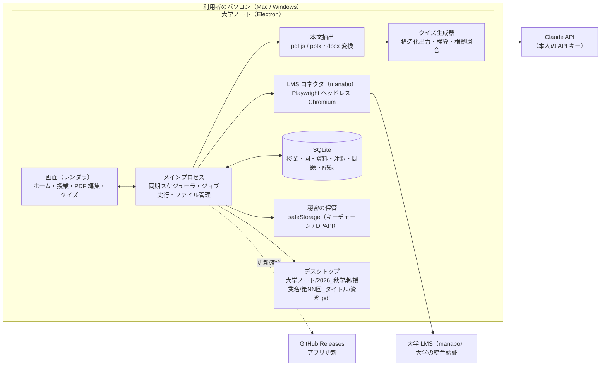
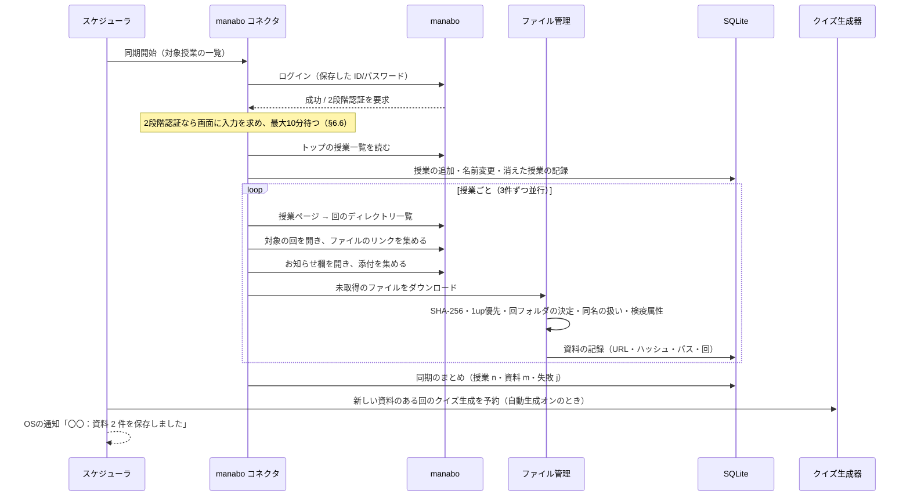
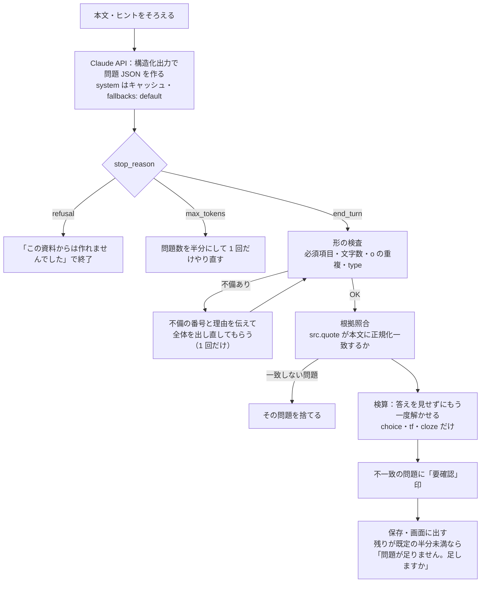
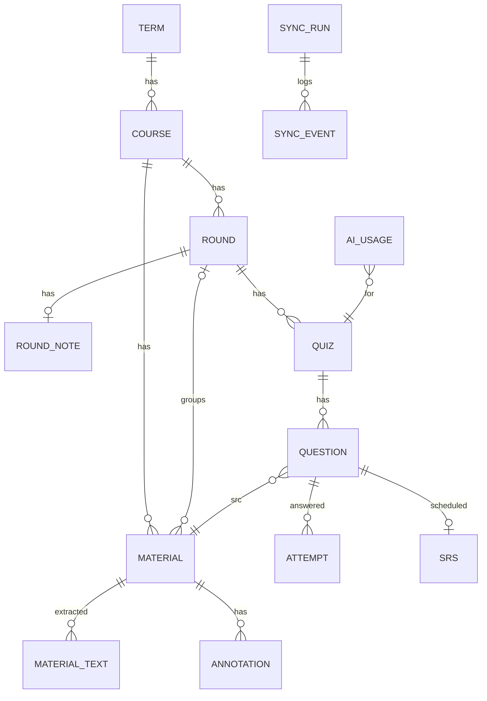
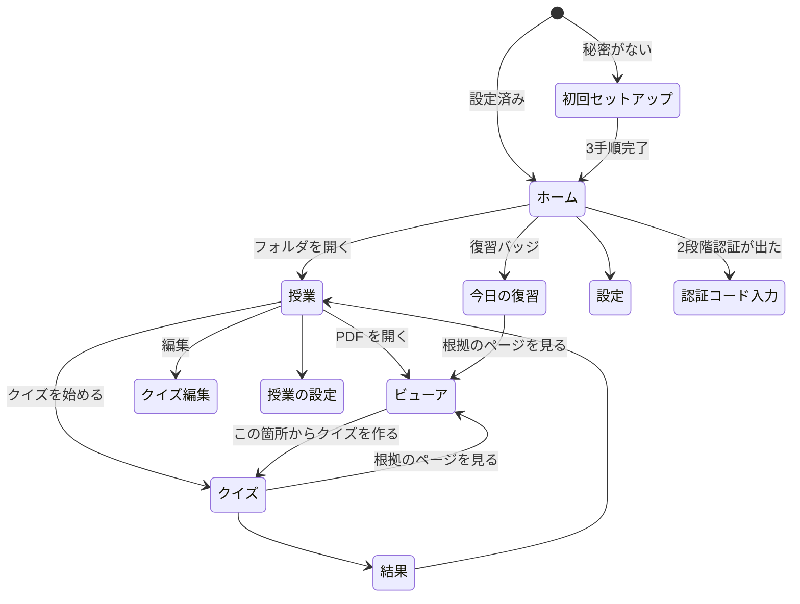

# 大学ノート 仕様書

| 項目 | 内容 |
|---|---|
| 文書の版 | 0.3 |
| 作成日 | 2026-10-16（0.1〜0.3） |
| 対象 | 大学ノート（デスクトップアプリ。Mac・Windows） |
| 参考にした自作アプリ | SaBoRo（リポジトリ `Peyangpiece/coursecue`。manabo 連携・資料の自動ダウンロード・授業フォルダ）、カテキョ（リポジトリ `Peyangpiece/kateikyoushi-quiz`。問題の形・AI による問題生成と検算・間隔をあけた復習）。**いずれも仕組みを参考にするだけで、コード・データ・アカウントの共有や連携はしない（§4.5）** |
| 状態 | 仕様確定（0.3）。未決事項はなし。次は詳細設計（M0）へ |

改訂履歴

| 版 | 内容 |
|---|---|
| 0.1 | 初版 |
| 0.2 | 決定を反映：(1) SaBoRo・カテキョとは完全に別アプリとし、コードの流用・データの読み取り・連携の記述を削除（§4.5・§5.4）。(2) クイズ生成の手段を Claude API のみに限定し、Claude Code CLI の手段を削除（§11.8）。(3) 授業フォルダの下に回ごとのサブフォルダを設ける（§7.1・§7.3・§8.3） |
| 0.3 | 残っていた 6 項目を決定：注釈はアプリ領域＋任意サイドカー（§9.6）／学年暦は同梱＋任意で PDF 読み取り（§6.10）／クイズ既定 10 問・選択 5・正誤 2・穴埋め 2・記述 1（§11.1）／Noto Sans JP・Noto Serif JP を同梱（§9.3.1・§9.7）／PowerPoint・Word は同梱ライブラリでテキスト化し PDF 版を優先（§11.4）／回フォルダ名は 40 文字・禁止文字と末尾の空白とピリオドを `_`・衝突は ` (2)`（§7.1）。未決事項なし |

本書は「何を作るか」を決める文書である。実装の細部（関数名・ファイル分け）は決めないが、動きの決まり・データの形・画面の構成・外部とのやり取り・フェーズ分けは、作る人が迷わない粒度まで書く。SaBoRo・カテキョで実際に動いている仕組みのうち、同じ決まりにする箇所と変える箇所を明記する。実装は大学ノートで独自に書く。

---

## 目次

1. [概要と目的](#1-概要と目的)
2. [用語](#2-用語)
3. [スコープ](#3-スコープ)
4. [前提・制約](#4-前提制約)
5. [全体構成](#5-全体構成)
6. [機能要件 A：大学アカウント連携と同期](#6-機能要件-a大学アカウント連携と同期)
7. [機能要件 B：フォルダ構成とファイル管理](#7-機能要件-bフォルダ構成とファイル管理)
8. [機能要件 C：ホーム画面と授業画面](#8-機能要件-cホーム画面と授業画面)
9. [機能要件 D：PDF ビューア・編集](#9-機能要件-dpdf-ビューア編集)
10. [機能要件 E：授業ごとのフォント設定](#10-機能要件-e授業ごとのフォント設定)
11. [機能要件 F：クイズ](#11-機能要件-fクイズ)
12. [機能要件 G：通知・設定・バックアップ](#12-機能要件-g通知設定バックアップ)
13. [データモデル](#13-データモデル)
14. [非機能要件](#14-非機能要件)
15. [画面一覧と遷移](#15-画面一覧と遷移)
16. [開発フェーズ](#16-開発フェーズ)
17. [決定事項・リスク](#17-決定事項リスク)
18. [付録](#18-付録)

---

## 1. 概要と目的

### 1.1 一文で

大学の LMS（manabo）に上がった授業資料を、何もしなくても授業ごとのフォルダにそろえ、そのまま PDF に書き込んで学び、資料から作ったクイズで回ごとに復習できる、大学生のための電子ノートアプリ。

### 1.2 解きたい問題

| 困りごと | いまの状態 | 大学ノートでの解決 |
|---|---|---|
| 資料を取りに行くのが面倒 | 授業ごとに manabo を開き、回のディレクトリを開き、1 件ずつダウンロードする | 大学アカウントで一度つなげば、新しい資料は自動で授業フォルダに入る（SaBoRo の仕組み） |
| ファイルが散らばる | ダウンロードフォルダに無秩序に溜まり、どの授業の何回目か分からない | デスクトップに「学期 → 授業 → 回 → 資料」の決まった構成で保存する |
| 資料に書き込めない・書き込みが散る | 別の PDF アプリで開き、保存場所がばらける | アプリ内で文字入れ・メモ・文字隠しができ、元ファイルは変えずに注釈を保存する |
| 復習の仕方が分からない | 資料を読み返すだけで、覚えたかどうか確かめられない | 回ごとの資料からクイズを作り、まちがえた問題を間隔をあけて出す（カテキョの仕組み） |

### 1.3 利用者

- 主：大学生本人（1 台のパソコンで使う。Mac または Windows）
- 本人以外（教員・友人）に資料を配る用途は対象外（§4.3 著作権）

### 1.4 成功の基準（MVP で測る）

| 指標 | 目標 |
|---|---|
| 同期後に手で動かす必要のあった資料の割合 | 5% 未満（回の判定ミス・重複の取りこぼしを含む） |
| 1 回分（10〜40 ページ）の資料からクイズができるまでの時間 | 2 分以内（生成を自動にした場合、資料保存から） |
| 生成したクイズのうち本人が「おかしい」と報告した割合 | 10% 未満 |
| 1 週間使った本人が翌週も開いた割合（自分で使う場合は主観評価） | 継続して使える |

---

## 2. 用語

| 用語 | 意味 |
|---|---|
| LMS | 大学の学習管理システム。本書では中京大学の manabo（`https://manabo.cnc.chukyo-u.ac.jp`）を第 1 対象とする |
| 大学アカウント | LMS にログインするための ID とパスワード（大学の統合認証） |
| 授業 | LMS 上の 1 つの科目（manabo の「授業」。授業 ID を持つ） |
| 回 | 授業の第 N 回。manabo のディレクトリ（「第3回 原価企画」など）が単位 |
| 資料 | 回に置かれたファイル（PDF・PowerPoint・Word・画像・音声・動画など）。本書で「授業ファイル」と同義 |
| 同期 | LMS を読み、授業一覧・回・資料を取り込み、新しい資料をダウンロードする一連の処理 |
| 学期フォルダ | デスクトップの `大学ノート/<西暦>_<学期名>`（例 `2026_秋学期`）。学期名の付け方は SaBoRo と同じ |
| 授業フォルダ | 学期フォルダの中の `<授業名>/` |
| 回フォルダ | 授業フォルダの中の `第NN回_<タイトル>/`。回が分からない資料は `その他/` |
| 注釈 | PDF の上に置く「文字入れ」「メモ」「文字隠しマーカー」。元の PDF は変えない |
| 文字入れ | PDF の任意の位置に置くテキストボックス |
| メモ | ページに付ける付箋。本文の上に小さなアイコンで出し、押すと本文を読める |
| 文字隠しマーカー | 文字の上に塗って隠すマーカー。暗記用に隠す・見せるを切り替えられる |
| クイズ | 回の資料から作った問題の集まり（カテキョの「テスト」に相当） |
| 今日の復習 | まちがえた問題・期日が来た問題を日ごとにまとめた出題（カテキョと同じ） |
| 根拠 | 問題の元になった資料の箇所（ファイル・ページ・引用文） |

---

## 3. スコープ

### 3.1 入れるもの（本書の対象）

1. 大学アカウントによる LMS 連携と資料の自動ダウンロード（§6）
2. 授業ごと・回ごとのフォルダ作成とデスクトップへの保存、重複の整理（§7）
3. 授業フォルダのアイコンを並べたホーム画面、授業画面（回ごとの資料一覧）（§8）
4. アプリ内 PDF ビューアと 3 つの編集機能：文字入れ・メモ・文字隠しマーカー（§9）
5. 授業ごとに変えられる文字入れのフォントサイズ（§10）
6. 授業ごと・回ごとに資料から作るクイズと、間隔をあけた復習（§11）
7. 通知・設定・バックアップ（§12）

### 3.2 入れないもの（はっきり対象外）

| 対象外 | 理由 |
|---|---|
| 課題の自動生成・自動提出・出席コードの入力 | SaBoRo の領域。大学ノートは「資料とノートと復習」に絞る。SaBoRo との連携もしない（§4.5） |
| スマホ版・Web 版 | ファイルはパソコンのデスクトップにあり、PDF 編集はパソコン前提。v2 以降で検討（§16） |
| PDF の本文編集（文字の書き換え・ページの削除や並べ替え） | 「注釈」の範囲を超える。元ファイルを変えない方針（§9.1）と相反する |
| 手書き（ペン・スタイラス） | 要望にない。注釈モデルは拡張できる形にしておく（§13.4） |
| 他人との共有・共同編集 | 著作権（§4.3）と個人情報の扱いの観点から対象外 |
| 複数大学・複数 LMS の同時接続 | v1 は manabo だけ。コネクタの抽象化は行い、他 LMS は v1.1 以降（§6.9） |

---

## 4. 前提・制約

### 4.1 技術的前提

- 利用者のパソコンが起きていて、ログインしているときだけ同期が動く（SaBoRo と同じ。クラウドは LMS を触らない）
- LMS には公開 API がない。SaBoRo と同じく Playwright のヘッドレス Chromium で、大学の正規ログインフォームを使って本人として操作する
- LMS の画面構成が変わると同期が止まる可能性がある。manabo を読む手順とセレクタは大学ノートのコネクタ 1 か所にまとめ（§6.9・§18.1）、構成が変わったときに直す場所を限る

### 4.2 認証と秘密

- 大学アカウントのパスワードはこのパソコンの中にだけ、OS の仕組み（macOS はキーチェーン、Windows は DPAPI。Electron の `safeStorage`）で暗号化して保存する。クラウドには送らない（SaBoRo と同じ）
- 2 段階認証（メールの認証コード）が出たら、アプリの画面で入力を求める（§6.6）

### 4.3 著作権と利用規約

- 授業資料は教員・大学に権利がある。大学ノートは本人の学習のための複製（私的使用）に限る。資料の共有・公開・外部送信の機能は作らない
- 問題生成のために資料本文を AI（外部 API）へ送ることは「本人の学習のための利用」だが、送る内容と送らないもの（§11.9）を本人に示し、初回に同意を取る。同意しなければクイズ機能だけが使えない状態で、ほかは全部使える
- 学籍番号などの ID（英字＋6 桁以上の数字）は SaBoRo の `scrubIds` と同じ規則で、AI に送る前に取り除く

### 4.4 費用

- AI の利用料は本人の負担（自分の Claude API キー。§11.8）。アプリ側で 1 日と月の上限を設ける
- クラウドの常設サーバーは持たない（v1 は完全にローカルで動く。§5.2）

### 4.5 SaBoRo・カテキョとの関係

大学ノートは SaBoRo・カテキョとは **完全に別のアプリ** である。

| 項目 | 決まり |
|---|---|
| コード | 共有しない・依存しない。同じ決まりで動く箇所も大学ノートの中に独自に書く。SaBoRo・カテキョのソースは「仕組みを確かめる参考資料」としてだけ読む |
| データ・フォルダ | SaBoRo の状態ファイル・保存フォルダ・記録を読まない・書かない。同じパソコンに SaBoRo が入っていても互いを認識しない（保存先の既定も別。§7.1） |
| アカウント・秘密 | 大学アカウントの保存は大学ノート自身の項目名で行う。SaBoRo の保存した秘密は読まない |
| クラウド | SaBoRo のクラウド（Worker・D1・学年暦の配信）に接続しない |
| 名前・識別子 | アプリ名・`appId`・ユーザーデータの保存場所・キーチェーンの項目名はすべて大学ノート固有 |

同じ manabo アカウントで SaBoRo と大学ノートを両方動かすと、それぞれが別々にログインしてダウンロードする。これは仕様どおりの動きで、問題にしない（資料の保存先が別なので衝突しない）。

---

## 5. 全体構成

### 5.1 構成図



### 5.2 方針：クラウドを持たない（v1）

SaBoRo は PWA（スマホからも見る）のために Cloudflare Worker と D1 を持ち、パソコンのエージェントとクラウドをジョブキューでつないでいる。大学ノートの v1 は次の理由でクラウドを持たない。

| 観点 | SaBoRo | 大学ノート v1 |
|---|---|---|
| 画面が動く場所 | クラウド配信の Web 画面（PWA）＋パソコン内のサービス | すべてアプリの中（レンダラ） |
| ファイルの場所 | パソコン | パソコン（同じ） |
| スマホからの利用 | あり（課題・締切の確認） | なし（PDF 編集はパソコン前提） |
| 利用者ごとの状態 | D1 の `account_state` | SQLite（ローカル） |
| 運用コスト | Worker・D1・Stripe の運用が要る | ゼロ |

よって、SaBoRo の「クラウドの仕事（job）を 5 秒ごとに取りに行く」仕組みは使わず、画面 → メインプロセスの IPC で直接ジョブを投げる。将来スマホ対応をするときは、SaBoRo と同じ接続キー方式のクラウドを足せるよう、ジョブの種類と状態の形は SaBoRo に合わせておく（§13.6）。

### 5.3 技術の選定

| 層 | 選定 | 理由 |
|---|---|---|
| アプリの土台 | Electron | 常駐・トレイ・safeStorage・自動更新・Playwright の同梱を 1 つの土台でまかなえる。Tauri も候補だが、Electron＋Playwright 同梱で常駐アプリが安定して動く実績が SaBoRo にあるため Electron を採る（コードは独自に書く） |
| 画面 | HTML + JavaScript（ビルドなし、または最小のバンドル） | SaBoRo・カテキョと同じ作法（`public/`・`dist/` をそのまま配る）。PDF 編集画面は 1 ファイルが大きくなるため、機能ごとにスクリプトを分ける |
| PDF 表示 | pdf.js（Mozilla） | テキストレイヤーが取れる（文字隠しマーカーの吸着・検索・本文抽出に必要）。描画はページごとに canvas |
| 注釈の書き出し | pdf-lib | 元 PDF を変えず、注釈を焼き込んだ別ファイルを作る（§9.7）。PDF 注釈オブジェクト（FreeText・Text・Highlight）としての書き出しも同ライブラリで行う |
| 本文抽出 | pdf.js（テキストレイヤー）。PowerPoint・Word は同梱ライブラリ（`mammoth`、pptx 用）でテキスト化。OS のコマンド（`textutil` など）は使わない | pdf.js を表示と抽出で共用し依存を減らす。Mac・Windows で同じ結果にする（§11.4） |
| LMS 操作 | Playwright（ヘッドレス Chromium） | 公開 API のない manabo を本人として操作できる唯一の現実的な方法。SaBoRo で実績がある。手順とセレクタは §18.1 を元に大学ノートのコネクタとして独自に書く |
| データ | SQLite（`better-sqlite3`）。ファイルは `userData/daigaku-note.sqlite` | SaBoRo は JSON の `state.json`。注釈・問題・記録は件数が増え、部分更新と検索が要るため SQLite にする |
| 秘密 | Electron `safeStorage` | SaBoRo と同じ |
| AI | Anthropic SDK（Claude API）。本人の API キーで、メインプロセスから呼ぶ | 構造化出力・プロンプトキャッシュ・拒否時の fallback・使用量の記録がそろう。手段はこれ 1 つ（§11.8） |
| 更新 | GitHub Releases（electron-updater。Mac は署名がなければ .dmg をダウンロードして sha512 を照合し入れ替える手順） | SaBoRo と同じ流れ |
| 検証 | `node --test`、Prettier、ESLint | SaBoRo と同じ |

### 5.4 参考にした仕組み（実装は大学ノートで独自に書く）

SaBoRo・カテキョで動いている次の決まりを、大学ノートでも同じにする。コードは共有せず、本書に書いた決まりを満たすように独自に実装する（§4.5）。

| 仕組み | 元 | 大学ノートでの決まり | 変える点 |
|---|---|---|---|
| manabo の操作手順 | SaBoRo | 正規ログイン・授業一覧・回のディレクトリ・ファイル取得・お知らせの添付・2 段階認証の待ち受け・出席コードの prompt の検出（§6・§18.1） | 課題（レポート・クイズ・掲示板）・提出・出席には触れない。読むのは資料と回だけ |
| 保存先の決まり | SaBoRo | 既定はデスクトップ、ホームフォルダ内のみ指定可、隠しフォルダ・Library は不可、1up/2up/4up の判定、複製のゴミ箱移動（§7） | 既定のフォルダ名を大学ノート固有にし、回ごとのサブフォルダを設ける（§7.1） |
| 授業開始時刻の同期 | SaBoRo | キャンパスごとの時限の開始時刻を過ぎたらその授業だけ同期。1 日 1 回（§6.2） | そのまま |
| 学年暦 | SaBoRo | 学期名・期間・曜日ごとの授業日を JSON で持ち、回の日付と学期フォルダ名に使う | 大学ノートの配布物に同梱し、更新はアプリの更新で行う。任意で PDF から読み取る（§6.10） |
| 常駐アプリの作り | SaBoRo | トレイ／メニューバー・safeStorage・OS 通知・GitHub Releases からの更新 | アプリ名・識別子・保存場所はすべて大学ノート固有 |
| 間隔をあけた復習 | カテキョ | 1→3→7→14→30→90 日、初回正解は 1 週間後、2 択は 2 連続正解で昇格、1 日 30 問、期限超過と誤答回数で優先（§11.7） | 定数は同じ。保存先は SQLite |
| 選択肢の並び | カテキョ | 種（seed）で並びを再現し、同じ問題を解き直しても位置で答えが分からないようにする | 誤答は AI が作る（`o` 必須）ため、プールからの補完はしない |
| AI 生成の流れ | カテキョ | 構造化出力（JSON Schema）、形の機械検査、不備を伝えて 1 回だけ作り直し、答えを隠して解き直す検算、拒否・途切れ・混雑の扱い（§11.5） | 「先生の指示から新しく作る」ではなく「資料から作る」。根拠の引用を必須にし、本文と照合する |
| 問題データの機械検査 | カテキョ | 必須項目・文字数・選択肢の重複（NFKC 正規化）を保存前に検査（§11.6） | 種類を大学ノートの 4 種に合わせる |

---

## 6. 機能要件 A：大学アカウント連携と同期

### 6.1 初回セットアップ（3 手順＋任意 1 つ）

SaBoRo の「はじめの設定」と同じ 3 手順に絞る。

1. **大学アカウントを保存する**：manabo のログイン ID とパスワードを入力。入力と同時に manabo へ接続を確かめ、成功したら `safeStorage` で暗号化して保存する。失敗したら理由（ID かパスワードが違う・ネットワーク・2 段階認証）を出し、保存しない
2. **保存先を確かめる**：既定はデスクトップの `大学ノート/<西暦>_<学期名>`（学年暦から）。「フォルダを選択…」で変えられる（ホームフォルダ内のみ。§7.2）
3. **最初の同期を始める**：授業一覧・全回の資料を取り込む。進み具合（「同期中 3/9（管理会計Ⅱ）」）を出す
4. **（任意）クイズの AI を設定する**：Claude API キーを入力し、接続を確かめて保存する。あとから設定でもよい（§11.8）

### 6.2 同期の種類とタイミング

| 種類 | いつ | 読む範囲 | 根拠 |
|---|---|---|---|
| 全体の同期 | 毎日、設定の時刻（既定 16:30）。パソコンが寝ていた場合は起きた後の最初の確認で、その日にまだなら実行 | 全授業。実行日の前後 7 日の回＋未取得の資料 | SaBoRo と同じ既定 |
| 授業開始の同期 | 授業の開始時刻を過ぎてから 2 時間以内。同じ授業は 1 日 1 回 | その授業だけ | SaBoRo と同じ決まり。授業直前に上がる資料を授業中に手元へ |
| 手動の同期 | ホームの「同期」、授業画面の「この授業を同期」 | 全授業／その授業 | |
| 初回の同期 | セットアップ直後、保存先を変えたとき | 全授業・全回（期間外の回も含む） | SaBoRo「そのフォルダで初めての同期のときだけ全回」 |
| 定期の確認（任意） | 設定で「N 時間ごと」（1・3・6 時間。既定オフ） | 全体の同期と同じ | 大学ノートで追加。資料が授業後に上がる授業のため |

同時に動く同期は 1 つ。実行中に別の要求が来たら待ち行列に入れ、終わってから続けて実行する（同じ種類・同じ授業は 1 つにまとめる）。

### 6.3 同期の手順（1 回の全体同期）



### 6.4 新しい資料の判定（SaBoRo と同じ規則）

1. **同じ URL** の資料が、いまの保存先の中に記録されていれば取りに行かない（本人が消していても、編集して中身が変わっていても、ダウンロードし直さない）
2. 取得したら **SHA-256** を計算し、同じ授業に同じハッシュの記録があれば保存しない（別 URL の同一ファイル）
3. ファイル名は `Content-Disposition` から取る（`filename*=UTF-8''` 優先）。取れなければ保存しない（失敗として記録）
4. 同名のファイルが既にあり中身が違えば `名前 (2).pdf` のように番号を足す。中身が同じならそのファイルを記録に使う
5. **印刷形式違い**（`4up`・`2up`・`4in1`・`2分割` など）があるときは 1up（印なし・「分割なし」）だけ保存する。1up がない組はそのまま
6. ダウンロードしたファイルに OS の「インターネットから来た」印（Mac は検疫属性、Windows は Zone.Identifier）を付ける

### 6.5 回（第 N 回）の判定

資料の `round` は次の優先順で決め、記録する。

1. manabo のディレクトリ名（「第3回 原価企画」「第03回」「3回目」「第三回」「第3講」のいずれも読む）
2. お知らせの見出し（「【第03回，10/09】」）
3. ファイル名の「第N回」
4. どれもなければ `0`（未分類）。授業画面では「その他」にまとめ、本人がドラッグで回に割り当てられる（§8.3）

ディレクトリの表示名（例「原価企画」）は回の **タイトル** として保存し、授業画面とクイズの名前に使う。

### 6.6 2 段階認証と出席コードの prompt

- ログイン後にメールの認証コードを求められたら、入力欄を見つけて待ち、アプリのホームに「認証コードを入力してください」の案内と入力欄を出し、OS の通知も出す。入れたコードを渡し、「30 日間はこの確認を表示しない」などのチェックがあれば入れてから送る。3 回まで入れ直せる。10 分待っても入らなければその同期は失敗にし、次の同期でまた求める（SaBoRo と同じ流れ）
- 授業ページで出席コードの入力（manabo の `prompt`）が出たら、**大学ノートはコードを入れない**。そのタブは閉じ、ほかの授業を続け、「〇〇で出席コードの入力が出ています（manabo で入れてください）」とホームに出す。出席の自動化は対象外（§3.2）

### 6.7 失敗の扱い

| 失敗 | 動き |
|---|---|
| ネットワークに届かない | 同期を失敗にし、15 分後に 1 回だけやり直す。ホームに「manabo に接続できませんでした」 |
| ID かパスワードが違う | 同期を止め、ホームの「要確認」に出す。設定で入れ直すまで自動の同期をしない |
| 授業ページが読めない（構成が変わった） | その授業だけ失敗として記録し、ほかの授業は続ける。要確認に授業名つきで出す |
| ファイルの取得に失敗 | その資料だけ失敗として記録。次の同期でまた試す |
| 保存先に書けない（権限・容量） | 同期を止め、要確認に出す |

失敗は握りつぶさず、同期のまとめ（「授業 9 件・資料 3 件保存・失敗 1 件」）と要確認に出す（SaBoRo と同じ方針）。

### 6.8 読まないもの

- 課題（レポート・クイズ・掲示板）の中身・提出状況
- 成績・学生情報欄
- CUBICS（時間割照会）は読まない。曜日・時限は manabo の「（金曜／2限）」表記と学年暦から決め、分からない授業は本人が設定で入れる（§8.4）

### 6.9 LMS コネクタの抽象化（v1.1 以降のため）

同期エンジンはコネクタに次だけを求める。manabo 以外（Moodle・Google Classroom・manaba 等）を足すときはこの形を満たす部品を作る。

```ts
interface LmsConnector {
  id: 'manabo' | string;
  login(credentials, onMfa): Promise<void>;
  listCourses(): Promise<{ lmsId: string; name: string; weekday?: string; period?: number }[]>;
  listRounds(course): Promise<{ round: number; title: string; lmsRef: string }[]>;
  listFiles(course, round): Promise<{ url: string; name: string; text?: string }[]>;
  listNoticeFiles(course): Promise<{ url: string; name: string; round?: number }[]>;
  fetchFile(url): Promise<{ ok: boolean; name: string; contentType: string; body: Buffer }>;
  openInBrowser(course): URL;   // 「manabo で開く」用
}
```

---

### 6.10 学年暦（決定：アプリに同梱し、PDF からの読み取りを任意で）

学期名・学期の期間・曜日ごとの授業日・祝日と休講日を JSON（`term.calendar_json`。§13.2）で持ち、学期フォルダ名・回の日付・授業開始の同期に使う。

| 項目 | 決まり |
|---|---|
| 配り方 | アプリの配布物に同梱する。学期が切り替わる前に新しい版を出し、アプリの更新で届く。クラウド配信はしない（§5.2） |
| 切り替え | 同梱の学年暦に今日を含む学期があればそれを使う。学期の終わり 30 日前からホームの要確認に「次の学期の学年暦がありません。アプリを更新してください」を出す（新しい版に次学期の学年暦が入っていれば出さない） |
| 学年暦が古いとき | 今日を含む学期がなければ、直前の学期の設定（曜日・時限・保存先）のまま同期を続け、新しい資料は直前の学期フォルダに保存する。新しい学年暦が入った時点で、その学期の開始日以降にダウンロードした資料を新しい学期フォルダへ **移す提案** を出す（本人が「移す」を押したときだけ移動し、記録のパスも書き換える） |
| 任意の読み取り | 設定 → 同期 → 「学年暦を PDF から読み取る」。大学の学年暦 PDF を選ぶと Claude API（§11.8 のキー）で学期名・期間・授業日・休講日を構造化出力で読み取り、**本人が内容を確かめて「使う」を押したときだけ**有効にする。読み取ったものは同梱のものより優先し、`settings.calendarOverride` に保存する。API キーがなければこの項目は出さない |
| 中身の検査 | 読み取り結果は、学期の期間が 90〜200 日・曜日ごとの授業日が 10〜16 日・日付が期間内、を満たさなければ使わせない（読み取りミスの検出） |

---

## 7. 機能要件 B：フォルダ構成とファイル管理

### 7.1 フォルダ構成

```
~/Desktop/
└── 大学ノート/                          ← アプリのルート（大学ノート固有。SaBoRo の学期フォルダとは別）
    └── 2026_秋学期/                     ← 学期フォルダ（学年暦の term「2026 秋学期」→ 2026_秋学期）
        ├── 管理会計Ⅱ/                   ← 授業フォルダ（manabo の授業名。/ \ : * ? " < > | と制御文字は _ に）
        │   ├── 第01回_イントロダクション/   ← 回フォルダ（「第NN回_<回のタイトル>」。2 桁ゼロ埋め）
        │   │   └── 第1回 イントロダクション.pdf   ← 資料は元のファイル名のまま
        │   ├── 第02回_原価企画/
        │   │   ├── 第2回 原価企画.pdf
        │   │   ├── 練習問題_第2回.pdf
        │   │   └── 第2回 原価企画_注釈.pdf  ← 「注釈付きで書き出す」で作る（§9.7。本人が押したときだけ）
        │   ├── 第03回/                    ← タイトルが分からない回は番号だけ
        │   └── その他/                    ← 回が分からない資料（round=0）。お知らせの添付で回のないものもここ
        ├── 意思決定論/
        └── …
```

決めたこと：

| 決定 | 理由 |
|---|---|
| ルートを `デスクトップ/大学ノート/` にする | SaBoRo の既定（デスクトップ直下の `<西暦>_<学期名>`）と重ならないようにし、学期をまたいでも 1 つのフォルダにまとまる |
| 授業フォルダの下に **回ごとのサブフォルダ** を作る | Finder/エクスプローラーでも回ごとに資料が見える。クイズも回単位なので、フォルダと学習の単位が一致する |
| 回フォルダの名前は `第NN回_<タイトル>` | 名前順に並べると回順になる（ゼロ埋め）。タイトルは manabo のディレクトリ名から、下の規則で整える。タイトルが取れなければ `第NN回` だけ |

回フォルダ名のタイトル部分の規則（決定）：

| 規則 | 内容 | 理由 |
|---|---|---|
| 長さ | 先頭から **40 文字** で切る（文字数は Unicode のコードポイントで数える。結合文字・絵文字の途中で切らない） | パス全体を Windows の 260 文字制限に収める |
| 使えない文字 | `/ \ : * ? " < > |` と制御文字（U+0000〜U+001F）を `_` に | Mac・Windows の両方で使える名前にする |
| 末尾 | 末尾の空白とピリオドを `_` に | Windows ではフォルダ名の末尾に使えない |
| 空白 | 連続する空白は 1 つにし、全角空白は半角に | manabo の表記ゆれで同じ回が別名にならないように |
| 絵文字・全角記号 | そのまま使う | Mac・Windows とも扱える |
| 予約名 | Windows の予約名（`CON`・`PRN`・`AUX`・`NUL`・`COM1`〜`COM9`・`LPT1`〜`LPT9`）と一致したら末尾に `_` を足す | Windows で作れない |
| 衝突 | 整えた結果が同じ授業内の別の回と同じ名前になったら、2 つ目以降に ` (2)`・` (3)` を足す | 同名フォルダの合流を避ける |
| 回が分からない資料は `その他/` | 判定ミスの資料を見失わない。授業画面から回へ移すとファイルも移動する（§8.3） |
| 元のファイル名を保つ | 本人が探せる。manabo と同じ名前 |
| 注釈は回フォルダに置かず、アプリのデータ領域に保存する（§9.6） | デスクトップを汚さない。iCloud/OneDrive でデスクトップを同期している人が多く、途中状態の JSON が同期されるのを避ける |
| 学期が変わると新しい学期フォルダ | 前学期のフォルダはそのまま残り、アプリのホームは「学期」を切り替えて見られる（§8.1） |

回フォルダの名前の変化：

| 起きること | 動き |
|---|---|
| manabo 側で回のタイトルが変わった（「第3回」→「第3回 原価企画」） | 回フォルダを新しい名前に **改名** し、記録のパスを書き換える。改名先に同名フォルダが既にあれば中身を合流させる（同名ファイルは SHA-256 が同じなら 1 つに、違えば `名前 (2).pdf`） |
| 本人が回のタイトルを付けた（`title_user`） | フォルダ名には使わない（manabo の名前を優先し、フォルダ名を安定させる） |
| 本人が Finder で回フォルダを改名した | 次の同期で、フォルダ内のファイルの SHA-256 から元の回を特定し、記録のパスを改名後に合わせる。アプリは元の名前に戻さない（本人の意思を優先）。ただし次に manabo のタイトルが変わったときは manabo の名前で改名する |
| 本人が回フォルダを消した | 記録の資料は「見つからない」印。フォルダは次の同期で必要になったときだけ作り直す。ダウンロードし直さない（§6.4） |

### 7.2 保存先の変更

- 設定 → 保存先 → 「フォルダを選択…」。OS のフォルダ選択画面（Mac は Finder、Windows は標準ダイアログ）。選んだフォルダの中に `<西暦>_<学期名>/<授業名>/<回>/` を作る
- 選べるのはホームフォルダの中で、隠しフォルダ（`.` 始まり）と `Library` 以外（SaBoRo と同じ決まり）
- 変えると、新しい場所では「初回の同期」として全回を確かめ、記録のない資料をダウンロードする。古い場所のファイルは動かさない（本人に「古いフォルダの資料はそのままです。移すなら手で移してください」と出す）
- 「既定に戻す」で `デスクトップ/大学ノート/` へ

### 7.3 本人がファイルを動かしたとき

| 操作 | 動き |
|---|---|
| 回フォルダ内で名前を変えた | 次の同期で記録のパスにファイルがなければ、同じ授業フォルダの中（全回フォルダと `その他/`）で同じ SHA-256 のファイルを探して記録を付け替える。見つからなければ「見つからない」印を付け、ダウンロードし直さない |
| 別の回フォルダへ移した | 同じ SHA-256 のファイルが別の回フォルダにあれば、**本人が回を変えた**とみなして `round` を移動先の回に更新する（§8.3 のドラッグと同じ結果）。その回のクイズに「資料が変わった」印 |
| 授業フォルダの外へ移した・消した | 「見つからない」印。授業画面に「このファイルは見つかりません。manabo から開くか、「もう一度ダウンロード」を押してください」。注釈は残す（ハッシュで結び付いているため、戻せば復活する） |
| 本人が手で回フォルダにファイルを足した | 次の同期またはフォルダ監視で検出し、「手で追加」として資料に加える（回はそのフォルダの回。URL なし）。`その他/` や授業フォルダ直下に置いたものは `round=0`。注釈・クイズの対象にできる |
| 授業フォルダ・回フォルダそのものを消した | 同期時に必要なものだけ作り直し、記録の資料はダウンロードし直さない。「全部もう一度ダウンロード」は授業画面のメニューから明示的に |

### 7.4 複製の整理

- 起動時と同期のたびに、同じ回フォルダで「名前 (2).pdf」の形の記録のうち、中身が記録と同じ（本人が編集していない）で元の名前のファイルが残っているものを OS のゴミ箱へ移す。以前の 2up・4up も、同じ授業に 1up があれば同様
- 移した件数と名前をホームの「お知らせ」に出す（SaBoRo と同じ決まり）

### 7.5 対応するファイルの種類

| 種類 | ダウンロード | アプリ内で開く | 注釈 | クイズの本文抽出 |
|---|---|---|---|---|
| PDF | ○ | ○（ビューア） | ○ | ○（テキストレイヤー。なければ §11.4 の画像入力） |
| PowerPoint（pptx） | ○ | ×（OS の既定アプリで開く） | ×（v1.1 で PDF 変換を検討） | ○（テキスト化） |
| Word（docx） | ○ | × | × | ○（テキスト化） |
| Excel・CSV | ○ | × | × | ×（表は読まない） |
| 画像（png・jpg・heic） | ○ | ○（表示のみ） | ×（v1.1） | ○（画像入力） |
| 音声・動画 | ○（サイズ上限 500 MB。超えるものは記録だけ） | × | × | × |
| 実行ファイル・書庫 | ○ | ×（アプリから開かない。Finder/エクスプローラーで表示） | × | × |

---

## 8. 機能要件 C：ホーム画面と授業画面

### 8.1 ホーム画面

```
┌─────────────────────────────────────────────────────────────┐
│ 大学ノート   [2026 秋学期 ▾]            今日の復習 12 問  [同期]  ⚙ │
├─────────────────────────────────────────────────────────────┤
│ 要確認：出席コードの入力が出ています（意思決定論）  ／ 新しい資料 3 件  │
├─────────────────────────────────────────────────────────────┤
│  📁            📁            📁            📁                 │
│  管理会計Ⅱ      意思決定論     国際ビジネス戦略  サービス・マーケ…   │
│  新着 2 ・復習 5   復習 3                     新着 1               │
│                                                               │
│  📁            📁            📁 (薄色)                           │
│  人材マネジメントⅡ コーポレートファイナンスⅡ  削除した授業           │
├─────────────────────────────────────────────────────────────┤
│ 前回の同期 16:31 に反映（授業 9 件・資料 3 件保存・失敗 0 件）         │
└─────────────────────────────────────────────────────────────┘
```

| 要素 | 仕様 |
|---|---|
| 学期の切り替え | 右上のプルダウン。既定は今の学期。過去の学期はフォルダがあれば選べる（同期はしない） |
| 授業フォルダのアイコン | 1 授業 1 枚。SaBoRo の `folder-icon.png` と同じモチーフ。並び：時間割順（曜日・時限が分かるもの）→ 名前順。本人がドラッグで並び替え可（記録する） |
| 色 | 授業ごとに 8 色から選べる（既定は順番に割り当て）。アイコンの縁とタブに使う |
| バッジ | 「新着 n」（未読の資料。開くと消える）、「復習 n」（その授業の今日の復習の問題数）。0 なら出さない |
| ダブルクリック／Enter | 授業画面へ |
| 右クリック | 「フォルダを Finder/エクスプローラーで開く」「manabo で開く」「この授業を同期」「色」「設定」「授業を非表示（削除）」 |
| 今日の復習 | 右上の数字。押すと復習画面（§11.7） |
| 要確認 | 同期の失敗・2 段階認証・出席コードの検出・AI が使えない・曜日未設定の授業を 1 枚にまとめ、同じ原因は 1 行 |
| 空の状態 | 接続前は「大学アカウントとつなぐ」の案内だけ。同期前は「最初の同期をしています…」と進み具合 |
| 検索 | `/` で検索欄。授業名・資料名・回のタイトル・メモの本文を横断 |

### 8.2 授業画面

```
┌─────────────────────────────────────────────────────────────┐
│ ← ホーム   管理会計Ⅱ（金曜 2限）        [この授業を同期] [manabo で開く] ⚙ │
├──────────────┬──────────────────────────────────────────────┤
│ 回            │ 第3回 原価企画  10/10（金）           [クイズを始める ▸] │
│ ● 第1回       │  📄 第3回 原価企画.pdf        24p  未読   注釈 5  [開く] │
│ ● 第2回       │  📄 練習問題_第3回.pdf          2p         注釈 0  [開く] │
│ ● 第3回 ◂     │  📊 第3回 補足.xlsx                    （既定アプリで開く）│
│ ○ 第4回(予定) │  クイズ：15 問（10/10 生成）  正答 9/15  今日の復習 3  [編集] │
│ …            │                                                     │
│ その他(2)     │  ─ メモ（この回） ─────────────────────────────────  │
│              │  原価企画＝設計段階でのコスト作り込み。試験は計算が出そう…  │
└──────────────┴──────────────────────────────────────────────┘
```

| 要素 | 仕様 |
|---|---|
| 左の回一覧 | 第 1〜15 回（学年暦の回数）。資料のある回は●、ない回は○。日付は学年暦と曜日から。今日の回を自動で選ぶ |
| 資料の行 | 種類アイコン・名前・ページ数・未読／既読・注釈の数・「開く」。PDF はアプリ内、ほかは既定アプリ。ドラッグで別の回へ移せる（`round` を書き換え、ファイルも移動先の回フォルダへ移す。§8.3） |
| 「その他」 | `round=0` の資料（`その他/` フォルダ）。右の一覧から回へドラッグして割り当てる |
| クイズの行 | その回のクイズの有無・問題数・成績・「クイズを始める」「編集」「作り直す」。未生成なら「資料からクイズを作る」ボタン（AI の設定がなければ案内） |
| 回のメモ | 回ごとの自由記述（PDF に紐づかないメモ）。自動保存 |
| 授業の設定 ⚙ | 色・曜日と時限・文字入れの既定フォント（§10）・クイズの自動生成オン/オフ・問題数の既定・非表示 |

### 8.3 回の割り当て直し

- 資料を別の回へドラッグ：`round` を更新し、ファイルを移動先の回フォルダへ移す（同名があれば SHA-256 が同じなら 1 つに、違えば `名前 (2).pdf`）。移動元・移動先の両方の回のクイズを「資料が変わった」印にする（本人が「作り直す」を押すまで自動では作り直さない。費用の無駄を避ける）
- 移動したあと次の同期で manabo の回が元のままなら、manabo の回ではなく **本人の割り当てを優先** する（`round_from='user'` を記録し、同期で上書きしない）。「manabo の回に戻す」を右クリックに置く
- 回のタイトルの変更：本人が入力できる（`title_user`）。フォルダ名には使わず、画面の表示だけに使う（§7.1）

### 8.4 曜日・時限

- manabo の授業ページの「（金曜／2限）」表記から読む。読めない授業は設定で本人が入れる（要確認に「曜日が分からない授業：〇〇」）
- 時限の開始時刻はキャンパス（名古屋・豊田）で選ぶ。既定は名古屋。授業開始の同期（§6.2）に使う

---

## 9. 機能要件 D：PDF ビューア・編集

### 9.1 基本方針

1. **元の PDF は一切変えない**。注釈は別の層として保存し、表示のとき重ねる。書き出すときだけ新しい PDF を作る（§9.7）
2. 注釈は **ページ座標（PDF のユーザー空間、左下原点、pt）** で保存する。拡大率や画面サイズに依存しない
3. 編集はすべて **取り消し・やり直し**（Undo/Redo。1 ファイルにつき 200 手まで）ができる
4. 保存は **自動**（変更から 1 秒後、またはページ移動・ファイルを閉じたとき）。保存ボタンはない。保存中・保存済みの表示だけ出す
5. 同じ PDF が manabo 側で更新された場合（§6.4 の規則で別ファイルとして保存される）、注釈は元のファイルに付いたまま。新ファイルへの「注釈のコピー」は v1.1 で検討（ページ構成が同じなら座標をそのまま写せる）

### 9.2 ビューアの基本機能

| 機能 | 仕様 |
|---|---|
| 表示 | 連続縦スクロール（既定）／1 ページ／2 ページ見開き。拡大 25〜400%、幅に合わせる・ページに合わせる。ピンチ・Ctrl/Cmd+ホイール |
| 移動 | サムネイル一覧（左）、ページ番号入力、←→ / PgUp PgDn / Home End、しおり（アウトライン）があれば表示 |
| 検索 | 本文の全文検索（テキストレイヤー）。ヒットを強調し、Enter で次へ。文字隠しで隠れている箇所もヒットするが、隠しモード中は結果の抜き出しに `●●●` を出す |
| テキスト選択 | ドラッグで選択・コピー |
| 回転 | 90 度単位（表示だけ。注釈の座標は PDF 座標なので影響しない） |
| 描画 | pdf.js の canvas。見えているページ±2 ページだけ描画し、ほかは破棄（24 ページ超の資料でメモリを抑える） |
| 複数ファイル | タブで複数の資料を開ける。同じ授業の資料は同じ色のタブ |
| 外部で開く | 「既定のアプリで開く」「Finder/エクスプローラーで表示」 |

### 9.3 編集ツール（3 つ）

ツールバー：`[選択] [文字入れ T] [メモ 📝] [文字隠し ▮]   | 隠す/見せる 👁 |  ↶ ↷ | 書き出し`

#### 9.3.1 文字入れ（テキストボックス）

| 項目 | 仕様 |
|---|---|
| 置く | ツールを選んでページ上をクリック→その位置にカーソル付きの箱が出て入力。ドラッグすると幅を決めた箱を作る（高さは文字量で伸びる） |
| 編集 | ダブルクリックで本文編集。選択状態で移動（ドラッグ・矢印キー 1pt、Shift で 10pt）、右下のハンドルで幅の変更。Delete で削除 |
| 文字の属性 | フォントサイズ（**授業ごとの既定を初期値**にする。§10）、フォント（既定「ゴシック」＝同梱の Noto Sans JP。「明朝」＝同梱の Noto Serif JP。「等幅」＝OS 標準の等幅。書き出し時はゴシックに置き換える）、色（8 色＋カスタム）、太字、背景（なし／白／半透明の白）。箱ごとに変えられる。画面の表示にも同梱フォントを使い、書き出しと字形をそろえる |
| 改行・長文 | 自由。箱の幅で折り返す。上限 2,000 文字 |
| 回転 | なし（v1） |
| 吸着 | Alt を押しながら動かすと、近くのテキスト行の基線に高さを合わせる（手書き風にずれないため。任意） |
| ショートカット | `T` でツール、`Esc` で選択ツールへ |

#### 9.3.2 メモ（付箋）

| 項目 | 仕様 |
|---|---|
| 置く | ツールを選んでクリック→その位置に付箋アイコン（20×20pt）が置かれ、横に吹き出しが開いて本文を入力 |
| 表示 | 本文は吹き出しで出し、閉じるとアイコンだけになる。アイコンにマウスを載せると先頭 80 文字をツールチップ。アイコンの色は 6 色 |
| 本文 | プレーンテキスト。上限 5,000 文字。URL は押せるリンクにする |
| 一覧 | 右パネル「メモ一覧」にファイル内の全メモをページ順で出し、押すとその場所へ。授業画面の検索対象 |
| 既定の色 | 授業の色 |
| 分類（任意） | 「要確認」「試験に出る」「疑問」の 3 つのタグ。タグで一覧を絞れる。クイズ生成のヒントにも使う（§11.3） |

#### 9.3.3 文字隠しマーカー

暗記用に、文字の上を塗って隠す。塗った箇所は「隠す」「見せる」を切り替えられる。

| 項目 | 仕様 |
|---|---|
| 塗る | ツールを選び、テキスト上をドラッグすると **行に吸着** して文字の高さの帯になる（テキストレイヤーの `TextItem` の矩形を使う）。テキストのない場所（図の中など）では自由な矩形になる。1 回のドラッグで複数行をまたぐと行ごとの矩形に分ける |
| 見た目 | 隠しモード：不透明の色（既定は授業の色。黒・赤・緑・青・橙から選ぶ）。見せモード：同じ色の半透明（30%）のハイライトとして下の文字が読める |
| 切り替え | ツールバーの 👁 で **ファイル全体**を隠す／見せる。個々のマーカーはクリックで一時的にめくる（マウスを離すか別の場所を押すと戻る）。Space キーで選択中のマーカーをめくる |
| 暗記モード | 右パネル「暗記」から開始。隠しモードで最初のマーカーへ移動し、Space で答えを見る、→ で次へ。「覚えた」「まだ」を記録し、「まだ」だけ回す。ファイル単位・回単位（複数ファイル）で実行できる |
| 消す | 選択して Delete、または消しゴム（マーカーをクリックで削除） |
| 隠した文字 | マーカーの矩形に重なる文字列を `hiddenText` として保存する（クイズの穴埋め生成、検索の `●●●` 表示に使う。§11.3） |
| 印刷・書き出し | 書き出し時に「隠したまま」「見せた状態」を選べる（§9.7） |

### 9.4 選択ツールと共通操作

- クリックで注釈を選択、Shift で複数、ドラッグで範囲選択。選択した注釈は移動・削除・色変更ができる
- コピー＆ペースト：同じファイル・別ファイルへ（座標はそのまま、ページは今のページ）
- 右クリック：色・サイズ・前面/背面・削除・「この箇所からクイズを作る」（文字隠しと選択範囲。§11.3）

### 9.5 キーボード

| キー | 動き |
|---|---|
| `V` / `T` / `M` / `H` | 選択／文字入れ／メモ／文字隠し |
| `Cmd/Ctrl+Z`, `Shift+Cmd/Ctrl+Z` | 取り消し／やり直し |
| `Cmd/Ctrl+F` | 検索 |
| `Cmd/Ctrl+E` | 書き出し |
| `Cmd/Ctrl+Shift+H` | 隠す／見せるの切り替え |
| `Space`（文字隠し選択中） | めくる |
| `Cmd/Ctrl+[1-9]` | タブ切り替え |

### 9.6 注釈の保存

- 保存先：SQLite の `annotation` テーブル（§13.3）。注釈はファイルの **SHA-256** に結び付ける（パスではない。ファイルを動かしても、同じ中身なら注釈が付く）
- 保存の単位：1 注釈 1 行。変更は差分で書き、Undo 履歴はメモリだけ（アプリを閉じると消える）
- 同時編集の対策：同じファイルを 2 つのタブで開けない（同じタブを前に出す）
- 任意の **サイドカー保存**（決定：既定オフ）：設定で「注釈を資料と同じフォルダにも保存する」をオンにすると、`<名前>.dnote.json` を同じ回フォルダに書く（別のパソコンへ移すとき用）。オンのときは注釈の保存のたびにサイドカーも書き換える。起動時にサイドカーの方が新しければ（`exportedAt` が SQLite の `updated_at` より後）、取り込むか確認する
- 既定をアプリ領域にした理由：デスクトップを汚さず、iCloud・OneDrive でデスクトップを同期している人の編集途中の JSON が頻繁に同期されるのを避ける。別のパソコンへの移行はバックアップ（§12.3）で行える

### 9.7 注釈付き PDF の書き出し

| 項目 | 仕様 |
|---|---|
| 操作 | 「書き出し」ボタン。保存先の既定は元の資料と同じ回フォルダ、名前は `<元の名前の拡張子なし>_注釈.pdf`。別名保存のダイアログも出せる |
| 内容の選択 | 「文字隠しを隠したまま／見せた状態」「メモを PDF の注釈（付箋）として含める／含めない」 |
| 方法 | pdf-lib で元 PDF を読み、ページに文字入れ（埋め込みフォント。同梱の Noto Sans JP・Noto Serif JP。使った文字だけをサブセット化して埋め込み、ファイルの肥大化を抑える）・文字隠し（塗り矩形またはハイライト）を描き込む。メモは PDF の `Text` 注釈として付ける（Acrobat・プレビューで付箋として見える） |
| フォント | 同梱するのは Noto Sans JP（ゴシック）と Noto Serif JP（明朝）。ライセンスは SIL Open Font License で、PDF への埋め込みと再配布が許される。Mac と Windows で同じ字形になる。配布物は約 20 MB 増える |
| 元ファイル | 変えない。書き出したファイルは「手で追加」の資料として一覧に出す（注釈の対象にはしない。無限に重ならないため） |
| 印刷 | 書き出した PDF を OS の印刷へ渡す（アプリ内で直接印刷はしない） |

---

## 10. 機能要件 E：授業ごとのフォント設定

### 10.1 階層

```
アプリの既定（設定 → 編集）  →  授業の既定（授業の設定）  →  個々の文字入れ（箱ごと）
   サイズ 12pt                      例：管理会計Ⅱ は 10pt            例：この箱だけ 18pt
   ゴシック / 黒                     （未設定ならアプリの既定）        （未設定なら授業の既定）
```

| 項目 | 仕様 |
|---|---|
| 授業ごとに変えられるもの | **フォントサイズ**（必須要件）。あわせてフォント・色・背景も授業単位で既定を持てる |
| サイズの範囲 | 6〜72pt。プリセット 8 / 9 / 10 / 11 / 12 / 14 / 16 / 18 / 24 / 36。直接入力も可 |
| 変更の及ぶ範囲 | **これから置く文字入れ**だけ。既存の箱は変えない（本人が意図して大きさを変えた箱を壊さないため）。「この授業の既存の文字入れにも適用」ボタンを別に置き、押したときだけ一括で変える（取り消し可） |
| 変える場所 | 授業の設定（§8.2 ⚙）、またはビューアのツールバーの「サイズ」の横の「この授業の既定にする」 |
| 表示 | ビューアのサイズ欄に、いまの値と「（授業の既定）」「（アプリの既定）」「（この箱だけ）」のどれかを添える |
| スライド資料への配慮 | PowerPoint 由来の横長ページでは文字が小さく見える。授業の既定とは別に「ページ幅が高さより大きいときの倍率」（既定 1.0。1.25・1.5 から選ぶ）をアプリ全体の設定に置く。授業ごとの既定に掛けて初期値にする |

### 10.2 保存

- アプリの既定：`settings` テーブル（`editor.defaultFont`）
- 授業の既定：`course.font_json`（§13.2）。`{size, family, color, background}` のうち設定した項目だけ
- 箱ごと：`annotation.style_json`

---

## 11. 機能要件 F：クイズ

### 11.1 概要

- 単位：**授業 → 回 → クイズ**（カテキョの「教科 → 分野 → テスト」に対応）。1 回につき 1 つのクイズ
- 既定の問題数と比率（決定）：**10 問 ＝ 選択（choice）5・正誤（tf）2・穴埋め（cloze）2・記述カード（card）1**。授業ごとに問題数（5〜30）と比率を変えられる（授業の設定。比率は各種類 0 以上で合計が問題数）。選択を半分にしたのは、講義資料から最も作りやすく検算も効くため。正誤は当て勘で半分当たるので少なめ。記述カードは自己採点で復習の対象外のため 1 問。10 問は 1 回分の資料から根拠付きで無理なく作れ、1 日 30 問の復習上限に 3 授業分が収まる数
- 資料が短く既定の数を作れないときは、作れた数だけ保存し「資料が短いため n 問です」と出す（水増ししない）
- 元：その回の資料の本文（PDF のテキスト、PowerPoint・Word のテキスト。画像のみの PDF は画像入力。§11.4）。授業名・回のタイトル・本人の回メモ（§8.2）・メモのタグ「試験に出る」の箇所もヒントとして渡す
- すべての問題は資料の **根拠**（ファイル・ページ・引用）を持ち、引用が本文に実在しない問題は捨てる（SaBoRo の「根拠引用が資料と一致しない場合は自動提出しない」と同じ考え方）
- 作った問題は本人が **編集・削除・報告** できる。カテキョの「先生が下書きを確かめて公開」の役を本人が担うが、確認なしでもすぐ解ける（学習の妨げにしない）

### 11.2 問題の形

カテキョの形を土台にし、大学の講義資料向けに種類を絞る。

| `type` | 名前 | 答え方 | 間隔をあけた復習 |
|---|---|---|---|
| `choice` | 選択 | 4 択（`a` 正解、`o` 誤答 3 つ。AI が必ず作る） | 対象 |
| `tf` | 正誤 | ○×。`a` は `"○"` か `"×"`。問題文は資料の記述を正しく／誤って言い換えたもの | 対象（2 連続正解で昇格。カテキョの `two`） |
| `cloze` | 穴埋め | 問題文の `[＿]` に入る語を 4 択で選ぶ（`a`・`o`）。文字隠しマーカーからも作れる（§11.3） | 対象 |
| `card` | 記述カード | 自分で答えを思い出し、模範解答 `a` を見て自己採点（○/×） | 対象外（カテキョと同じ。自己採点だけなので） |

`num`（数字入力）・`graph` は v1 では使わない（講義資料の問題は計算より用語・概念が中心。計算問題は `choice` にする）。

1 問の形（JSON）：

```json
{
  "id": "q_01HX…",
  "type": "choice",
  "q": "原価企画において、目標原価を設定する主な段階として最も適当なものはどれか。",
  "a": "製品の企画・設計段階",
  "o": ["量産開始後の改善段階", "販売後のアフターサービス段階", "決算時の原価計算段階"],
  "n": "原価企画は製造前の企画・設計段階で原価を作り込む活動である（資料 p.5）。",
  "src": { "material_sha256": "…", "page": 5, "quote": "原価企画とは、製品の企画・設計段階において目標原価を設定し" },
  "tags": ["定義"],
  "difficulty": 2
}
```

| 項目 | 決まり |
|---|---|
| `q` | 1〜300 文字。資料の文をそのまま写さず、問いの形にする |
| `a`・`o` | 各 1〜120 文字。`o` は `a` と同じもの・互いに同じもの（空白・全角半角だけの違いも）を含まない（カテキョと同じ検査） |
| `n` | 解説。必ず付ける。根拠のページを含める |
| `src.quote` | 20〜200 文字。資料本文に **正規化後に部分一致** すること（空白・全角半角・改行を無視。SaBoRo の照合と同じ）。一致しない問題は捨てる |
| `tags` | `定義`・`比較`・`計算`・`事例`・`手順` から 0〜2 個 |
| `difficulty` | 1〜3 |

### 11.3 生成のきっかけ

| きっかけ | 動き |
|---|---|
| 同期で新しい資料が入った回（自動生成オン・AI 設定済み） | 同期の終わりに生成ジョブを予約。同じ回に 10 分以内に複数の資料が入ったら 1 回にまとめる。既にクイズがある回に資料が足されたら「資料が増えました。作り直す／足す」の案内だけ出し、自動では作り直さない |
| 授業画面の「資料からクイズを作る」 | すぐ生成 |
| 「作り直す」 | 既存の問題と記録を保ったまま新しい版を作り、本人が「置き換える／足す／やめる」を選ぶ。記録（正誤・復習段階）は問題 ID が変わるので引き継がない（はっきり表示する） |
| ビューアの「この箇所からクイズを作る」 | 選択範囲または文字隠しマーカーの `hiddenText` を使い、その箇所から 1〜3 問（`cloze` 中心）を作って、その回のクイズに足す |
| 文字隠しマーカーからの一括生成 | 回の資料にマーカーが 5 つ以上あれば、授業画面に「隠した箇所から穴埋めを作る」を出す。AI を使わず、`hiddenText` を空欄にした `cloze` を機械的に作ることもできる（誤答は同じ回の他のマーカーの語から。AI なしで使える最小のクイズ） |

### 11.4 本文の用意

1. PDF：pdf.js でページごとにテキストを取り、`material_text` に保存する（ページ番号付き。ファイルのハッシュが同じなら読み直さない。SaBoRo の `text-cache` と同じ）
2. PowerPoint・Word：**同梱ライブラリでテキスト化**（Word は `mammoth`、PowerPoint は pptx の XML を読むライブラリ。Mac・Windows とも同じ処理にし、OS のコマンドに頼らない）。スライド番号・ページ番号が取れれば付ける。スライドのノート欄も本文に含める。図の中の文字は取れないことがある
3. **PDF 版の優先**：同じ回に、名前の印刷形式部分と拡張子を除いて同じ名前の PDF と PowerPoint/Word がある場合（例「第3回 原価企画.pdf」と「第3回 原価企画.pptx」）は、PDF の本文だけを使い、PowerPoint/Word は使わない（重複した本文で問題が偏るのを防ぐ。教員が両方を上げるケースが多い）。PDF がなければ PowerPoint/Word の本文を使う
4. テキストが取れない PDF（文字数がページあたり 20 文字未満のページが 8 割以上）：**画像つきの PDF 入力**として Claude API に PDF そのものを渡す（base64 文書入力。1 リクエスト 32 MB・600 ページまで）。本文抽出より費用がかかるため、本人に「この資料は画像のため費用が多めにかかります（目安を表示）。作りますか」と確認してから
5. 1 回分の本文の上限：30 万文字（SaBoRo の上限と同じ）。超える場合はページの前から詰め、超えた分は「この資料の p.41 以降は使っていません」と知らせる
6. 送る前に ID の除去（`[A-Za-z]\d{6,}` を消す）。メールアドレス・電話番号も `[メール]`・`[電話]` に置き換える（カテキョと同じ）

### 11.5 生成の手順（1 回分）



| 項目 | 決まり |
|---|---|
| モデル | 既定 `claude-sonnet-5-5`（カテキョ・SaBoRo と同じ。入力 $2／出力 $10 per MTok）。設定で `claude-opus-5-5`（$4／$20）を「高精度」として選べる。モデル ID は日付接尾辞を付けない |
| 出力形式 | `output_config.format` に JSON Schema（`additionalProperties: false`、`required` を全部指定）。`max_tokens` 16,000。思考は既定（adaptive）のまま |
| system | 固定文（§18.2 のプロンプト案）。`cache_control: {type: 'ephemeral'}` で入力費を抑える |
| 拒否への備え | `fallbacks: 'default'`（beta `server-side-fallback-2026-07-01`）を付け、安全のための判定で断られたときは別のモデルで作り直してもらう |
| 再試行 | 429・5xx・通信は 1 分・5 分・15 分の間をあけて 3 回まで。形の不備は 1 回だけ出し直し。それでも不備なら不備のない問題だけ保存 |
| 検算 | カテキョの検算と同じ。選択肢は五十音順に並べて渡す。不一致は捨てず「要確認」印を付け、授業画面の編集で本人が見る |
| 1 日の上限 | 生成 30 回・費用の月上限（既定 5 ドル。設定で変更）。超えたら自動生成を止め、手動も案内を出して止める。使用量は `ai_usage` に 1 回ごと記録し設定画面に月の合計を出す |
| 同時実行 | 1 件ずつ（順番待ち） |

### 11.6 形の検査（機械的）

カテキョの `check.mjs`・`draftProblems` に相当。生成直後と本人の編集保存時の両方で行う。

- `type` が 4 種のいずれか。`q`・`a`・`n`・`src.quote` が空でない
- `choice`・`cloze`：`o` がちょうど 3 つ、`a` と重複しない、互いに重複しない（NFKC 正規化・空白除去で比較）
- `tf`：`a` が `○` か `×`
- `cloze`：`q` に `[＿]` がちょうど 1 つ
- 文字数の上限（§11.2）
- `src.page` が資料のページ数の範囲内
- 同じクイズ内で `q` が重複しない

### 11.7 出題と復習

| モード | 内容 |
|---|---|
| 回のクイズ | その回の問題を順番（または「ランダム」）に出す。1 問ごとに正誤・解説・根拠（「資料の p.5 を見る」でビューアのそのページへ飛ぶ） |
| 今日の復習 | 全授業の、まちがえた問題と期日が来た問題。1 日 30 問まで。期限を過ぎて長いもの・まちがえた回数が多いものを先に（カテキョと同じ優先順）。残りは「あと n 問」と出し翌日へ |
| まちがえた問題 | 授業・回を選んで、直近まちがえた問題だけ |
| 試験前 | 授業と回の範囲（第 1〜8 回など）を選び、範囲の全問をランダムに。制限時間（任意）。結果を「試験前の記録」として保存 |
| 暗記モード | §9.3.3。クイズとは別に記録 |

間隔をあけた復習の規則はカテキョと同じにする。

```
まちがえた → s:0（すぐ今日の復習に出る。lapses に回数）
復習で正解 → s:1（1日後）→ 2（3日後）→ 3（1週間後）→ 4（2週間後）→ 5（1か月後）→ 6（3か月後）→ 正解で「おぼえた」（出さない）
初めて正解した問題 → s:3（1週間後に 1 回だけ確かめる）
まだ日が来ていない問題を、ふつうのクイズで正解しても段階は進めない
おぼえた問題をまちがえたら s:0 からやり直す
tf（2択）は 2 回続けて正解したときだけ段階を進める
card（記述）は復習の対象にしない
```

記録：1 回答ごとに `attempt`（問題・正誤・選んだ答え・所要秒・モード・日時）。問題ごとに `srs`（`s`・`due`・`at`・`c`・`lapses`）。

成績の表示：回ごとの正答率・授業ごとの「おぼえた」の割合・日ごとの回答数（連続日数）。ホームの「復習 n」バッジに反映。

### 11.8 AI の手段と設定

クイズ生成の手段は **Claude API（本人の API キー）だけ** にする。Claude Code CLI やほかの経路は使わない。

| 状態 | 動き |
|---|---|
| API キーを設定済み | 生成・検算・作り直しをすべて Claude API で行う。構造化出力・プロンプトキャッシュ・拒否時の fallback・使用量の記録が使える |
| API キーなし | クイズの生成は使えない。文字隠しマーカーからの機械的な穴埋め（§11.3）だけ使える。授業画面と設定に「クイズを作るには Claude API キーが必要です（取得の手順へのリンク）」を出す |

API キーの扱い：

| 項目 | 決まり |
|---|---|
| 入力 | 設定 → クイズ → 「API キー」。入力時に `models.list` 相当の軽い呼び出しで有効性を確かめ、成功したら保存。失敗したら理由（キーが違う・ネットワーク・権限）を出し保存しない |
| 保存 | `safeStorage` で暗号化（大学アカウントと同じ扱い）。ログ・バックアップに含めない。設定画面には末尾 4 文字だけ出す |
| 呼び出し場所 | メインプロセスだけ。レンダラにはキーを渡さない |
| モデル | 既定 `claude-sonnet-5-5`。設定で `claude-opus-5-5`（高精度・費用約 2 倍）を選べる |
| 使用量 | 1 回ごとに `ai_usage` に記録（入力・出力・キャッシュのトークン数と概算費用）。設定画面に今月の合計と上限までの残りを出す |
| 上限 | 1 日の生成回数（既定 30 回）と月の費用（既定 5 ドル）。超えたら自動生成を止め、手動も案内を出して止める。翌日・翌月に自動で再開 |
| 失敗の表示 | 401/403「API キーを確かめてください」、429「混んでいます。しばらくして自動でやり直します」、通信「インターネットに接続してください」。英語のエラーをそのまま出さない |
| 削除 | 「API キーを削除」で秘密を消す。問題・記録は残る |

どのモデルで作ったかは `quiz.generated_by` に記録する（画面には出さない）。

### 11.9 AI に送るもの・送らないもの

| 送る | 送らない |
|---|---|
| その回の資料の本文（ID・メール・電話を除いたもの）、授業名、回のタイトル、本人の回メモとタグ付きメモの本文、問題数と種類の指定 | 大学アカウント、資料のファイルそのもの（画像 PDF 入力のときだけ PDF を送る。その場合は事前に確認）、ほかの回・ほかの授業の資料、注釈の座標、成績、本人の名前 |

初回に同意画面を出し、設定からいつでも見返せる・取り消せる。

### 11.10 問題の編集・報告

- 授業画面の「編集」：問題の一覧（要確認印・正答率つき）。1 問ずつ `q`・`a`・`o`・`n` を直せる（保存時に §11.6 の検査）。削除・追加（手で作る）も可
- 「おかしい」報告：出題中の問題に 1 クリック。理由（答えが違う・資料にない・問題文が変）を選ぶ。報告した問題は復習から外し、編集画面に「報告」印。報告の統計を成功基準（§1.4）に使う。外部には送らない

---

## 12. 機能要件 G：通知・設定・バックアップ

### 12.1 OS の通知

| タイミング | 文言（例） | 既定 |
|---|---|---|
| 授業開始の同期で資料を保存した | 「管理会計Ⅱ：資料 2 件を保存しました」 | オン |
| 全体の同期で新しい資料があった | 「新しい資料 5 件（3 授業）」 | オン |
| 2 段階認証のコードが必要 | 「manabo の認証コードを入力してください」 | オン（止められない） |
| 出席コードの入力が出ている | 「意思決定論で出席コードの入力が出ています」 | オン |
| 今日の復習がある（朝 1 回。時刻は設定） | 「今日の復習 12 問」 | オン・9:00 |
| クイズができた | 「第3回 原価企画 のクイズ（15 問）ができました」 | オン |
| 同期の失敗 | 「manabo に接続できませんでした」 | オン（同じ失敗は 1 日 1 回） |

通知を押すと該当の画面を開く。

### 12.2 設定画面

| 区分 | 項目 |
|---|---|
| 大学アカウント | ID（表示）・パスワード（変更）・接続の確認・接続の解除（秘密を消す。資料・注釈・問題は残す） |
| 保存先 | いまの保存先・「フォルダを選択…」・「既定に戻す」・「保存先を開く」 |
| 同期 | 実行時刻（既定 16:30）・授業開始の同期（オン/オフ）・キャンパス（名古屋/豊田）・定期の確認（オフ/1/3/6 時間）・「今すぐ同期」 |
| 授業 | 一覧（並び・色・曜日時限・非表示/復活） |
| 編集 | 文字入れの既定（サイズ・フォント・色・背景）・横長ページの倍率・注釈のサイドカー保存 |
| クイズ | Claude API キー（入力・確認・削除）・モデル（標準/高精度）・自動生成（オン/オフ）・問題数の既定・1 日と月の上限・使用量の表示・同意の確認/取り消し・復習の通知時刻 |
| 通知 | §12.1 の各項目のオン/オフ |
| 更新 | いまの版・新しい版の確認・自動更新の記録 |
| データ | バックアップの書き出し/読み込み・データの場所を開く・すべて消す |
| 情報 | 版・ライセンス（pdf.js、pdf-lib、Playwright、mammoth、Noto Sans JP・Noto Serif JP ほか） |

### 12.3 バックアップと復元

- 「バックアップを書き出す」：SQLite の内容（授業・回・資料の記録・注釈・問題・記録・設定。**秘密は含めない**）を 1 つの JSON（`daigaku-note-backup-YYYYMMDD.json`）に。資料ファイルそのものは含めない（デスクトップのフォルダをそのままコピーすればよい）
- 「読み込む」：JSON を読み、既存のデータと **新しい方を優先して**合わせる（カテキョの記録の合わせ方と同じ考え方。問題と注釈は ID で、記録は時刻で）
- 自動バックアップ：毎日の同期の前に `userData/backups/` へ JSON を書き、7 日分を保つ
- 別のパソコンへ移す手順（ヘルプに書く）：デスクトップの学期フォルダをコピー → 新しいパソコンで大学ノートを入れ、保存先を同じ場所に → バックアップを読み込む → 注釈はハッシュで資料に結び付くので、ファイルがあれば復元する

---

## 13. データモデル

### 13.1 全体（ER 図）



### 13.2 主な表

```sql
-- 学期（学年暦から。例 2026 秋学期）
CREATE TABLE term (
  id TEXT PRIMARY KEY,            -- '2026-fall'
  label TEXT NOT NULL,            -- '2026 秋学期'
  folder TEXT NOT NULL,           -- '2026_秋学期'
  start_date TEXT, end_date TEXT, -- 'YYYY-MM-DD'
  calendar_json TEXT NOT NULL     -- 曜日ごとの授業日・祝日・休講日（SaBoRo academic-calendar.json と同じ形）
);

-- 授業
CREATE TABLE course (
  id TEXT PRIMARY KEY,            -- ULID
  term_id TEXT NOT NULL REFERENCES term(id),
  lms_id TEXT,                    -- manabo の授業 ID（'103904'）。手で足した授業は NULL
  name TEXT NOT NULL,             -- manabo の授業名
  folder_name TEXT NOT NULL,      -- ファイル名に使えない文字を _ にしたもの
  weekday TEXT, period INTEGER,   -- '金', 2
  weekday_from TEXT,              -- 'manabo' | 'user'
  color TEXT NOT NULL DEFAULT '#3b6ea5',
  sort_order INTEGER NOT NULL DEFAULT 0,
  hidden INTEGER NOT NULL DEFAULT 0,
  font_json TEXT,                 -- {"size":10,"family":"gothic","color":"#000","background":"none"} のうち設定した項目
  quiz_json TEXT,                 -- {"auto":true,"count":10}
  created_at TEXT NOT NULL, updated_at TEXT NOT NULL,
  UNIQUE(term_id, lms_id)
);

-- 回
CREATE TABLE round (
  id TEXT PRIMARY KEY,
  course_id TEXT NOT NULL REFERENCES course(id),
  number INTEGER NOT NULL,        -- 1..15。0 は「その他」
  title TEXT,                     -- manabo のディレクトリ名（'原価企画'）
  title_user TEXT,                -- 本人が付けた名前（表示だけ。フォルダ名には使わない）
  folder_name TEXT NOT NULL,      -- '第02回_原価企画' / '第03回' / 'その他'（§7.1 の規則で title から作る）
  date TEXT,                      -- 学年暦・曜日から 'YYYY-MM-DD'
  lms_ref TEXT,                   -- manabo の directory_id
  UNIQUE(course_id, number),
  UNIQUE(course_id, folder_name)
);

CREATE TABLE round_note (
  round_id TEXT PRIMARY KEY REFERENCES round(id),
  body TEXT NOT NULL DEFAULT '',
  updated_at TEXT NOT NULL
);

-- 資料（SaBoRo の state.materials と同じ項目＋状態）
CREATE TABLE material (
  id TEXT PRIMARY KEY,
  course_id TEXT NOT NULL REFERENCES course(id),
  round_id TEXT REFERENCES round(id),
  round_from TEXT NOT NULL DEFAULT 'lms',  -- 'lms' | 'notice' | 'filename' | 'user'（user は同期で上書きしない。§8.3）
  url TEXT,                       -- manabo のファイル URL。手で足したものは NULL
  name TEXT NOT NULL,             -- 元のファイル名
  path TEXT NOT NULL,             -- 保存したフルパス（<保存先>/<学期>/<授業>/<回フォルダ>/<name>）
  sha256 TEXT NOT NULL,
  size INTEGER NOT NULL,
  mime TEXT,
  pages INTEGER,                  -- PDF のページ数
  layout INTEGER NOT NULL DEFAULT 1,  -- 1up=1, 2up=2, 4up=4
  source TEXT NOT NULL,           -- 'lms' | 'notice' | 'user' | 'export'
  text_hash TEXT,                 -- リンクの表示文のハッシュ（名前変更の検出。SaBoRo と同じ）
  status TEXT NOT NULL DEFAULT 'ok', -- 'ok' | 'missing' | 'trashed'
  read_at TEXT,                   -- 本人が開いた最初の時刻（未読バッジ）
  downloaded_at TEXT NOT NULL,
  UNIQUE(course_id, sha256)
);
CREATE INDEX material_url ON material(url);

-- 抽出した本文（ページごと）
CREATE TABLE material_text (
  sha256 TEXT NOT NULL,
  page INTEGER NOT NULL,
  text TEXT NOT NULL,
  method TEXT NOT NULL,           -- 'pdfjs' | 'mammoth' | 'pptx' | 'image' | 'none'
  PRIMARY KEY(sha256, page)
);
```

### 13.3 注釈

```sql
CREATE TABLE annotation (
  id TEXT PRIMARY KEY,
  sha256 TEXT NOT NULL,           -- 資料の中身に結び付ける（パスではない）
  page INTEGER NOT NULL,          -- 1 始まり
  kind TEXT NOT NULL,             -- 'text' | 'note' | 'hide'
  rect_json TEXT NOT NULL,        -- {"x":72,"y":640,"w":200,"h":14}（PDF 座標・pt・左下原点）。hide は行ごとに 1 件
  body TEXT,                      -- text: 本文、note: 本文、hide: 隠した文字（hiddenText）
  style_json TEXT,                -- text: {"size":12,"family":"gothic","color":"#000","background":"none","bold":false}
                                  -- note: {"color":"#f5c518","tag":"exam"}
                                  -- hide: {"color":"#000"}
  memorized INTEGER,              -- hide: 暗記モードの「覚えた」(1) / 「まだ」(0) / 未 (NULL)
  z INTEGER NOT NULL DEFAULT 0,
  created_at TEXT NOT NULL, updated_at TEXT NOT NULL
);
CREATE INDEX annotation_file ON annotation(sha256, page);
```

注釈の JSON（サイドカー・バックアップで使う形）は上の行をそのまま配列にしたもの。`kind` を増やせば手書きなどに拡張できる（`kind:'ink'`、`path_json`）。

### 13.4 クイズ・問題・記録

```sql
CREATE TABLE quiz (
  id TEXT PRIMARY KEY,
  round_id TEXT NOT NULL REFERENCES round(id),
  version INTEGER NOT NULL DEFAULT 1,
  title TEXT NOT NULL,            -- '第3回 原価企画'
  status TEXT NOT NULL,           -- 'generating' | 'ready' | 'stale'（資料が変わった）| 'error'
  source_json TEXT NOT NULL,      -- 使った資料の sha256 とページ範囲、本文の文字数
  generated_by TEXT,              -- 'api:claude-sonnet-5-5' | 'api:claude-opus-5-5' | 'cloze-local' | 'user'
  error TEXT,
  created_at TEXT NOT NULL, updated_at TEXT NOT NULL
);

CREATE TABLE question (
  id TEXT PRIMARY KEY,
  quiz_id TEXT NOT NULL REFERENCES quiz(id),
  seq INTEGER NOT NULL,
  type TEXT NOT NULL,             -- 'choice' | 'tf' | 'cloze' | 'card'
  q TEXT NOT NULL, a TEXT NOT NULL,
  o_json TEXT,                    -- ["…","…","…"]
  n TEXT NOT NULL,
  src_sha256 TEXT, src_page INTEGER, src_quote TEXT,
  tags_json TEXT, difficulty INTEGER,
  review TEXT,                    -- NULL | 'mismatch'（検算で不一致）| 'reported'
  report_reason TEXT,
  deleted INTEGER NOT NULL DEFAULT 0,
  updated_at TEXT NOT NULL
);

CREATE TABLE attempt (
  id TEXT PRIMARY KEY,
  question_id TEXT NOT NULL REFERENCES question(id),
  mode TEXT NOT NULL,             -- 'round' | 'review' | 'wrong' | 'exam'
  ok INTEGER NOT NULL,
  answer TEXT,
  seconds INTEGER,
  at TEXT NOT NULL
);
CREATE INDEX attempt_q ON attempt(question_id, at);

CREATE TABLE srs (
  question_id TEXT PRIMARY KEY REFERENCES question(id),
  s INTEGER NOT NULL,             -- 0..6、-1 = おぼえた
  due TEXT NOT NULL,              -- 次に出す日時（ISO）
  at TEXT NOT NULL,
  c INTEGER NOT NULL DEFAULT 0,   -- 2 択の連続正解
  lapses INTEGER NOT NULL DEFAULT 0
);

CREATE TABLE ai_usage (
  id TEXT PRIMARY KEY,
  quiz_id TEXT,
  model TEXT NOT NULL,            -- 'claude-sonnet-5-5' | 'claude-opus-5-5'
  input INTEGER, output INTEGER, cache_read INTEGER, cache_write INTEGER,
  cost_usd REAL,
  purpose TEXT NOT NULL,          -- 'generate' | 'verify' | 'regenerate'
  at TEXT NOT NULL
);
```

### 13.5 同期の記録・設定

```sql
CREATE TABLE sync_run (
  id TEXT PRIMARY KEY,
  kind TEXT NOT NULL,             -- 'full' | 'course' | 'class-start' | 'initial' | 'manual'
  course_id TEXT,
  started_at TEXT NOT NULL, finished_at TEXT,
  courses INTEGER, materials INTEGER, failures INTEGER,
  timing_json TEXT                -- {"login":3.1,"courses":42.0,"download":12.5}
);
CREATE TABLE sync_event (
  id TEXT PRIMARY KEY,
  run_id TEXT NOT NULL REFERENCES sync_run(id),
  level TEXT NOT NULL,            -- 'info' | 'warn' | 'error'
  course_id TEXT,
  message TEXT NOT NULL,
  at TEXT NOT NULL
);
CREATE TABLE settings (key TEXT PRIMARY KEY, value TEXT NOT NULL);  -- JSON
```

### 13.6 ジョブ（メインプロセス内の待ち行列）

`kind`・`payload`・`status` を持つジョブをメモリと SQLite（`job` 表）で管理する（SaBoRo の待ち行列と同じ考え方。将来クラウドを足すときにも同じ形で運べる）。

| kind | payload | 内容 |
|---|---|---|
| `sync` | `{course?: id}` | 全体／授業ごとの同期 |
| `verify` | — | 大学アカウントの接続確認 |
| `mfa` | `{code}` | 2 段階認証コードの受け渡し |
| `generate` | `{round, mode: 'new'|'regenerate'|'add', from?: 'selection'|'hide'}` | クイズ生成 |
| `move` | `{material, round}` | 資料の回の変更（ファイルの移動を含む。§8.3） |
| `extract` | `{sha256}` | 本文抽出 |
| `export` | `{sha256, options}` | 注釈付き PDF の書き出し |
| `settings` | `{…}` | 保存先・時刻などの変更 |

状態：`pending → running → done | failed | waiting`（`waiting` は再試行待ち）。

---

## 14. 非機能要件

### 14.1 性能

| 項目 | 目標 |
|---|---|
| 起動から操作できるまで | 3 秒以内（Playwright のブラウザ起動は同期のときだけ） |
| ホームの表示 | 授業 20 件・資料 500 件で 300 ms 以内 |
| PDF を開く | 50 ページ・20 MB の資料で最初のページ表示まで 1.5 秒以内 |
| 注釈の操作の反応 | 16 ms（60 fps）。再描画は変更したページだけ |
| 同期（全体） | 授業 9 件で 2〜3 分（SaBoRo の実績並み。授業ページは 3 件ずつ並行） |
| メモリ | 資料 3 本を開いた状態で 800 MB 以下 |

### 14.2 オフライン

- 同期とクイズ生成以外は、ネットワークなしで全部使える（資料・注釈・クイズの回答・復習）
- オフラインで予約された生成は、オンラインになったら順に実行

### 14.3 セキュリティ・プライバシー

- 大学アカウントのパスワード・API キーは `safeStorage` のみ。ログ・バックアップ・クラッシュレポートに含めない
- レンダラは `contextIsolation: true`・`sandbox: true`。ファイル操作・LMS 操作はメインプロセスだけ。IPC は許可した種類だけ
- 画面に出す文字列はすべてエスケープ（資料名・manabo の見出し・AI の出力を含む）
- 外部へ送るのは Claude API への生成依頼と、更新確認（GitHub Releases）だけ。テレメトリは送らない
- ダウンロードしたファイルには OS の検疫属性を付け、アプリから開くのは書類・画像・音声・動画だけ（実行ファイル・書庫は開かない）

### 14.4 ログ

- `userData/logs/app.log`（7 日分ローテーション）。同期の各段階・ダウンロード・生成の結果・エラー。秘密・本文は書かない
- 設定の「ログを開く」から見られる

### 14.5 更新

- 起動時と 10 分ごとに GitHub Releases を確認。Windows は electron-updater で自動更新。Mac は署名がなければ SaBoRo の `mac-update.js` の手順（.dmg をダウンロード → sha512 照合 → 入れ替えスクリプト）。署名があれば自動更新
- 更新中に同期・生成が動いていれば終わるまで待つ

### 14.6 アクセシビリティ・表示

- 文言は日本語。英語のエラーをそのまま見せない（SaBoRo・カテキョの決まりと同じ）
- キーボードだけで主要操作ができる（§9.5）。フォーカスの見える表示
- ダークモード対応（OS に追従）。PDF のページは反転しない（資料の色を保つ）
- 文字サイズは OS の設定に追従（最小 13px）

### 14.7 テスト

| 種類 | 対象 | 方法 |
|---|---|---|
| 単体 | 回の判定・回フォルダ名・ファイル名・1up 判定・保存先の検査・SRS の計算・問題の形の検査・根拠照合の正規化 | `node --test`。本書の決まりを 1 つずつテストにする |
| 結合 | manabo コネクタ（模擬ページ）→ ダウンロード → 回フォルダへ保存 → 記録 → 回の移動 | manabo の構造（§18.1）を模した HTML を Playwright に読ませる模擬ページ方式。実際の manabo には送信しない |
| 画面 | ビューアの注釈の置く・動かす・消す・Undo、書き出しの座標 | Playwright でレンダラを操作し、書き出した PDF を pdf.js で読み戻して座標を照合 |
| 生成 | 構造化出力の形・不備の出し直し・根拠照合・検算 | Claude API を模擬した応答で分岐を網羅。本番 API での確認は手動 |
| 公開前 | 整形（Prettier）→ lint（ESLint）→ 上記テスト。失敗したら配布物を作らない | GitHub Actions |

---

## 15. 画面一覧と遷移



| 画面 | 主な要素 | 入口 |
|---|---|---|
| 初回セットアップ | 3 手順（アカウント・保存先・最初の同期）＋任意の AI 設定 | 初回起動・接続解除後 |
| ホーム | 学期切替・授業フォルダのグリッド・バッジ・要確認・同期状況・検索 | 起動 |
| 授業 | 回一覧・資料一覧・クイズの行・回メモ・授業の設定 | ホーム |
| ビューア | タブ・サムネイル・ツールバー・右パネル（メモ一覧・暗記）・ページ | 授業・検索・通知 |
| クイズ | 1 問ずつ・正誤・解説・根拠へのリンク・報告 | 授業・ホーム |
| 今日の復習 | 全授業の復習キュー・残り数 | ホーム・通知 |
| 結果 | 正答率・まちがえた問題の一覧・「まちがえた問題だけもう一度」 | クイズの終わり |
| クイズ編集 | 問題一覧・要確認印・編集フォーム・追加・削除 | 授業 |
| 設定 | §12.2 | ホーム・トレイ |
| 認証コード入力 | コード欄・残り時間・「manabo で直接入れる」 | 同期中に自動で出る |
| トレイ／メニューバー | 大学ノートを開く・今すぐ同期・資料のフォルダを開く・設定・終了 | 常駐 |

---

## 16. 開発フェーズ

| フェーズ | 範囲 | 完了の目安 |
|---|---|---|
| **M0 土台**（2〜3 週） | Electron の常駐・トレイ・safeStorage・SQLite・学年暦・manabo コネクタの実装（ログイン・2 段階認証・授業一覧・回・ファイル取得・お知らせの添付）・保存先・回フォルダ・1up・複製整理・初回セットアップ | 自分の大学アカウントで全体の同期が通り、デスクトップに学期／授業／回フォルダと資料ができる |
| **M1 ホームと授業画面**（1〜2 週） | 授業フォルダのグリッド・バッジ・回一覧・資料一覧・回の割り当て直し・既定アプリで開く・通知・設定の基本 | 毎日の同期と授業開始の同期が動き、新着が分かる |
| **M2 PDF ビューア・編集**（3〜4 週） | pdf.js ビューア・文字入れ・メモ・文字隠し・Undo/Redo・自動保存・授業ごとのフォント既定・書き出し・暗記モード | 3 つの編集が使え、書き出した PDF を他のアプリで見ても同じ位置に出る |
| **M3 クイズ**（3 週） | 本文抽出・Claude API 生成・形の検査・根拠照合・検算・出題・今日の復習・SRS・成績・編集と報告・AI 設定と上限・同意画面 | 回の資料から 2 分以内にクイズができ、翌日に復習が出る |
| **M4 仕上げ**（1〜2 週） | 文字隠しからの穴埋め・画像 PDF 入力・バックアップ・更新・テストの整備・ヘルプ | GitHub Releases から入れた版で、新しいパソコンでも初回セットアップから使える |
| **v1.1 以降（候補）** | PowerPoint の PDF 変換と注釈・資料更新時の注釈コピー・他 LMS コネクタ・手書き | — |
| **v2（候補）** | スマホ版（接続キー方式のクラウドを足す）・複数端末の同期 | — |

優先順の原則：**資料がそろう（M0・M1）→ 書ける（M2）→ 覚える（M3）**。M2 と M3 は独立なので、人手があれば並行できる。

---

## 17. 決定事項・リスク

### 17.1 決定事項（未決事項なし）

0.3 までにすべて決定した。変えるときは本書の該当節を直し、改訂履歴に残す。

| 事項 | 決定 | 節 |
|---|---|---|
| SaBoRo・カテキョとの関係 | 完全に別アプリ。コード・データ・アカウントの共有や連携はしない | §4.5 |
| クイズ生成の手段 | Claude API（本人の API キー）のみ | §11.8 |
| 回ごとのサブフォルダ | 設ける（`第NN回_<タイトル>`、`その他`） | §7.1 |
| 注釈の保存場所 | アプリのデータ領域（SQLite）。サイドカーは任意で既定オフ | §9.6 |
| 学年暦の更新 | アプリに同梱。任意で PDF から Claude API で読み取り、本人が確かめて有効化 | §6.10 |
| クイズの既定 | 10 問 ＝ 選択 5・正誤 2・穴埋め 2・記述カード 1。授業ごとに変更可 | §11.1 |
| フォント | Noto Sans JP・Noto Serif JP を同梱（OFL）。等幅は OS 標準で、書き出し時はゴシックに置き換え | §9.3.1・§9.7 |
| Windows でのテキスト化 | 同梱ライブラリ（mammoth・pptx）で Mac・Windows 共通。同名の PDF があれば PDF を優先 | §11.4 |
| 回フォルダ名 | タイトル 40 文字・禁止文字と末尾の空白・ピリオドを `_`・予約名回避・衝突は ` (2)` | §7.1 |

### 17.2 リスク

| リスク | 影響 | 備え |
|---|---|---|
| manabo の画面構成が変わる | 同期が止まる | 手順とセレクタをコネクタ 1 か所にまとめ、模擬ページのテストで壊れた箇所を特定しやすくする。失敗は要確認に出し、manabo を直接開くリンクを常に用意 |
| 大学の利用規約で自動操作が問題になる | 利用停止 | 本人のアカウント・本人の端末・本人の学習のためだけに動く設計。提出・出席の自動化はしない。規約の確認は本人の責任と明記（ヘルプ） |
| AI の生成した問題の誤り | 誤った知識の定着 | 根拠照合・検算・要確認印・報告。解説に必ず根拠のページを付け、1 クリックで資料に戻れる |
| AI の費用の想定外の増加 | 本人の負担 | 1 日と月の上限・使用量の表示・画像 PDF 入力の事前確認・自動生成のオフ |
| pdf.js のテキストレイヤーの位置ずれ（縦書き・特殊フォント） | 文字隠しの吸着が外れる | 吸着が効かないときは自由な矩形で塗れる。書き出しは座標で描くので表示と一致する |
| Electron＋Playwright の配布サイズ（約 300 MB） | ダウンロードの負担 | SaBoRo と同等。Chromium は初回起動時に取り込む（SaBoRo と同じ）方式で配布物を小さく保つ |
| Mac の署名がないことによる初回起動の手間 | 導入の障壁 | SaBoRo と同じ案内（「このまま開く」）。Apple Developer の署名が用意できれば解消 |

---

## 18. 付録

### 18.1 manabo の構造（SaBoRo の実装から分かっていること。大学ノートのコネクタを書くときの参考情報）

| 要素 | セレクタ・形 | 使い方 |
|---|---|---|
| 授業一覧 | トップページの授業へのリンク。授業 URL は `/class/<授業ID>/` | 授業の追加・名前変更の検出 |
| 回のディレクトリ | `#div-class-directories .a-open-contents`（`directory_id` 属性）。押すと `#div-class-contents` に中身が入る | 回の一覧・資料のリンク |
| 資料のリンク | `#div-class-contents a[href*="/file/"]` | ダウンロード対象（`/file/` を含む URL） |
| お知らせ | `#div-class-news`。AJAX で入り、[+] を押すと本文と添付が出る | 添付の収集（`openNotices`） |
| 曜日・時限 | 授業ページの「（金曜／2限）」表記 | 時間割・授業開始の同期 |
| ログイン | 大学の統合認証フォーム。月 1 回程度メールの認証コード | `finishLogin` |
| 出席コード | 授業ページで `prompt` が出る | 検出して案内するだけ |
| 時限の開始時刻 | 名古屋：1限 9:00・2限 10:45・3限 13:10・4限 14:55・5限 16:40。豊田：9:30・11:10・13:30・15:10・16:50 | 授業開始の同期 |

### 18.2 クイズ生成プロンプト（案）

system（固定。キャッシュする）：

```
あなたは大学生向け電子ノート「大学ノート」で、授業資料から復習クイズを作る係です。作った問題は本人が確かめて使います。

## 作り方
- 渡された資料本文だけを根拠にする。資料にないことは出さない。一般知識で補わない。
- 指定された問題数と種類の比率に従う。資料が短くて作れないときは少なくてよい（無理に水増ししない）。
- 用語の定義・概念の比較・手順・事例の意味を問う。資料の文をそのまま写した問いにしない（言い換える）。
- 誤答（o）は、ありがちな誤解・似た用語・逆の関係など、資料を読んでいれば消せるものにする。正解と同じもの・互いに同じものは入れない。
- 全問に解説（n）を付け、根拠のページを書く。
- 各問に根拠（src）を付ける。quote は資料本文からそのまま 20〜200 文字を写す（言い換えない）。
- 答えに自信がない問題は入れない。

## 種類（type）
- choice … 4 択。a に正解、o に誤答 3 つ。
- tf … 正誤。資料の記述を正しく、または 1 点だけ誤って言い換えた文を q にし、a は "○" か "×"。
- cloze … 穴埋め。q に [＿] を 1 つ入れ、a に入る語、o に誤答 3 つ。
- card … 記述カード。q は「〜を説明せよ」の形、a は 1〜3 文の模範解答。

## 書き方
- q は 300 文字まで、a と o は 120 文字まで、n は 400 文字まで。
- 学籍番号・個人名は書かない。
```

user（毎回）：

```
授業：管理会計Ⅱ
回：第3回 原価企画
問題数と種類：10 問（choice 5・tf 2・cloze 2・card 1）
本人のメモ（ヒント）：試験は計算が出そう。「原価企画」と「原価維持」の違いを押さえる。

## 資料本文（ページごと）
### 第3回 原価企画.pdf（sha256: …）
[p.1] …
[p.2] …
```

出力スキーマ（JSON Schema。`additionalProperties: false`）：

```json
{
  "type": "object", "required": ["title", "qs"], "additionalProperties": false,
  "properties": {
    "title": { "type": "string" },
    "qs": { "type": "array", "items": {
      "type": "object", "additionalProperties": false,
      "required": ["type", "q", "a", "n", "src"],
      "properties": {
        "type": { "type": "string", "enum": ["choice", "tf", "cloze", "card"] },
        "q": { "type": "string" }, "a": { "type": "string" },
        "o": { "type": "array", "items": { "type": "string" } },
        "n": { "type": "string" },
        "src": { "type": "object", "additionalProperties": false, "required": ["file", "page", "quote"],
                 "properties": { "file": { "type": "string" }, "page": { "type": "integer" }, "quote": { "type": "string" } } },
        "tags": { "type": "array", "items": { "type": "string", "enum": ["定義", "比較", "計算", "事例", "手順"] } },
        "difficulty": { "type": "integer" }
      } } }
  }
}
```

検算（カテキョと同じ方式）：問題文と五十音順に並べた選択肢だけを渡し、答えだけを返させる。一致しない問題に `review='mismatch'`。

### 18.3 注釈 JSON の例（サイドカー `<名前>.dnote.json`）

```json
{
  "format": "daigaku-note/annotations@1",
  "sha256": "…",
  "exportedAt": "2026-10-16T12:00:00+09:00",
  "items": [
    { "id": "a1", "page": 5, "kind": "text", "rect": { "x": 72, "y": 640, "w": 220, "h": 16 },
      "body": "ここが試験範囲", "style": { "size": 10, "family": "gothic", "color": "#c00", "background": "none", "bold": false } },
    { "id": "a2", "page": 5, "kind": "note", "rect": { "x": 500, "y": 700, "w": 20, "h": 20 },
      "body": "先生：ここは必ず出ると言っていた", "style": { "color": "#f5c518", "tag": "exam" } },
    { "id": "a3", "page": 6, "kind": "hide", "rect": { "x": 120, "y": 512, "w": 96, "h": 13 },
      "body": "目標原価", "style": { "color": "#000" }, "memorized": 0 }
  ]
}
```

### 18.4 SaBoRo との対応表（仕組みをどこまで参考にするか）

| SaBoRo の機能 | 大学ノート | 備考 |
|---|---|---|
| manabo 同期（授業・回・資料・お知らせの添付） | 同じ決まりで独自に実装 | コードは共有しない（§4.5） |
| 課題の検出・生成・提出 | なし | 対象外 |
| 出席コードの入力・共有 | なし（検出して案内だけ） | 対象外 |
| 時間割・出席の記録 | 曜日・時限だけ | 授業開始の同期に必要な最小限 |
| CUBICS | 読まない | |
| クラウド（Worker・D1）・PWA・Web Push | なし | v2 候補 |
| 資料を Mac の既定アプリで開く | 同じ（PDF はアプリ内） | |
| 複製の整理・1up 優先 | 同じ決まり | |
| 保存先の選択と検査 | 同じ決まり | 既定のフォルダは `デスクトップ/大学ノート/`。回ごとのサブフォルダを足す |
| 自動更新 | 同じ流れ | |
| 料金・Stripe | なし | 自分の API キー |

### 18.5 カテキョとの対応表

| カテキョの機能 | 大学ノート | 備考 |
|---|---|---|
| 教科 → 分野 → テスト | 授業 → 回 → クイズ | |
| 問題の形（choice・num・text・graph） | choice・tf・cloze・card | num・graph は使わない |
| 先生の指示から新しく作る | 資料本文から作る（根拠必須） | |
| 下書き → 先生が確認 → 公開 | 生成 → すぐ使える → 本人が編集・報告 | |
| 検算（aiVerify） | 同じ | |
| 間隔をあけた復習 | 同じ定数・同じ規則 | |
| 1 日 30 問 | 同じ | |
| Firestore 同期・先生・保護者・LINE | なし | 1 人で使う |
| 紙のテスト（PDF 印刷） | なし | 書き出しは注釈付き PDF のみ |
