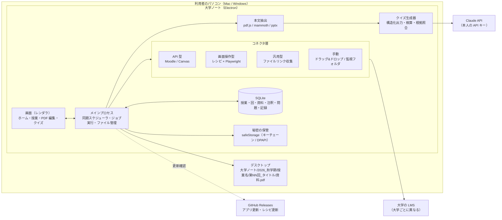
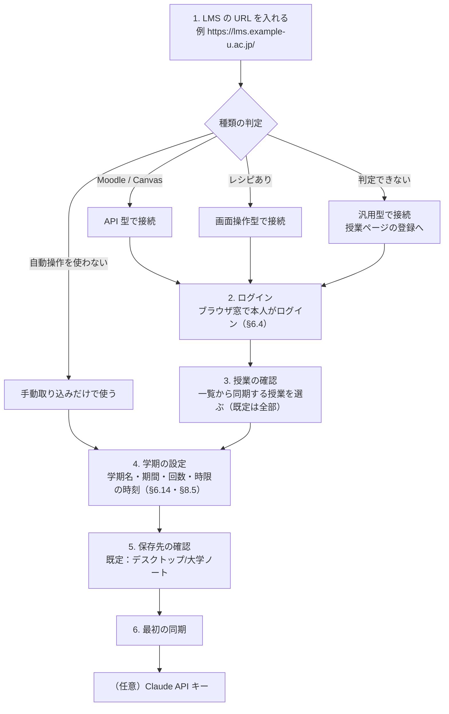
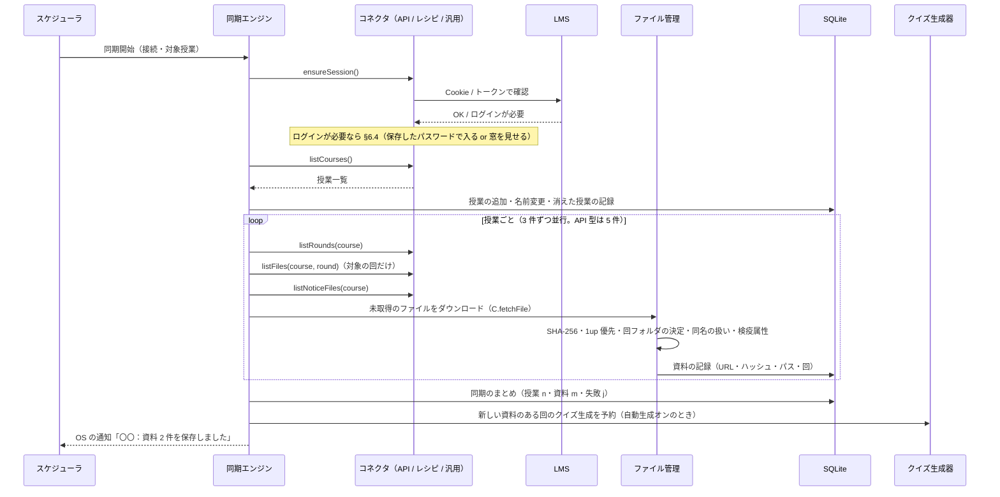
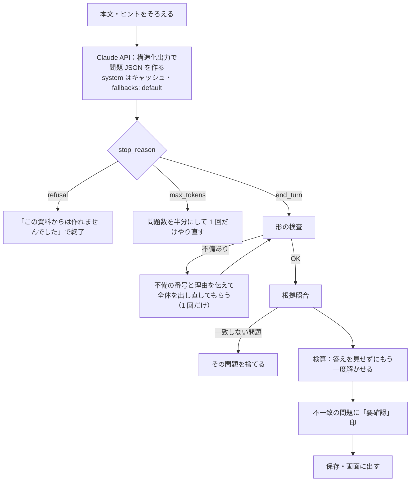
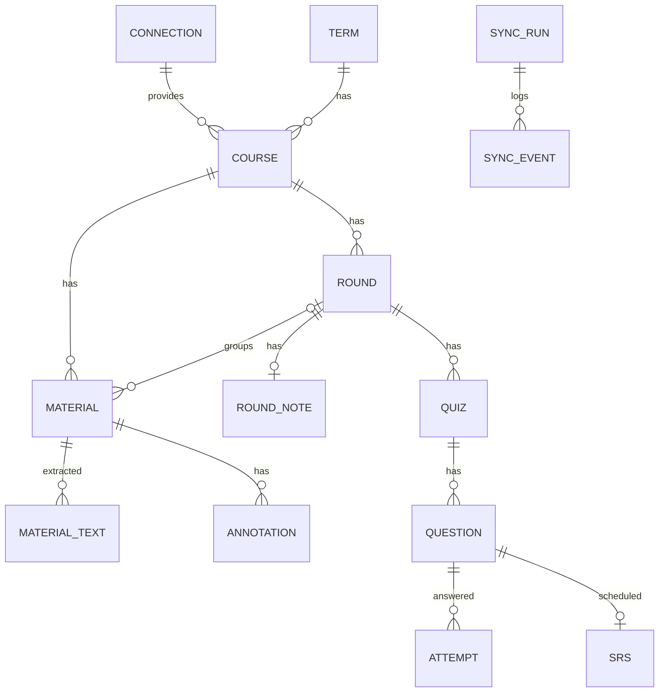
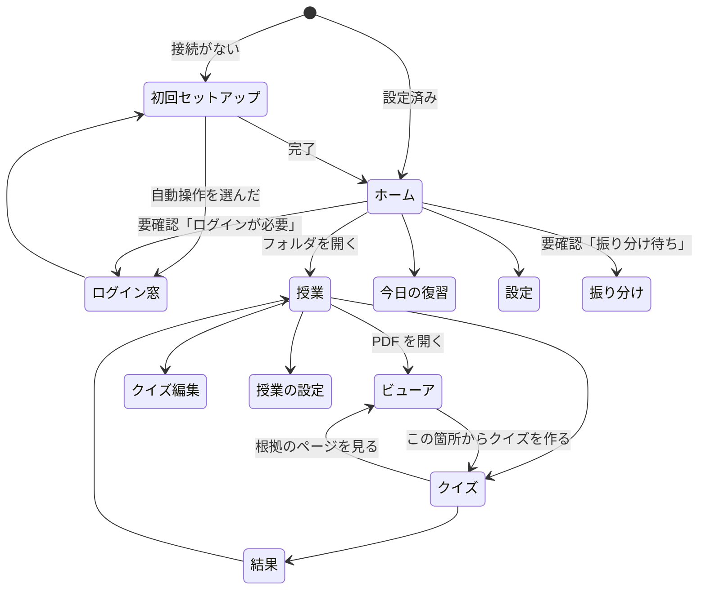

# 大学ノート 仕様書

| 項目                 | 内容                                                                                                                                                                                                                                                                                                    |
| -------------------- | ------------------------------------------------------------------------------------------------------------------------------------------------------------------------------------------------------------------------------------------------------------------------------------------------------- |
| 文書の版             | 0.4                                                                                                                                                                                                                                                                                                     |
| 作成日               | 2026-10-16（0.1〜0.3）／2026-10-17（0.4）                                                                                                                                                                                                                                                               |
| 対象                 | 大学ノート（デスクトップアプリ。Mac・Windows）。**全国の大学生**が対象で、特定の大学・LMS に依存しない                                                                                                                                                                                                  |
| 参考にした自作アプリ | SaBoRo（リポジトリ `Peyangpiece/coursecue`。LMS 連携・資料の自動ダウンロード・授業フォルダ）、カテキョ（リポジトリ `Peyangpiece/kateikyoushi-quiz`。問題の形・AI による問題生成と検算・間隔をあけた復習）。**いずれも仕組みを参考にするだけで、コード・データ・アカウントの共有や連携はしない（§4.5）** |
| 状態                 | 仕様確定（0.4）。次は詳細設計（M0）へ                                                                                                                                                                                                                                                                   |

改訂履歴

| 版  | 内容                                                                                                                                                                                                                                                                                                                                                                                                                                                                  |
| --- | --------------------------------------------------------------------------------------------------------------------------------------------------------------------------------------------------------------------------------------------------------------------------------------------------------------------------------------------------------------------------------------------------------------------------------------------------------------------- |
| 0.1 | 初版                                                                                                                                                                                                                                                                                                                                                                                                                                                                  |
| 0.2 | SaBoRo・カテキョとは完全に別アプリ（§4.5）。クイズ生成は Claude API のみ（§11.8）。回ごとのサブフォルダ（§7.1）                                                                                                                                                                                                                                                                                                                                                       |
| 0.3 | 注釈の保存場所・学年暦・クイズ既定・フォント・テキスト化・回フォルダ名の 6 項目を決定                                                                                                                                                                                                                                                                                                                                                                                 |
| 0.4 | **(1) 対象を全国の大学に広げ、LMS を 4 階層（API 型・画面操作型・汎用型・手動）で扱う構成に変更**（§6 全面改訂・§13 にアカウントとコネクタの表を追加・§18.1 を manabo レシピの例に変更）。学年暦は「学期の設定」（本人入力＋LMS の情報＋任意の PDF 読み取り）に置き換え（§6.14）。時限の開始時刻は大学ごとの設定に（§8.5）。**(2) デザイン方針を追加**：罫線ノートの背景にマスキングテープでフォルダを貼った、ポップでシンプル、余白をデザインの一部とする UI（§8.0） |

本書は「何を作るか」を決める文書である。実装の細部（関数名・ファイル分け）は決めないが、動きの決まり・データの形・画面の構成・外部とのやり取り・フェーズ分けは、作る人が迷わない粒度まで書く。実装は大学ノートで独自に書く。

---

## 目次

1. [概要と目的](#1-概要と目的)
2. [用語](#2-用語)
3. [スコープ](#3-スコープ)
4. [前提・制約](#4-前提制約)
5. [全体構成](#5-全体構成)
6. [機能要件 A：大学アカウント連携と同期](#6-機能要件-a大学アカウント連携と同期)
7. [機能要件 B：フォルダ構成とファイル管理](#7-機能要件-bフォルダ構成とファイル管理)
8. [機能要件 C：デザイン方針・ホーム画面・授業画面](#8-機能要件-cデザイン方針ホーム画面授業画面)
9. [機能要件 D：PDF ビューア・編集](#9-機能要件-dpdf-ビューア編集)
10. [機能要件 E：授業ごとのフォント設定](#10-機能要件-e授業ごとのフォント設定)
11. [機能要件 F：クイズ](#11-機能要件-fクイズ)
12. [機能要件 G：通知・設定・バックアップ](#12-機能要件-g通知設定バックアップ)
13. [データモデル](#13-データモデル)
14. [非機能要件](#14-非機能要件)
15. [画面一覧と遷移](#15-画面一覧と遷移)
16. [開発フェーズ](#16-開発フェーズ)
17. [決定事項・リスク](#17-決定事項リスク)
18. [付録](#18-付録)

---

## 1. 概要と目的

### 1.1 一文で

大学の LMS に上がった授業資料を、何もしなくても授業ごと・回ごとのフォルダにそろえ、そのまま PDF に書き込んで学び、資料から作ったクイズで回ごとに復習できる、全国の大学生のための電子ノートアプリ。

### 1.2 解きたい問題

| 困りごと                           | いまの状態                                                         | 大学ノートでの解決                                                                    |
| ---------------------------------- | ------------------------------------------------------------------ | ------------------------------------------------------------------------------------- |
| 資料を取りに行くのが面倒           | 授業ごとに LMS を開き、回のページを開き、1 件ずつダウンロードする  | 大学アカウントで一度つなげば、新しい資料は自動で授業フォルダに入る（SaBoRo の仕組み） |
| 大学ごとに LMS が違う              | 便利なツールがあっても自分の大学の LMS に対応していない            | API 型・画面操作型・汎用型・手動の 4 階層で、どの大学でも最低限動く（§6.1）           |
| ファイルが散らばる                 | ダウンロードフォルダに無秩序に溜まり、どの授業の何回目か分からない | デスクトップに「学期 → 授業 → 回 → 資料」の決まった構成で保存する                     |
| 資料に書き込めない・書き込みが散る | 別の PDF アプリで開き、保存場所がばらける                          | アプリ内で文字入れ・メモ・文字隠しができ、元ファイルは変えずに注釈を保存する          |
| 復習の仕方が分からない             | 資料を読み返すだけで、覚えたかどうか確かめられない                 | 回ごとの資料からクイズを作り、まちがえた問題を間隔をあけて出す（カテキョの仕組み）    |

### 1.3 利用者

- 主：大学生本人（1 台のパソコンで使う。Mac または Windows）。大学・学部・LMS は問わない
- 本人以外（教員・友人）に資料を配る用途は対象外（§4.3 著作権）

### 1.4 成功の基準（MVP で測る）

| 指標                                                                         | 目標                                               |
| ---------------------------------------------------------------------------- | -------------------------------------------------- |
| 専用レシピのある LMS で、同期後に手で動かす必要のあった資料の割合            | 5% 未満                                            |
| 汎用コネクタで、授業ページを登録してから最初の資料がフォルダに入るまでの手順 | 3 手順以内（URL を入れる → ログイン → 授業を選ぶ） |
| 1 回分（10〜40 ページ）の資料からクイズができるまでの時間                    | 2 分以内（自動生成の場合、資料保存から）           |
| 生成したクイズのうち本人が「おかしい」と報告した割合                         | 10% 未満                                           |

---

## 2. 用語

| 用語             | 意味                                                                                                                                                                                                                                                                                                 |
| ---------------- | ---------------------------------------------------------------------------------------------------------------------------------------------------------------------------------------------------------------------------------------------------------------------------------------------------- |
| LMS              | 大学の学習管理システム。manaba・Moodle・WebClass・Google Classroom・Canvas・Microsoft Teams・UNIVERSAL PASSPORT・CoursePower・manabo など。本書では総称として LMS と書く                                                                                                                             |
| 大学アカウント   | LMS にログインするための ID とパスワード（大学の統合認証）。Google・Microsoft のアカウントで入る大学もある                                                                                                                                                                                           |
| コネクタ         | ある LMS から授業・回・資料を取り出す部品。方式は API 型・画面操作型・汎用型の 3 つ（§6.1）                                                                                                                                                                                                          |
| レシピ           | 画面操作型コネクタの手順書（どの URL を開き、どの要素から授業名・回・ファイルのリンクを取るか）。LMS ごとに 1 つ。JSON で書き、アプリと別に更新できる（§6.13）                                                                                                                                       |
| 授業             | LMS 上の 1 つの科目（コース）                                                                                                                                                                                                                                                                        |
| 回               | 授業の第 N 回。LMS のセクション・トピック・ディレクトリ・週が単位                                                                                                                                                                                                                                    |
| 資料             | 回に置かれたファイル（PDF・PowerPoint・Word・画像・音声・動画など）                                                                                                                                                                                                                                  |
| 同期             | LMS を読み、授業一覧・回・資料を取り込み、新しい資料をダウンロードする一連の処理                                                                                                                                                                                                                     |
| 学期の設定       | 学期名・開始日・終了日・曜日ごとの授業日・時限の開始時刻。大学ごとに違うため本人が入れる（LMS から取れるものは自動で補う。§6.14）                                                                                                                                                                    |
| 学期フォルダ     | デスクトップの `大学ノート/<西暦>_<学期名>`（例 `2026_秋学期`）                                                                                                                                                                                                                                      |
| 授業フォルダ     | 学期フォルダの中の `<授業名>/`                                                                                                                                                                                                                                                                       |
| 回フォルダ       | 授業フォルダの中の `第NN回_<タイトル>/`。回が分からない資料は `その他/`                                                                                                                                                                                                                              |
| 注釈             | PDF の上に置く「文字入れ」「メモ」「文字隠しマーカー」。元の PDF は変えない                                                                                                                                                                                                                          |
| 文字入れ         | PDF の任意の位置に置くテキストボックス。サイズ・太字・色は PDF ごとに覚え（最後に使ったもの）、初めて開く PDF では同じ授業（フォルダ）で最後に使ったものを初期値にする。赤く見える色の字は赤シートの下で見えなくなる                                                                                 |
| メモ             | ページに付ける付箋。本文の上に小さなアイコンで出し、押すと本文を読める。本文の下に手書きの欄があり、筆箱のボールペン（持っていなければ黒の 0.5）で書ける。吹き出しは右下の角で大きさを変えられ、大きさと手書きは注釈に残る。書き出しでは本文がテキスト注釈、手書きがアイコンの右のスタンプ注釈になる |
| 文字隠しマーカー | 文字の上に塗って隠すマーカー。暗記用に隠す・見せるを切り替えられる                                                                                                                                                                                                                                   |
| クイズ           | 回の資料から作った問題の集まり                                                                                                                                                                                                                                                                       |
| 今日の復習       | まちがえた問題・期日が来た問題を日ごとにまとめた出題                                                                                                                                                                                                                                                 |
| 根拠             | 問題の元になった資料の箇所（ファイル・ページ・引用文）                                                                                                                                                                                                                                               |

---

## 3. スコープ

### 3.1 入れるもの（本書の対象）

1. 大学アカウントによる LMS 連携と資料の自動ダウンロード。全国の大学を対象に、LMS を 4 階層で扱う（§6）
2. 授業ごと・回ごとのフォルダ作成とデスクトップへの保存、重複の整理（§7）
3. 罫線ノート＋マスキングテープのデザイン、授業フォルダを並べたホーム画面、授業画面（§8）
4. アプリ内 PDF ビューアと 3 つの編集機能：文字入れ・メモ・文字隠しマーカー（§9）
5. 授業ごとに変えられる文字入れのフォントサイズ（§10）
6. 授業ごと・回ごとに資料から作るクイズと、間隔をあけた復習（§11）
7. 通知・設定・バックアップ（§12）

### 3.2 入れないもの（はっきり対象外）

| 対象外                                                   | 理由                                                                           |
| -------------------------------------------------------- | ------------------------------------------------------------------------------ |
| 課題の自動生成・自動提出・出席コードの入力               | 大学ノートは「資料とノートと復習」に絞る                                       |
| 成績・履修登録・シラバス検索                             | LMS や教務システムの領域。資料と回の取得に必要な範囲だけ読む                   |
| スマホ版・Web 版                                         | ファイルはパソコンのデスクトップにあり、PDF 編集はパソコン前提。v2 以降（§16） |
| PDF の本文編集（文字の書き換え・ページの削除や並べ替え） | 「注釈」の範囲を超える。元ファイルを変えない方針（§9.1）と相反する             |
| 手書き（ペン・スタイラス）                               | 要望にない。注釈モデルは拡張できる形にしておく（§13.4）                        |
| 他人との共有・共同編集                                   | 著作権（§4.3）と個人情報の扱いから対象外                                       |
| 複数の大学アカウントの同時接続                           | v1 は 1 大学・1 アカウント（複数 LMS を併用する大学には対応。§6.3）            |

---

## 4. 前提・制約

### 4.1 技術的前提

- 利用者のパソコンが起きていて、ログインしているときだけ同期が動く。クラウドは LMS を触らない
- LMS の多くは学生向けの公開 API を持たない。API がある LMS（Moodle・Canvas）は API を使い、ないものは Playwright のヘッドレス Chromium で大学の正規ログインフォームを使って本人として操作する（§6.1）
- LMS の画面構成は大学ごとのカスタマイズや更新で変わる。手順はレシピ（JSON）に閉じ込め、アプリ本体を更新せずにレシピだけ更新できるようにする（§6.15）

### 4.2 認証と秘密

- 大学アカウントのパスワードはこのパソコンの中にだけ、OS の仕組み（macOS はキーチェーン、Windows は DPAPI。Electron の `safeStorage`）で暗号化して保存する。クラウドには送らない
- API のトークン（Moodle・Canvas）も同じ扱い
- 2 段階認証や見慣れない画面が出たら、アプリは勝手に進めず、本人にブラウザ窓を見せて操作してもらう（§6.4）

### 4.3 著作権と利用規約

- 授業資料は教員・大学に権利がある。大学ノートは本人の学習のための複製（私的使用）に限る。資料の共有・公開・外部送信の機能は作らない
- 問題生成のために資料本文を AI（外部 API）へ送ることは本人の学習のための利用だが、送る内容と送らないもの（§11.9）を本人に示し、初回に同意を取る。同意しなければクイズ機能だけが使えない状態で、ほかは全部使える
- 学籍番号などの ID（英字＋6 桁以上の数字、または 7 桁以上の数字）は AI に送る前に取り除く
- LMS の自動操作を大学の規約が禁じている場合がある。初回セットアップで「自分の大学の規約を確かめた」ことに同意してもらい、同意しなければ手動取り込み（§6.10）だけで使える

### 4.4 費用

- AI の利用料は本人の負担（自分の Claude API キー。§11.8）。アプリ側で 1 日と月の上限を設ける
- クラウドの常設サーバーは持たない（v1 は完全にローカルで動く。§5.2）。レシピの配布は GitHub 上の静的ファイルで行う（§6.15）

### 4.5 SaBoRo・カテキョとの関係

大学ノートは SaBoRo・カテキョとは **完全に別のアプリ** である。

| 項目             | 決まり                                                                                                                                         |
| ---------------- | ---------------------------------------------------------------------------------------------------------------------------------------------- |
| コード           | 共有しない・依存しない。同じ決まりで動く箇所も大学ノートの中に独自に書く。SaBoRo・カテキョのソースは「仕組みを確かめる参考資料」としてだけ読む |
| データ・フォルダ | SaBoRo の状態ファイル・保存フォルダ・記録を読まない・書かない。同じパソコンに SaBoRo が入っていても互いを認識しない（保存先の既定も別。§7.1）  |
| アカウント・秘密 | 大学アカウントの保存は大学ノート自身の項目名で行う。SaBoRo の保存した秘密は読まない                                                            |
| クラウド         | SaBoRo のクラウドに接続しない                                                                                                                  |
| 名前・識別子     | アプリ名・`appId`・ユーザーデータの保存場所・キーチェーンの項目名はすべて大学ノート固有                                                        |

### 4.6 大学ごとの違いの扱い

全国の大学を対象にするため、「大学ごとに違うもの」はアプリに決め打ちせず、次のどれかで持つ。

| 大学ごとに違うもの                                        | 持ち方                                                                                 |
| --------------------------------------------------------- | -------------------------------------------------------------------------------------- |
| LMS の種類と URL                                          | 初回セットアップで本人が LMS の URL を入れ、アプリが種類を判定する（§6.3）             |
| LMS の画面構成                                            | レシピ（§6.13）。大学独自のカスタマイズはレシピの「大学別の上書き」で吸収              |
| ログインの流れ（統合認証・Google・Microsoft・2 段階認証） | 汎用のログイン処理（§6.4）。決め打ちせず、ログインフォームの検出と本人の操作で済ませる |
| 学期の名前・期間・授業日                                  | 学期の設定（§6.14）。本人が入れる。LMS から取れれば補う                                |
| 時限の開始時刻                                            | 本人が設定（§8.5）。よくある時間割のプリセットを用意                                   |
| 回の数（15 回・14 回・8 回のクォーター制）                | 学期の設定で回数を入れる（既定 15）                                                    |

---

## 5. 全体構成

### 5.1 構成図



### 5.2 方針：クラウドを持たない（v1）

| 観点             | 大学ノート v1                                                                       |
| ---------------- | ----------------------------------------------------------------------------------- |
| 画面が動く場所   | すべてアプリの中（レンダラ）                                                        |
| ファイルの場所   | パソコン                                                                            |
| 利用者ごとの状態 | SQLite（ローカル）                                                                  |
| 外部との通信     | LMS（本人として）、Claude API（本人のキー）、GitHub（アプリとレシピの更新確認）だけ |
| 運用コスト       | ゼロ（サーバーを持たない）                                                          |

画面 → メインプロセスの IPC で直接ジョブを投げる。将来スマホ対応をするときにクラウドを足せるよう、ジョブの種類と状態の形は決めておく（§13.6）。

### 5.3 技術の選定

| 層             | 選定                                                                                                                     | 理由                                                                                                                                                                           |
| -------------- | ------------------------------------------------------------------------------------------------------------------------ | ------------------------------------------------------------------------------------------------------------------------------------------------------------------------------ |
| アプリの土台   | Electron                                                                                                                 | 常駐・トレイ・safeStorage・自動更新・Playwright の同梱を 1 つの土台でまかなえる。Electron＋Playwright 同梱で常駐アプリが安定して動く実績が SaBoRo にある（コードは独自に書く） |
| 画面           | HTML + JavaScript（最小のバンドル）                                                                                      | 機能ごとにスクリプトを分ける。デザイントークン（§8.0）は CSS 変数で持つ                                                                                                        |
| PDF 表示       | pdf.js（Mozilla）                                                                                                        | テキストレイヤーが取れる（文字隠しマーカーの吸着・検索・本文抽出に必要）                                                                                                       |
| 注釈の書き出し | pdf-lib                                                                                                                  | 元 PDF を変えず、注釈を焼き込んだ別ファイルを作る（§9.7）                                                                                                                      |
| 本文抽出       | pdf.js（テキストレイヤー）。PowerPoint・Word は同梱ライブラリ（`mammoth`、pptx 用）でテキスト化。OS のコマンドは使わない | Mac・Windows で同じ結果にする（§11.4）                                                                                                                                         |
| LMS 操作       | Playwright（Chromium。ふだんはヘッドレス、本人の操作が要るときは窓を見せる）                                             | 公開 API のない LMS を本人として操作できる唯一の現実的な方法                                                                                                                   |
| LMS API        | 標準の HTTPS クライアント（Node の `fetch`）                                                                             | Moodle Web Services・Canvas REST はトークン付きの JSON API                                                                                                                     |
| データ         | SQLite（Node 22 以降の `node:sqlite`。Electron の Node で使えなければ `better-sqlite3`）                                 | 注釈・問題・記録は件数が増え、部分更新と検索が要る。ネイティブビルドを避けられるなら避ける                                                                                     |
| 秘密           | Electron `safeStorage`                                                                                                   | OS の鍵で暗号化                                                                                                                                                                |
| AI             | Anthropic SDK（Claude API）。本人の API キーで、メインプロセスから呼ぶ                                                   | 構造化出力・プロンプトキャッシュ・拒否時の fallback・使用量の記録がそろう。手段はこれ 1 つ（§11.8）                                                                            |
| 更新           | GitHub Releases（electron-updater。Mac は署名がなければ .dmg をダウンロードして sha512 を照合し入れ替える手順）          | サーバーを持たずに配れる                                                                                                                                                       |
| フォント       | Noto Sans JP・Noto Serif JP を同梱（OFL）。見出しは Zen Maru Gothic（OFL。§8.0）                                         | PDF への埋め込みが許され、Mac・Windows で同じ字形                                                                                                                              |
| 検証           | `node --test`、Prettier、ESLint                                                                                          |                                                                                                                                                                                |

### 5.4 参考にした仕組み（実装は大学ノートで独自に書く）

| 仕組み                   | 元       | 大学ノートでの決まり                                                                                               | 変える点                                                                             |
| ------------------------ | -------- | ------------------------------------------------------------------------------------------------------------------ | ------------------------------------------------------------------------------------ |
| LMS の画面操作による同期 | SaBoRo   | 正規ログイン・授業一覧・回・ファイル取得・添付・2 段階認証の待ち受け（§6）                                         | manabo 決め打ちではなく、レシピで LMS ごとに手順を書く。課題・提出・出席には触れない |
| 保存先の決まり           | SaBoRo   | 既定はデスクトップ、ホームフォルダ内のみ、隠しフォルダ・Library は不可、1up/2up/4up の判定、複製のゴミ箱移動（§7） | 既定のフォルダ名を大学ノート固有にし、回ごとのサブフォルダを設ける                   |
| 授業開始時刻の同期       | SaBoRo   | 時限の開始時刻を過ぎたらその授業だけ同期。1 日 1 回（§6.5）                                                        | 時限の時刻は大学ごとに本人が設定（§8.5）                                             |
| 常駐アプリの作り         | SaBoRo   | トレイ／メニューバー・safeStorage・OS 通知・GitHub Releases からの更新                                             | アプリ名・識別子・保存場所はすべて大学ノート固有                                     |
| 間隔をあけた復習         | カテキョ | 1→3→7→14→30→90 日、初回正解は 1 週間後、2 択は 2 連続正解で昇格、1 日 30 問（§11.7）                               | 定数は同じ。保存先は SQLite                                                          |
| 選択肢の並び             | カテキョ | 種（seed）で並びを再現する                                                                                         | 誤答は AI が作る（`o` 必須）                                                         |
| AI 生成の流れ            | カテキョ | 構造化出力、形の機械検査、1 回だけの作り直し、答えを隠して解き直す検算、拒否・途切れ・混雑の扱い（§11.5）          | 「資料から作る」。根拠の引用を必須にし本文と照合                                     |
| 問題データの機械検査     | カテキョ | 必須項目・文字数・選択肢の重複（NFKC 正規化）を保存前に検査（§11.6）                                               | 種類を 4 種に合わせる                                                                |

---

## 6. 機能要件 A：大学アカウント連携と同期

### 6.1 対応方針：4 階層

どの大学でも「最低限、資料が授業フォルダに入る」ことを保証するため、LMS への対応を 4 階層にする。上の階層ほど手間がなく、下の階層ほど対応範囲が広い。

| 階層                    | 方式                                                                                          | 対象                                                                                                                 | 本人の手間                                                                        | 取れるもの                                                                        |
| ----------------------- | --------------------------------------------------------------------------------------------- | -------------------------------------------------------------------------------------------------------------------- | --------------------------------------------------------------------------------- | --------------------------------------------------------------------------------- |
| 1. API 型               | LMS の公式 API をトークンで呼ぶ                                                               | Moodle（Web Services）、Canvas（REST API）                                                                           | 初回にログイン（トークンは自動で取得・保存）                                      | 授業一覧・セクション（回）・ファイルの URL と名前・更新日時。安定して速い         |
| 2. 画面操作型（レシピ） | Playwright で LMS の画面を読む。手順は LMS ごとのレシピ                                       | manaba、WebClass、manabo、Google Classroom、Microsoft Teams、UNIVERSAL PASSPORT、CoursePower、Blackboard、Sakai ほか | 初回にログイン                                                                    | レシピが定義する範囲（授業一覧・回・ファイル・お知らせの添付）                    |
| 3. 汎用型               | レシピのない LMS。本人が授業ページの URL を登録し、アプリがページ内のファイルのリンクを集める | 上のどれにも当たらない LMS・大学独自のシステム                                                                       | 初回にログイン＋授業ページを 1 つずつ登録（授業一覧ページを登録すれば候補を出す） | ページ内と 1 階層下のページにあるファイルのリンク。回は見出しとファイル名から推定 |
| 4. 手動                 | LMS を読まない。本人がファイルを入れる                                                        | 自動操作を規約で禁じている大学、ログインが特殊な大学、LMS がない科目                                                 | ファイルをドラッグ、または「取り込みフォルダ」に置く                              | 置いたファイルすべて。回はファイル名から推定、または本人が選ぶ                    |

同じ大学で複数の方式を併用できる（例：Moodle は API 型、教員が Google Classroom を使う科目は画面操作型、ゼミの資料は手動）。

### 6.2 対応 LMS と連携方式

| LMS                                                        | 方式                                                                     | 認証                                                                                                                       | 回の単位                               | 備考                                                                               |
| ---------------------------------------------------------- | ------------------------------------------------------------------------ | -------------------------------------------------------------------------------------------------------------------------- | -------------------------------------- | ---------------------------------------------------------------------------------- |
| Moodle                                                     | API 型                                                                   | Moodle のモバイルアプリ用サービスのトークン。統合認証（SSO）の大学は、Moodle アプリと同じブラウザ経由の流れで取得（§18.2） | コースのセクション（週・トピック）     | 多くの大学が採用。`core_course_get_contents` でモジュールとファイルの URL が取れる |
| Canvas LMS                                                 | API 型                                                                   | 本人が Canvas の設定で作るアクセストークン（手順を画面で案内）                                                             | モジュール                             | REST API（`/api/v1/courses`・`/modules`・`/files`）                                |
| manaba                                                     | 画面操作型                                                               | 大学の統合認証                                                                                                             | コースコンテンツのページ・ディレクトリ | 公開 API なし                                                                      |
| WebClass                                                   | 画面操作型                                                               | 大学の統合認証                                                                                                             | 教材一覧の見出し                       | 公開 API なし                                                                      |
| manabo                                                     | 画面操作型                                                               | 大学の統合認証                                                                                                             | ディレクトリ（第 N 回）                | レシピの例を §18.1 に示す                                                          |
| Google Classroom                                           | 画面操作型（API は大学の管理者が外部アプリを許可している場合のみ。v1.x） | Google アカウント                                                                                                          | トピック・投稿日                       | 添付は Google ドライブ。ドライブからのダウンロードもレシピで行う                   |
| Microsoft Teams（クラス）                                  | 画面操作型                                                               | Microsoft アカウント                                                                                                       | チャネル・ファイルのフォルダ           | 添付は SharePoint                                                                  |
| UNIVERSAL PASSPORT・CoursePower・Blackboard・Sakai・その他 | 画面操作型（レシピがあれば）→ なければ汎用型                             | 大学の統合認証                                                                                                             | LMS による                             | レシピは順次追加（§6.15）                                                          |
| 大学独自のシステム                                         | 汎用型                                                                   | 大学の統合認証                                                                                                             | 見出し・ファイル名から推定             |                                                                                    |
| すべて                                                     | 手動                                                                     | なし                                                                                                                       | ファイル名から推定、または本人が選ぶ   |                                                                                    |

v1.0 で同梱するレシピ・コネクタ：Moodle（API）、Canvas（API）、manaba、WebClass、manabo、Google Classroom、Microsoft Teams、汎用型、手動。残りは v1.x でレシピを追加する（§16）。

### 6.3 初回セットアップ

いまの初回（`#/setup`）は「1. あなた → 2. 使い方 → 3. 授業の資料 → （4. 利用規約）→ 学期の設定 → 保存先」（授業の資料は大学生が「授業の資料を活用」を選んだときだけ。社会人は学期の設定を飛ばす）。LMS とつなぐ手順は 設定 → LMS との連携 から入る（下の図の 1〜3）。

- **授業の資料**：「PC内の授業フォルダを取り込む」「大学サービスとの連携（授業資料自動ダウンロード）」「あとで設定」から 1 つ選ぶ
  - PC内の授業フォルダを取り込む：選んだフォルダの中のフォルダを 1 つずつ今学期のフォルダとして登録する（コピーしない。中にフォルダがなければ選んだフォルダそのもの）。ホームの「＋ PC内の授業フォルダを取り込む」からもできる
  - 大学サービスとの連携：次の手順で注意書きと利用規約（`src/shared/lms-terms.js`）を見せ、同意にチェックしたときだけ先へ進む。同意した版と日時を記録し、初回のあとそのまま LMS とつなぐ手順へ。規約の版を上げたら、同意し直すまで同期とログインのジョブを止め（`terms-required`）、ホームの「要確認」から同意の画面（`#/settings/lms-terms`）へ案内する。v0.5.11 より前につないだ接続も、最初に一度同意を求める。設定から LMS とつなぐときも、同意していなければ最初に同じ手順を挟む。LMS の URL の手順で、学習支援サービスの名前を自分で付けられる（既定は判定した種類の名前。設定 → LMS との連携 の ✎ でも変えられる）。メインも、同意がなければ LMS の接続を作らない

- **あなた**：大学生・社会人から選ぶ。大学生のときだけ大学名を入れる（いまは記録するだけ）
- **使い方**（いくつでも。設定 → 使い方 で変えられる。`src/shared/profile.js`）
  - 大学生：授業の資料を活用・自分のファイルで勉強・試験・復習
  - 社会人：資格・試験の勉強・仕事の資料の整理・学び直し・講座
- 使い方に合わせて出すもの
  - LMS（連携と同期の設定）：「授業の資料を活用」か「学び直し・講座」
  - クイズ（設定の「復習」・授業ページの「クイズを使う…」）：「試験・復習」か「資格・試験の勉強」
  - 学期（設定の「学期」・上の学期名・フォルダの「今学期のフォルダ」）：大学生だけ。社会人は学期を使わず、フォルダはいつもマイフォルダ。LMS の同期で学期が要るときは、今日の日付から仮の学期を作る（画面には出さない）
  - ホームの並び：LMS を使わない人と社会人は、自分のフォルダを先に
  - もう設定してあるもの（LMS の接続・API キー）は、使い方で選んでいなくても出す。まだ選んでいない人（前の版から使っている人）には全部を出す



| 手順                | 仕様                                                                                                                                                                                                                                                                                                                                                                                                                                       |
| ------------------- | ------------------------------------------------------------------------------------------------------------------------------------------------------------------------------------------------------------------------------------------------------------------------------------------------------------------------------------------------------------------------------------------------------------------------------------------ |
| 1. LMS の URL       | 本人が LMS のトップページの URL を入れる。アプリは次の順で種類を判定する：(a) URL のパターン（`manaba.jp`、`/webclass/`、`classroom.google.com`、`teams.microsoft.com` など）、(b) そのページを取得し、HTML の印（Moodle は `M.cfg`・`/login/index.php`、Canvas は `/api/v1` への応答・`ENV`、manaba は `manaba` を含む要素など）、(c) レシピの `detect` 規則（§6.13）。判定できなければ「汎用型」を提案し、本人が一覧から選ぶこともできる |
| 同じ LMS をもう一度 | 同じ LMS（コネクタ・種類・ホストが同じ）への接続がもうあれば、新しく作らずにそれを使う（作ると授業が 2 つずつできる）。起動時に、同じ LMS の接続が 2 つ以上あれば 1 つにまとめる：新しいほうの接続を残し、同じ授業は資料の多いほう（同じなら古いほう）を残して、もう一方のフォルダを OS のゴミ箱へ。消すほうにしかない資料があれば、残すほうを次の同期で全部の回から見直す                                                                 |
| 大学の選択（任意）  | 既知の大学なら「大学名から選ぶ」で URL と学期の設定の既定値が入る（同梱のレシピにある大学別の上書き。§6.13）。なくても URL を入れれば進める                                                                                                                                                                                                                                                                                                |
| 2. ログイン         | §6.4。API 型は ID・パスワード、画面操作型は「ログイン窓を開く」で見えるブラウザ窓（「あとでログインする」で先へ進め、設定 → 接続 から開いてもよい）                                                                                                                                                                                                                                                                                        |
| 3. 授業の確認       | 取得した授業一覧を出し、同期する授業を選ぶ（既定は全部）。外した授業は LMS の ID を覚えておき（設定 `courses.exclude.<接続 ID>`）、同期で**非表示**の授業として作る（同期しない。設定 → 授業 で戻せる）。授業が 0 件・未ログインなら、その旨を案内し、最初の同期で全部を取り込む                                                                                                                                                           |
| 4. 学期の設定       | §6.14。LMS から取れたもの（Moodle のコース開始日など）は入れておく                                                                                                                                                                                                                                                                                                                                                                         |
| 5. 保存先           | §7.2                                                                                                                                                                                                                                                                                                                                                                                                                                       |
| 6. 最初の同期       | 全授業・全回を取り込む。進み具合を出す                                                                                                                                                                                                                                                                                                                                                                                                     |
| 任意                | Claude API キー（§11.8）。あとから設定でもよい                                                                                                                                                                                                                                                                                                                                                                                             |
| 規約の同意          | 手順 1 で自動操作を選んだとき、「自分の大学の規約で自動操作が禁じられていないことを確かめた」にチェックを求める。チェックしなければ手動取り込みへ                                                                                                                                                                                                                                                                                          |

### 6.4 ログインと認証（汎用）

LMS ごとにログインの流れが違う（大学の統合認証・Shibboleth・Google・Microsoft・2 段階認証・初回の同意画面）。決め打ちせず、次の決まりで扱う。

| 場面                         | 動き                                                                                                                                                                                                                                                                                                                                                                                                                                                                                                                                                                                                                                                                                                                                                                                                                                                                                                                                              |
| ---------------------------- | ------------------------------------------------------------------------------------------------------------------------------------------------------------------------------------------------------------------------------------------------------------------------------------------------------------------------------------------------------------------------------------------------------------------------------------------------------------------------------------------------------------------------------------------------------------------------------------------------------------------------------------------------------------------------------------------------------------------------------------------------------------------------------------------------------------------------------------------------------------------------------------------------------------------------------------------------- |
| 初回のログイン               | **見えるブラウザ窓**（Playwright の Chromium。アプリの窓の中に出す）で LMS のログインページを開き、本人が ID・パスワード・2 段階認証を入れる。ログインが完了した（LMS のトップに戻った、またはレシピの `loggedIn` 規則に合った）ことを検出したら窓を閉じ、**セッション（Cookie）を保存**する                                                                                                                                                                                                                                                                                                                                                                                                                                                                                                                                                                                                                                                      |
| パスワードの保存（任意）     | 「次回から自動でログイン」を提案し（セットアップの手順 2・設定 → 接続）、同意した場合だけ ID とパスワードを `safeStorage` に保存して以後はヘッドレスで入力する。欄はレシピの `login.form` があればそのセレクタ、なければ画面から探す（パスワード欄とその手前の ID 欄。ID だけを先に聞く 2 段階のページにも合わせる。`src/main/browser/login-form.js`）。統合認証のような別のホストのページには、**見えるログイン窓で一度ログインしたときに通ったホスト**（接続の `allowed_hosts_json`）にだけ入力する（知らないページにパスワードを送らない）。Google・Microsoft のページには入力しない（規約・2 段階認証の都合）。見えるログイン窓でも、保存した ID とパスワードを空の欄に入れておく（送信は本人が押す）。ただし入れるのは **https の、LMS と同じ組織のドメイン（例：lms.example-u.ac.jp に対して idp.example-u.ac.jp）か、レシピの allowedHosts のページだけ**（`credentialUrlAllowed`）。ヘッドレスの自動ログインも https のページだけに入れる |
| 以後の同期                   | 保存した Cookie で入る。期限切れでログインページに戻されたら：パスワードを保存していれば入力して進む、していなければホームの要確認に「ログインが必要です」と出して **見えるブラウザ窓**でログインしてもらう（OS の通知も出す）。要確認の「ログイン窓を開く」でログインできたら、そのまま同期する                                                                                                                                                                                                                                                                                                                                                                                                                                                                                                                                                                                                                                                  |
| 保存したパスワードが通らない | パスワードの欄がもう一度出たら（ID かパスワードの誤り・変更）、**自動ログインを止める**（`save_password = 0`）。次の同期でまた送ってアカウントをロックさせない。理由はトーストと要確認に出し、設定 → 接続 で入れ直してもらう                                                                                                                                                                                                                                                                                                                                                                                                                                                                                                                                                                                                                                                                                                                      |
| 2 段階認証・見慣れない画面   | ヘッドレスで進めている途中にログインフォーム以外の入力（認証コード・同意・パスワード変更など）が出たら、そこで止めて（何も入力しない。認証コードの欄を ID の欄と取り違えない）要確認に「ログインが必要です（認証コードなど…）」と出す。本人が「ログイン窓を開く」を押すと、ID とパスワードが入った窓が開くので、認証コードだけ入れればよい。自動ログインは止めない（次に期限が切れたときは、また ID とパスワードで入れる）                                                                                                                                                                                                                                                                                                                                                                                                                                                                                                                        |
| 入力しないもの               | 大学ノートは認証コードを代わりに取得・入力しない。メールを読まない                                                                                                                                                                                                                                                                                                                                                                                                                                                                                                                                                                                                                                                                                                                                                                                                                                                                                |
| API 型のトークン             | Moodle：ログイン後にトークンを取得して保存（§18.2）。Canvas：本人が作ったトークンを貼り付け、`/api/v1/users/self` で確かめて保存。トークンが無効になったら要確認に出す                                                                                                                                                                                                                                                                                                                                                                                                                                                                                                                                                                                                                                                                                                                                                                            |
| 複数の LMS                   | 大学で 2 つ以上の LMS を使う場合、それぞれ別の「接続」として追加する（§12.2）。接続ごとに Cookie・トークンを持つ                                                                                                                                                                                                                                                                                                                                                                                                                                                                                                                                                                                                                                                                                                                                                                                                                                  |

### 6.5 同期の種類とタイミング

| 種類               | いつ                                                                                                        | 読む範囲                                    |
| ------------------ | ----------------------------------------------------------------------------------------------------------- | ------------------------------------------- |
| 全体の同期         | 毎日、設定の時刻（既定 16:30）。パソコンが寝ていた場合は起きた後の最初の確認で、その日にまだなら実行        | 全授業。実行日の前後 7 日の回＋未取得の資料 |
| 授業開始の同期     | 授業の開始時刻を過ぎてから 2 時間以内。同じ授業は 1 日 1 回。曜日・時限と時限の時刻（§8.5）が分かる授業だけ | その授業だけ                                |
| 手動の同期         | ホームの「同期」、授業画面の「この授業を同期」                                                              | 全授業／その授業                            |
| 初回の同期         | セットアップ直後、保存先を変えたとき、接続を足したとき                                                      | 全授業・全回                                |
| 定期の確認（任意） | 設定で「N 時間ごと」（1・3・6 時間。既定オフ）                                                              | 全体の同期と同じ                            |

同時に動く同期は 1 つ。実行中に別の要求が来たら待ち行列に入れ、同じ種類・同じ授業は 1 つにまとめる。

### 6.6 同期の手順（共通エンジンとコネクタ）

同期エンジンはコネクタの種類を問わず同じ手順で動き、LMS 固有の部分はコネクタに任せる。



### 6.7 新しい資料の判定

1. **同じ URL（API 型はファイル ID）** の資料が、いまの保存先の中に記録されていれば取りに行かない（本人が消していても、編集して中身が変わっていても、ダウンロードし直さない）
2. LMS が更新日時・サイズを返す場合（Moodle `timemodified`、Canvas `updated_at`）、記録より新しければ **別の版** として取得し、`名前 (v2).pdf` で保存する（元のファイルは残す。注釈は元に付いたまま）
3. 取得したら **SHA-256** を計算し、同じ授業に同じハッシュの記録があれば保存しない
4. ファイル名は `Content-Disposition` から取る。なければ API のファイル名、なければ URL の末尾。取れなければ失敗として記録
5. 同名のファイルが既にあり中身が違えば `名前 (2).pdf`。中身が同じならそのファイルを記録に使う
6. **印刷形式違い**（`4up`・`2up`・`4in1`・`2分割` など）があるときは 1up（印なし・「分割なし」）だけ保存する
7. ダウンロードしたファイルに OS の「インターネットから来た」印（Mac は検疫属性、Windows は Zone.Identifier）を付ける
8. HTML が返ってきた（ログインページ・エラーページ）ものは保存しない

### 6.8 回（第 N 回）の判定

LMS によって回の表し方が違うため、次の優先順で決める。

| 優先 | 手がかり                                                          | 例                                                                                                                                 |
| ---- | ----------------------------------------------------------------- | ---------------------------------------------------------------------------------------------------------------------------------- |
| 1    | コネクタが回の番号を返す                                          | Moodle のセクション番号（週形式）、レシピの `round` 規則                                                                           |
| 2    | セクション・ディレクトリ・トピックの名前の番号                    | 「第3回 原価企画」「第03回」「3回目」「第三回」「第3講」「Week 3」「Lecture 3」「L03」「#3」                                       |
| 3    | お知らせ・投稿の見出しの番号                                      | 「【第03回，10/09】」                                                                                                              |
| 4    | ファイル名の番号                                                  | 「第3回*資料.pdf」「lecture03.pdf」「03*原価企画.pdf」                                                                             |
| 5    | 公開日・投稿日と授業日の対応                                      | Google Classroom の投稿日が第 3 回の授業日の前後 3 日なら第 3 回（学期の設定で授業日が分かるときだけ）                             |
| 6    | セクションの並び順（Moodle のトピック形式で名前に番号がないとき） | 「イントロダクション」「原価企画」… の並びを第 1 回、第 2 回とみなす（設定で「並び順で回を決める」をオンにしたときだけ。既定オフ） |
| 7    | どれもなければ `0`（その他）                                      | 授業画面で本人が回へドラッグ                                                                                                       |

名前は回の **タイトル** として保存し、授業画面とクイズの名前・回フォルダ名に使う（§7.1）。番号の表記は NFKC 正規化と漢数字変換（一〜十五）で読む。

### 6.9 汎用型コネクタの仕組み

レシピのない LMS・大学独自のシステムのため。

| 項目             | 仕様                                                                                                                                                                                                                             |
| ---------------- | -------------------------------------------------------------------------------------------------------------------------------------------------------------------------------------------------------------------------------- |
| 授業の登録       | 本人が **授業ページの URL** を登録する（1 授業 1 URL）。授業一覧のページの URL を登録すると、ページ内のリンクから「授業らしいもの」（リンク文に科目名らしい文字列が多い・同じ階層の URL が複数並ぶ）を候補として出し、本人が選ぶ |
| 読む範囲         | 登録したページと、そのページから **同じホスト内で 1 階層下**のページ（回のページ・教材ページを想定）。それより深くは読まない（LMS 全体を巡回しない）                                                                             |
| ファイルの検出   | リンク先が (a) 拡張子でファイルと分かる（`.pdf .pptx .ppt .docx .doc .xlsx .zip .mp4 .mp3` など）、(b) `Content-Type` がファイル（HTML 以外）、(c) `Content-Disposition: attachment` のどれか。(b)(c) は HEAD 要求で確かめる     |
| 回の判定         | ファイルのリンクの直近の見出し（`h1`〜`h4`・`th`・`legend`・リスト項目の先頭）の番号 → ファイル名の番号 → その他（§6.8）                                                                                                         |
| 本人による微調整 | 授業画面の「読み取りの設定」で、無視するリンク（例：シラバス PDF）、回の見出しの選び方（見出し／表の列）、1 階層下を読むか、を授業ごとに変えられる                                                                               |
| 限界の表示       | 汎用型の授業には「汎用の読み取りです。取れていない資料があれば LMS で確かめてください」を授業画面に常に出す。LMS を開くリンクも出す                                                                                              |
| レシピへの昇格   | 汎用型でうまく読めた設定（URL のパターン・見出しの選び方）は、本人が「この設定をレシピとして書き出す」で JSON にできる（個人情報・URL のホスト名以外は含めない）。GitHub のレシピ集に送るかどうかは本人が決める                  |

### 6.10 手動取り込み

| 方法                                 | 動き                                                                                                                                                                                                                                                                                                                                                                                                                                                                                                                                       |
| ------------------------------------ | ------------------------------------------------------------------------------------------------------------------------------------------------------------------------------------------------------------------------------------------------------------------------------------------------------------------------------------------------------------------------------------------------------------------------------------------------------------------------------------------------------------------------------------------ |
| ドラッグ&ドロップ                    | 授業画面の **付箋を追加**（回の付箋と同じ大きさで、回の付箋の後ろに置く。色は付箋の 5 色から選べ、選ばなければ罫線入りの白）へファイルをドラッグするか「ファイルを追加…」で選ぶと、授業フォルダの `自分の資料` へ **コピー**（元は動かさない）し、資料として記録する（回はまだ決めない。札「自分で追加」）。回の付箋へ直接ドラッグすればその回へ入る。同じ中身（SHA-256）がすでにあれば入れず、どこにあるかを知らせる。自分で入れた資料は「外す」で OS のゴミ箱へ。ホームの授業フォルダへのドラッグ・取り込みフォルダ・「移動」の設定は M1 |
| 取り込みフォルダ                     | `デスクトップ/大学ノート/取り込み/` を監視する。ここに置いたファイルは、ファイル名から授業（授業名の部分一致）と回（§6.8）を推定し、推定できたら該当の回フォルダへ移し、できなければホームの「振り分け待ち」に出して本人が授業と回を選ぶ                                                                                                                                                                                                                                                                                                   |
| ブラウザのダウンロードの監視（任意） | 設定でオンにすると、OS の「ダウンロード」フォルダに新しく入った PDF・PowerPoint・Word について「大学ノートに取り込みますか」を通知で尋ねる（既定オフ。LMS から手で落とした資料を拾うため）                                                                                                                                                                                                                                                                                                                                                 |
| 手で足したファイルの扱い             | `source='user'`。URL なし。注釈・クイズの対象。同期で消えない                                                                                                                                                                                                                                                                                                                                                                                                                                                                              |

### 6.11 失敗の扱い

| 失敗                                                        | 動き                                                                                                                                                     |
| ----------------------------------------------------------- | -------------------------------------------------------------------------------------------------------------------------------------------------------- |
| ネットワークに届かない                                      | 同期を失敗にし、15 分後に 1 回だけやり直す。ホームに「LMS に接続できませんでした」                                                                       |
| ログインが必要（Cookie 切れ・パスワード変更・トークン無効） | 自動で入れなければ要確認に出し、見えるブラウザ窓でのログインを案内。入るまで自動の同期をしない                                                           |
| 授業ページが読めない（構成が変わった）                      | その授業だけ失敗として記録し、ほかの授業は続ける。要確認に授業名つきで出す。同じ失敗が 3 回続いたら「レシピの更新を確認」（§6.15）を促す                 |
| ファイルの取得に失敗                                        | その資料だけ失敗として記録。次の同期でまた試す。3 回失敗したら「LMS で開く」リンクつきで要確認に                                                         |
| 保存先に書けない（権限・容量）                              | 同期を止め、要確認に出す                                                                                                                                 |
| レシピが古い（LMS の更新で合わなくなった）                  | 「要素が見つからない」失敗が授業の半数以上で出たら、その接続を「レシピの確認が必要」にし、レシピの更新を確かめる。更新がなければ汎用型への切り替えを提案 |

### 6.12 読まないもの

- 課題（レポート・小テスト・掲示板）の中身・提出状況・成績
- 学生情報欄・ほかの受講者の名前
- 出席・アンケート
- 時間割システム・教務システム（UNIVERSAL PASSPORT などの教務機能）。曜日・時限は LMS の授業情報に書かれていれば読み、なければ本人が設定で入れる

### 6.13 コネクタのインターフェースとレシピの形

同期エンジンはすべてのコネクタに同じ形を求める。

```ts
interface Connector {
  kind: 'api' | 'recipe' | 'generic' | 'manual';
  id: string; // 'moodle' | 'canvas' | 'manaba' | 'webclass' | 'manabo' | 'classroom' | 'teams' | 'generic' | 'manual'
  detect(url: URL, html?: string): Promise<number>; // この LMS である確からしさ 0〜1
  ensureSession(ctx): Promise<'ok' | 'login-required'>;
  login(ctx, mode: 'visible' | 'headless'): Promise<void>;
  listCourses(ctx): Promise<Course[]>; // { lmsId, name, url, weekday?, period?, startDate? }
  listRounds(ctx, course): Promise<Round[]>; // { number, title, lmsRef, date? }
  listFiles(ctx, course, round): Promise<FileRef[]>; // { url|fileId, name, size?, modified?, text? }
  listNoticeFiles(ctx, course): Promise<FileRef[]>;
  fetchFile(ctx, ref): Promise<{ok; name; contentType; body}>;
  openUrl(course, round?): URL; // 「LMS で開く」用
}
```

画面操作型のレシピ（JSON）の形：

```json
{
  "id": "manaba",
  "name": "manaba",
  "version": "2026.10.1",
  "detect": {"urlPatterns": ["manaba\\.jp", "/ct/home"], "htmlMarkers": ["manaba"]},
  "login": {
    "loggedIn": {"selector": "a[href*='/ct/logout']"},
    "form": {"user": "input[name='userid']", "password": "input[type='password']", "submit": "input[type='submit']"}
  },
  "courses": {
    "url": "{base}/ct/home_course",
    "items": "table.courselist tr",
    "name": "td.courselist-c a",
    "link": "td.courselist-c a@href",
    "lmsId": "@href:/course_(\\d+)/",
    "weekday": "td.courselist-c .coursedata@text:/([月火水木金土日])/",
    "period": "td.courselist-c .coursedata@text:/(\\d)限/"
  },
  "rounds": {
    "url": "{course.url}_page",
    "items": ".contentslist li",
    "title": "a@text",
    "link": "a@href",
    "round": "title:/第\\s*(\\d{1,2})\\s*回|Week\\s*(\\d{1,2})/"
  },
  "files": {
    "url": "{round.url}",
    "items": "a[href*='/page_'][href$='.pdf'], a.file, a[href*='/file']",
    "name": "@text",
    "link": "@href",
    "openBeforeRead": null
  },
  "notices": {
    "url": "{course.url}_news",
    "items": ".newsitem",
    "openBeforeRead": "a.toggle",
    "files": "a[href*='/file']",
    "round": "h3@text:/第\\s*(\\d{1,2})\\s*回/"
  },
  "universities": {
    "example-u.ac.jp": {"login": {"form": null}, "courses": {"url": "{base}/ct/home_course?chglistformat=list"}}
  },
  "waits": {"afterClick": 800, "pageLoad": "domcontentloaded"}
}
```

| レシピの要素                               | 意味                                                                                                                                                                                                                                                                                                                                                         |
| ------------------------------------------ | ------------------------------------------------------------------------------------------------------------------------------------------------------------------------------------------------------------------------------------------------------------------------------------------------------------------------------------------------------------ |
| `detect`                                   | URL のパターンと HTML の印。初回セットアップの判定に使う                                                                                                                                                                                                                                                                                                     |
| `login.loggedIn`                           | ログイン済みと判定する要素。`login.form` が `null` なら統合認証とみなし、常に見えるブラウザ窓でログインしてもらう                                                                                                                                                                                                                                            |
| `courses` / `rounds` / `files` / `notices` | 一覧の URL（`{base}`・`{course.url}` などの差し込み）、項目のセレクタ、各項目から取る値（`セレクタ@属性:/正規表現/`）                                                                                                                                                                                                                                        |
| `openBeforeRead`                           | 読む前に押す要素（AJAX で中身が入る欄。manabo のお知らせの [+] など）。`"auto"` なら `container` の中の折りたたみ（onclick・`#`/`javascript:` のリンク・[+] の画像・toggle/collapse/expand の class・jQuery のクリック処理）をすべて開く                                                                                                                     |
| `container`                                | AJAX で後から入る欄のセレクタ。中身が入るまで待ってから押す・読む。`auto` の範囲にもなる                                                                                                                                                                                                                                                                     |
| `items: "auto"`                            | 項目の作りを決め打ちしない。`openBeforeRead: "auto"` で開いた見出しごとに、その見出しだけを含む最大の祖先を項目とする。見出しがなければ `container` 全体を 1 項目にする                                                                                                                                                                                      |
| 値の式                                     | `セレクタ@属性:/正規表現/`。セレクタの先頭に歩き方を付けられる：`^tr`（項目から closest）、`<`（前の兄弟）、`>`（次の兄弟）。例 `^tr<@text` は「項目の行の 1 つ前の行の文字」。属性は `text`（既定）・`innertext`（見えている文字。改行あり）・`html`・属性名。式は `\|\|` で候補を並べられ、左から順に最初に値のあるものを使う（例 `@text \|\| ^tr<@text`） |
| `universities`                             | 大学ごとの上書き（ホスト名で選ぶ）。大学独自のカスタマイズに対応                                                                                                                                                                                                                                                                                             |
| `waits`                                    | 待ち時間の既定                                                                                                                                                                                                                                                                                                                                               |

上の例は形を示すためのもので、実際の manaba のセレクタは実装時に実物で確かめる（§17.2 リスク）。レシピはアプリに同梱し、§6.15 で更新する。

### 6.14 学期と授業日の設定

大学ごとに違う学年暦はアプリに同梱できない。本人が入れる「学期の設定」を基本にし、LMS から取れるものと任意の PDF 読み取りで補う。

| 項目                   | 入れ方                                                                                                                                                                                                                                                                                                                                                                                                                                                                                                                                           | 使い先                                                                                                                 |
| ---------------------- | ------------------------------------------------------------------------------------------------------------------------------------------------------------------------------------------------------------------------------------------------------------------------------------------------------------------------------------------------------------------------------------------------------------------------------------------------------------------------------------------------------------------------------------------------ | ---------------------------------------------------------------------------------------------------------------------- |
| 学期名                 | 選ぶ（前期／後期／春学期／秋学期／第 1〜4 クォーター／通年）か自由入力                                                                                                                                                                                                                                                                                                                                                                                                                                                                           | 学期フォルダ名 `<西暦>_<学期名>`                                                                                       |
| 学期の編集             | 学期の id は作ったときに決めたまま変えない。年度・学期名を変えても同じ学期のまま（授業はその学期に付いたまま。日付は入れた値のまま）。パソコンの学期フォルダの名前も変え、中の資料の記録・自分のフォルダの場所を合わせる。ほかの学期と同じ年度・学期名にはできない。新しく足すときに同じ年度・学期名の学期があれば、その学期を直す。授業・フォルダのない学期は消せる（最後の 1 つは消さない）。移し先の学期フォルダがもうあれば中身を合わせる（同じ名前のファイルがあれば止める）                                                                | 設定 → 学期                                                                                                            |
| 期間の重なる学期       | 通年と前期のように重なってよい。今日を含む学期が 2 つ以上あれば、期間のいちばん短い学期を「今の学期」にする（編集画面で重なりを知らせる）                                                                                                                                                                                                                                                                                                                                                                                                        | —                                                                                                                      |
| 仮の学期のまとめ       | LMS をつなぐ前に自動で作った仮の学期は、時期の重なる学期を保存したときにまとめる。授業・フォルダを付け替え、パソコンの仮の学期フォルダの中身も移して資料の記録を合わせる。同じ名前の授業フォルダが両方にあればまとめずに知らせる                                                                                                                                                                                                                                                                                                                 | —                                                                                                                      |
| 開始日・終了日         | 日付。既定は入力した学期名から（春・前期：4/1〜9/30、秋・後期：10/1〜3/31、クォーターは 2 か月）                                                                                                                                                                                                                                                                                                                                                                                                                                                 | 学期の切り替え、回の日付の計算、同期の対象期間                                                                         |
| 回数                   | 既定 15（14・8・7 も選べる）                                                                                                                                                                                                                                                                                                                                                                                                                                                                                                                     | 回一覧の長さ、回フォルダのゼロ埋め                                                                                     |
| 休みの日・振替授業日   | 祝日は自動（日本の祝日の計算を同梱）。大学の休講日と振替授業日（例：5/7（水）は月曜日の授業。祝日に授業を行う日も含む）は本人が足すか、学年暦のファイルから読み取る（下の行）。学期を保存すると、その学期の授業の回の日付を計算し直す（LMS から来た日付はそのまま）。今日の授業・授業開始の同期も同じ判定（shared/calendar.js の classWeekday）                                                                                                                                                                                                  | 回の日付の計算（第 N 回の日付 ＝ 開始日以降で、その曜日の授業を行う N 番目の日。休みの日を飛ばし、振替授業日を数える） |
| 曜日・時限（授業ごと） | LMS が返せば自動（manaba のコース情報、Moodle のコース名の「（金2）」など）。なければ授業の設定で本人が入れる                                                                                                                                                                                                                                                                                                                                                                                                                                    | 授業開始の同期、回の日付、ホームの並び                                                                                 |
| 時限の開始時刻         | §8.5                                                                                                                                                                                                                                                                                                                                                                                                                                                                                                                                             | 授業開始の同期                                                                                                         |
| 学期の切り替え         | 終了日の 30 日前からホームに「次の学期の設定を入れてください」。入れるまでは今の学期フォルダに保存を続け、新しい学期の設定を入れた時点で、その開始日以降にダウンロードした資料を新しい学期フォルダへ移す提案を出す（本人が「移す」を押したときだけ）                                                                                                                                                                                                                                                                                             |
| 学年暦の読み取り       | 設定 → 学期 → 「学年暦のファイルから読み取る」。PDF・Word・テキストの学年暦から、日付と近くの言葉（休講・休業・試験・補講・○曜日の授業・授業実施…）の組で休講日・振替授業日を読み取る（アプリの中の決まり。AI には送らない。範囲「〜」と「休講日：5/1、5/2」の並びも読む。年は年度から決め、曜日が書いてあれば合う年を選ぶ）。**本人が一覧を確かめて「保存」を押したときだけ**反映する。学期の期間の外の日は数えない。LMS をつないでいる人には、学年暦のない学期でホームの「要確認」に「学年暦を入れる」を出す（「この学期は入れない」で消せる） |
| 既知の大学の既定値     | レシピの `universities` に学期の設定の既定値を持てる（任意。本人が「大学名から選ぶ」を使ったとき入る）                                                                                                                                                                                                                                                                                                                                                                                                                                           |

### 6.15 レシピとコネクタの更新

- レシピ（JSON）はアプリに同梱し、起動時と 1 日 1 回、GitHub のレシピ集（大学ノートのリポジトリの `recipes/` を Releases に添付した `recipes.json`）を確かめる。新しい版があればダウンロードして `userData/recipes/` に置き、同梱より優先する
- ダウンロードしたレシピは **署名を検証** する（Ed25519。公開鍵をアプリに同梱。署名が合わないものは使わない）。レシピはセレクタと URL のパターンだけで、コードは含まない（レシピから任意のコードを実行させない）
- レシピの更新はアプリの更新なしで届く。API 型・汎用型・手動の動きはアプリ本体にあるので、アプリの更新で届く
- 本人が書き出したレシピ（§6.9）をレシピ集へ送るのは本人の操作（GitHub の Issue か Pull Request）。アプリは自動で送らない

---

## 7. 機能要件 B：フォルダ構成とファイル管理

### 7.1 フォルダ構成

```
~/Desktop/
└── 大学ノート/                          ← アプリのルート（大学ノート固有）
    ├── 取り込み/                        ← 手動取り込みの監視フォルダ（§6.10）
    └── 2026_秋学期/                     ← 学期フォルダ（学期の設定から。§6.14）
        ├── 管理会計Ⅱ/                   ← 授業フォルダ（LMS の授業名。/ \ : * ? " < > | と制御文字は _ に）
        │   ├── 第01回_イントロダクション/   ← 回フォルダ（「第NN回_<回のタイトル>」。2 桁ゼロ埋め）
        │   │   └── 第1回 イントロダクション.pdf   ← 資料は元のファイル名のまま
        │   ├── 第02回_原価企画/
        │   │   ├── 第2回 原価企画.pdf
        │   │   ├── 練習問題_第2回.pdf
        │   │   └── 第2回 原価企画_注釈.pdf  ← 「注釈付きで書き出す」で作る（§9.7）
        │   ├── 第03回/                    ← タイトルが分からない回は番号だけ
        │   └── その他/                    ← 回が分からない資料（round=0）
        ├── 意思決定論/
        └── …
```

| 決定                                                           | 理由                                                                                                                                                 |
| -------------------------------------------------------------- | ---------------------------------------------------------------------------------------------------------------------------------------------------- |
| ルートを `デスクトップ/大学ノート/` にする                     | 学期をまたいでも 1 つのフォルダにまとまる。ほかのアプリの既定と重ならない                                                                            |
| 授業フォルダの下に **回ごとのサブフォルダ** を作る             | Finder/エクスプローラーでも回ごとに資料が見える。クイズも回単位なので、フォルダと学習の単位が一致する                                                |
| 回フォルダの名前は `第NN回_<タイトル>`                         | 名前順に並べると回順になる（ゼロ埋め。回数が 100 を超えることはない）。タイトルは LMS のセクション名から下の規則で整える。取れなければ `第NN回` だけ |
| 回が分からない資料は `その他/`                                 | 判定ミスの資料を見失わない。授業画面から回へ移すとファイルも移動する（§8.3）                                                                         |
| 元のファイル名を保つ                                           | 本人が探せる。LMS と同じ名前                                                                                                                         |
| 注釈は回フォルダに置かず、アプリのデータ領域に保存する（§9.6） | デスクトップを汚さない。iCloud/OneDrive の同期対象にならない                                                                                         |
| 学期が変わると新しい学期フォルダ                               | 前学期のフォルダは残り、ホームは「学期」を切り替えて見られる（§8.1）                                                                                 |

回フォルダ名のタイトル部分の規則：

| 規則             | 内容                                                                                                        | 理由                                       |
| ---------------- | ----------------------------------------------------------------------------------------------------------- | ------------------------------------------ | ------------------------------------- |
| 長さ             | 先頭から **40 文字** で切る（Unicode のコードポイントで数える。結合文字・絵文字の途中で切らない）           | パス全体を Windows の 260 文字制限に収める |
| 使えない文字     | `/ \ : \* ? " < >                                                                                           | `と制御文字（U+0000〜U+001F）を`\_` に     | Mac・Windows の両方で使える名前にする |
| 末尾             | 末尾の空白とピリオドを `_` に                                                                               | Windows ではフォルダ名の末尾に使えない     |
| 空白             | 連続する空白は 1 つにし、全角空白は半角に                                                                   | 表記ゆれで同じ回が別名にならないように     |
| 絵文字・全角記号 | そのまま使う                                                                                                | Mac・Windows とも扱える                    |
| 予約名           | Windows の予約名（`CON`・`PRN`・`AUX`・`NUL`・`COM1`〜`COM9`・`LPT1`〜`LPT9`）と一致したら末尾に `_` を足す | Windows で作れない                         |
| 衝突             | 整えた結果が同じ授業内の別の回と同じ名前になったら、2 つ目以降に ` (2)`・` (3)` を足す                      | 同名フォルダの合流を避ける                 |

回フォルダの名前の変化：

| 起きること                                 | 動き                                                                                                                                                                              |
| ------------------------------------------ | --------------------------------------------------------------------------------------------------------------------------------------------------------------------------------- |
| LMS 側で回のタイトルが変わった             | 回フォルダを新しい名前に **改名** し、記録のパスを書き換える。改名先に同名フォルダが既にあれば中身を合流させる（同名ファイルは SHA-256 が同じなら 1 つに、違えば `名前 (2).pdf`） |
| 本人が回のタイトルを付けた（`title_user`） | フォルダ名には使わない（LMS の名前を優先し、フォルダ名を安定させる）                                                                                                              |
| 本人が Finder で回フォルダを改名した       | 次の同期で、フォルダ内のファイルの SHA-256 から元の回を特定し、記録のパスを改名後に合わせる。アプリは元の名前に戻さない                                                           |
| 本人が回フォルダを消した                   | 記録の資料は「見つからない」印。フォルダは次の同期で必要になったときだけ作り直す。ダウンロードし直さない（§6.7）                                                                  |

### 7.2 保存先の変更

- 設定 → 保存先 → 「フォルダを選択…」。OS のフォルダ選択画面。選んだフォルダの中に `<西暦>_<学期名>/<授業名>/<回>/` を作る
- 選べるのはホームフォルダの中で、隠しフォルダ（`.` 始まり）と `Library` 以外
- 変えると、新しい場所では「初回の同期」として全回を確かめ、記録のない資料をダウンロードする。古い場所のファイルは動かさない（「古いフォルダの資料はそのままです。移すなら手で移してください」と出す）
- 「既定に戻す」で `デスクトップ/大学ノート/` へ

### 7.3 本人がファイルを動かしたとき

| 操作                                                                         | 動き                                                                                                                                                                                                   |
| ---------------------------------------------------------------------------- | ------------------------------------------------------------------------------------------------------------------------------------------------------------------------------------------------------ |
| 回フォルダ内で名前を変えた                                                   | 次の同期で記録のパスにファイルがなければ、同じ授業フォルダの中で同じ SHA-256 のファイルを探して記録を付け替える。見つからなければ「見つからない」印を付け、ダウンロードし直さない                      |
| アプリで名前を変えた（自分のフォルダ・その中のフォルダ・LMS を使わない授業） | パソコンのフォルダの名前も変える。置き場所（親フォルダ）は変えず、中のファイルも動かさない。記録のパスを新しい名前に書き換え、注釈・しおり・未読の印はそのまま。同じ名前のフォルダがもうあれば変えない |
| 別の回フォルダへ移した                                                       | 同じ SHA-256 のファイルが別の回フォルダにあれば、**本人が回を変えた**とみなして `round` を更新する（`round_from='user'`。同期で上書きしない）。両方の回のクイズに「資料が変わった」印                  |
| 授業フォルダの外へ移した・消した                                             | 「見つからない」印。授業画面に「このファイルは見つかりません。LMS から開くか、「もう一度ダウンロード」を押してください」。注釈は残す（ハッシュで結び付いているため、戻せば復活する）                   |
| 本人が手で回フォルダにファイルを足した                                       | 次の同期またはフォルダ監視で検出し、「手で追加」として資料に加える（回はそのフォルダの回）。`その他/` や授業フォルダ直下に置いたものは `round=0`                                                       |
| 授業フォルダ・回フォルダそのものを消した                                     | 同期時に必要なものだけ作り直し、記録の資料はダウンロードし直さない。「全部もう一度ダウンロード」は授業画面のメニューから明示的に                                                                       |

### 7.4 複製の整理

- 起動時と同期のたびに、同じ回フォルダで「名前 (2).pdf」の形の記録のうち、中身が記録と同じ（本人が編集していない）で元の名前のファイルが残っているものを OS のゴミ箱へ移す。以前の 2up・4up も、同じ授業に 1up があれば同様
- 移した件数と名前をホームの「お知らせ」に出す

### 7.5 対応するファイルの種類

| 種類                                       | ダウンロード                                  | アプリ内で開く          | 注釈                        | クイズの本文抽出                                 |
| ------------------------------------------ | --------------------------------------------- | ----------------------- | --------------------------- | ------------------------------------------------ |
| PDF                                        | ○                                             | ○（ビューア）           | ○                           | ○（テキストレイヤー。なければ §11.4 の画像入力） |
| PowerPoint（pptx）                         | ○                                             | ×（OS の既定アプリ）    | ×（v1.1 で PDF 変換を検討） | ○（テキスト化）                                  |
| Word（docx）                               | ○                                             | ×                       | ×                           | ○（テキスト化）                                  |
| Excel・CSV                                 | ○                                             | ×                       | ×                           | ×                                                |
| 画像（png・jpg・heic）                     | ○                                             | ○（表示のみ）           | ×（v1.1）                   | ○（画像入力）                                    |
| 音声・動画                                 | ○（500 MB まで。超えるものは記録だけ）        | ×                       | ×                           | ×                                                |
| Google ドキュメント・スライド（Classroom） | PDF に書き出して保存（Google の書き出し URL） | ○                       | ○                           | ○                                                |
| 実行ファイル・書庫                         | ○                                             | ×（アプリから開かない） | ×                           | ×                                                |

---

## 8. 機能要件 C：デザイン方針・ホーム画面・授業画面

### 8.0 デザイン方針

#### 8.0.1 コンセプト

**「罫線ノートにマスキングテープで貼ったフォルダ」**。ポップでシンプル。余白をデザインの一部として扱い、1 画面に詰め込まない。情緒は背景とテープで出し、情報そのものは読みやすさを最優先にする。

| 原則                   | 内容                                                                                                                                                                               |
| ---------------------- | ---------------------------------------------------------------------------------------------------------------------------------------------------------------------------------- |
| 余白が主役             | 画面の外周に 48px、カードの間に 32px、カードの中に 20px。授業フォルダは 1 行 4 枚まで（画面が広くても 5 枚まで）。空いた部分は罫線ノートが見えることで「余白」ではなく「紙」になる |
| ポップだが騒がしくない | 彩度の高い色はテープとバッジにだけ使う。テープは半透明で下の罫線が透ける。本文のインクは濃いグレー 1 色                                                                            |
| 紙の上に置く           | すべての情報は「紙」（カード・付箋・タグ）の上に置く。罫線の上に直接文字を書かない（読みやすさのため）。ただしホームの見出しと日付だけは罫線に沿って手書き風に置く                 |
| 手触りのある動き       | 貼る・めくる・はがす、の 3 つの動きだけ。150〜250ms。`prefers-reduced-motion` のときは動かさない                                                                                   |
| 読みやすさは譲らない   | 本文は 15px 以上、コントラスト 4.5:1 以上。装飾フォントは見出しだけ。アイコンは必ず文字ラベル付き                                                                                  |

#### 8.0.2 背景（罫線ノート）

| 要素     | 仕様                                                                                                                                                         |
| -------- | ------------------------------------------------------------------------------------------------------------------------------------------------------------ |
| 紙       | オフホワイト `#FBF8F1`。わずかな紙の質感（ノイズ 2%）は任意。ダークモードは濃紺の紙 `#1F2430`                                                                |
| 横罫     | 間隔 32px（8pt グリッドに合わせる。A 罫 7mm の雰囲気）。色 `#CFE0EA`（ダーク `#2E3647`）、太さ 1px。ページ全体に敷き、内容と一緒にスクロールする（紙らしさ） |
| 左の縦線 | 画面左から 72px に赤系 `#E88B8B`（ダーク `#8C4A4A`）の 1px。ホームと授業画面だけ。ビューア・クイズでは出さない                                               |
| 穴       | ルーズリーフの穴（左端に 24px 間隔の丸 3〜4 個）を上部に薄く。装飾なので省いてもよい                                                                         |
| 上端     | 最上部に 96px の無地の帯（ノートの上余白）。ここにアプリ名・学期・今日の日付を置く                                                                           |

CSS 変数（抜粋。実装はこれを唯一の色の出どころにする）：

```css
:root {
  --paper: #fbf8f1;
  --paper-ink: #2b2b2b;
  --paper-ink-weak: #6b6f76;
  --rule: #cfe0ea;
  --rule-margin: #e88b8b;
  --rule-gap: 32px;
  --card: #ffffff;
  --card-shadow: 0 2px 6px rgba(43, 43, 43, 0.08);
  --tape-alpha: 0.72;
  --c1: #f6c445;
  --c2: #f28b82;
  --c3: #7fd1ae;
  --c4: #8ab4f8;
  --c5: #c58af9;
  --c6: #ffab70;
  --c7: #6fd3e6;
  --c8: #f7a1c4;
  --radius: 10px;
  --space-1: 8px;
  --space-2: 16px;
  --space-3: 24px;
  --space-4: 32px;
  --space-6: 48px;
  --font-body: 'Noto Sans JP', system-ui, sans-serif;
  --font-head: 'Zen Maru Gothic', 'Noto Sans JP', sans-serif;
}
:root[data-theme='dark'] {
  --paper: #1f2430;
  --paper-ink: #eceff4;
  --paper-ink-weak: #a3aab8;
  --rule: #2e3647;
  --rule-margin: #8c4a4a;
  --card: #2a3040;
  --card-shadow: 0 2px 8px rgba(0, 0, 0, 0.35);
  --tape-alpha: 0.55;
}
```

#### 8.0.3 授業フォルダ（マスキングテープで貼った紙のフォルダ）

```
        ╭──────────╮  ← マスキングテープ（授業色・半透明・わずかに斜め）
   ┌────┴──────────┴─────┐
   │ ▭ タブ               │  ← 紙のフォルダ（白〜クリーム。タブ付き）
   │                      │
   │  管理会計Ⅱ            │  ← 授業名（見出しフォント 18px）
   │  金曜 2限             │  ← 補助（13px・薄いインク）
   │                      │
   │  ● 新着 2   ● 復習 5  │  ← 丸シールのバッジ
   └──────────────────────┘
```

| 要素             | 仕様                                                                                                                                                                                                                                                                                   |
| ---------------- | -------------------------------------------------------------------------------------------------------------------------------------------------------------------------------------------------------------------------------------------------------------------------------------- |
| フォルダ本体     | 168×128px（幅×高さ）。背景 `--card`。角丸 10px。上辺の左に 48×14px のタブ。影は `--card-shadow`。ホバーで 2px 浮く（`translateY(-2px)` と影を少し強く）                                                                                                                                |
| マスキングテープ | 幅 72px・高さ 20px。授業色（`--c1`〜`--c8`）に `--tape-alpha` の透明度。両端をギザギザ（`clip-path` の鋸歯）。角度は −6°〜+6° の範囲で **授業 ID のハッシュから決める**（毎回同じ角度。ランダムに見えるが安定）。柄は無地・ストライプ・ドットの 3 種を授業の設定で選べる（既定は無地） |
| 授業名           | 見出しフォント（Zen Maru Gothic）18px。2 行まで。長い名前は末尾を「…」                                                                                                                                                                                                                 |
| 補助             | 曜日・時限。分からなければ空（空の行は詰めない。高さを固定して並びをそろえる）                                                                                                                                                                                                         |
| バッジ           | 直径 22px の丸シール。「新着」はテープと同じ授業色、「復習」は `--c2`（珊瑚）。数字は 12px 太字。0 なら出さない                                                                                                                                                                        |
| 非表示の授業     | 彩度を落とし（`filter: saturate(.3)`）、テープをはがした跡（点線の枡）にする                                                                                                                                                                                                           |
| 選択・フォーカス | 2px の輪郭（インク色）。キーボード操作で分かる                                                                                                                                                                                                                                         |
| ドラッグ         | 並べ替え中はテープがはがれて少し傾く。離すと貼り直す動き                                                                                                                                                                                                                               |

#### 8.0.4 そのほかの部品

| 部品                                 | 見た目                                                                                                                                                                                                                          |
| ------------------------------------ | ------------------------------------------------------------------------------------------------------------------------------------------------------------------------------------------------------------------------------- |
| ボタン                               | 主ボタンはインク色の塗り＋白文字、角丸 999px（丸ピル）。副ボタンは紙色＋インクの輪郭。控えめなボタンは薄いインクの輪郭。押すと 1px 沈む。**押せないボタンは点線の輪郭・薄いインク・塗りなし**（押せるボタンと見分けがつくこと） |
| 付箋（メモ・要確認）                 | 正方形寄りの紙片。上端に短いテープ。色は 6 色（`--c1`〜`--c6` を薄めたもの）。少し傾ける（−2°〜+2°）                                                                                                                            |
| インデックスタブ（授業画面の回一覧） | ノートの右端に重ねたインデックス。選んだ回は手前に出て濃い色、ほかは奥で薄い色                                                                                                                                                  |
| 単語カード（クイズ）                 | 1 問 1 枚の横長カード（4:3）。左上に穴とリング。めくると答え（Y 軸の回転 200ms）                                                                                                                                                |
| 入力欄                               | 下線だけの入力（罫線に合わせる）。フォーカスで下線が授業色に                                                                                                                                                                    |
| トースト                             | 画面下に紙片が貼られる動き。重ねずに積む（3 枚まで、新しいものが下）。ふだんは 4 秒、失敗の知らせは左に赤い線を付けて 8 秒。押すと消える。読み上げは知らせの欄（`role=status`）だけ                                             |
| アイコン                             | 線の太さ 2px の単色アイコン（丸みのあるもの）。常に文字ラベルを添える                                                                                                                                                           |
| 空の状態                             | 紙の上に短い手書き風の一言と、1 つの主ボタンだけ（例「まだ資料がありません。同期すると、ここに貼られます」）                                                                                                                    |

#### 8.0.5 タイポグラフィ

| 用途                         | フォント                                 | サイズ            |
| ---------------------------- | ---------------------------------------- | ----------------- |
| 見出し・授業名・回のタイトル | Zen Maru Gothic（丸ゴシック。OFL。同梱） | 28 / 22 / 18px    |
| 本文・一覧・設定             | Noto Sans JP                             | 15px（最小 13px） |
| 数字（バッジ・成績）         | Noto Sans JP の太字（タブラー数字）      | 12〜20px          |
| PDF の文字入れ               | §9.3.1（Noto Sans JP / Noto Serif JP）   | 授業ごとの既定    |

手書き風フォントは使わない（読みにくく、日本語の品質が安定しない）。「手書き感」は配置の傾きと紙の部品で出す。

フォントは `src/renderer/fonts/` に同梱する（Noto Sans JP は可変ウェイト、Zen Maru Gothic は 700。どちらも Fontsource の woff2 を Unicode の範囲ごとに分けたもので、使う文字の分だけ読み込む）。授業名などの見出しは、語のまとまりの境目（漢字・カタカナ・英数字の始まり、「・」の後）でだけ折り返す（`ja-wrap.js`。「国際ビジネス戦／略」にしない）。

#### 8.0.6 画面ごとの適用

| 画面             | 適用                                                                                                            |
| ---------------- | --------------------------------------------------------------------------------------------------------------- |
| ホーム           | 罫線ノートの全面。上余白にアプリ名・学期・日付。フォルダは 4 列のグリッド、左右の余白を広く。要確認は右上の付箋 |
| 授業画面         | 同じノートの次のページ（右へスライドする動き）。回ごとの付箋に資料の紙が貼ってある（§8.2）                      |
| ビューア         | ノート背景は **薄く**（罫線を 40% に、左の縦線なし）、PDF が主役。ツールバーは上部の白い帯。右パネルは付箋の束  |
| クイズ           | 無地寄りの紙（罫線 20%）に単語カード 1 枚。進み具合はカードの束の残り枚数で見せる                               |
| 設定             | 罫線ノートのまま。項目はシンプルなフォーム。見出しだけ丸ゴシック                                                |
| 初回セットアップ | 1 ページに 1 手順。大きな余白と 1 つの主ボタン。手順はノートの付箋 6 枚が順に貼られていく表現                   |

#### 8.0.7 ダークモードと配慮

- OS に追従。紙を濃紺に、罫線とテープの彩度を落とす。PDF のページは反転しない
- コントラスト：インクと紙 12:1 以上、薄いインクと紙 4.5:1 以上、テープ上の文字は置かない（テープは装飾）
- `prefers-reduced-motion` では貼る・めくる・はがすの動きを省き、即時に切り替える
- 色だけで意味を伝えない（バッジは文字、非表示は点線）

> 利用者が見た目を変える仕組み（ノートの種類・色、フォルダとテープのテンプレート、画像のシール）は別紙 [SPEC-KISEKAE.md](SPEC-KISEKAE.md) に書く。色の出どころは上の CSS 変数のままで、着せ替えはその値を差し替える。

### 8.1 ホーム画面

```
┌──────────────────────────────────────────────────────────────────┐
│  大学ノート        2026 秋学期 ▾                 10月17日（金）    │ ← 上余白（無地）
│ ·································································· │
│ ‖  ╭tape╮          ╭tape╮          ╭tape╮          ╭tape╮          │
│ ‖ ┌┴────┴──┐      ┌┴────┴──┐      ┌┴────┴──┐      ┌┴────┴──┐       │ 付箋：要確認
│ ‖ │管理会計Ⅱ │      │意思決定論│      │国際ビジネス│     │サービス・ │       │ ┌─────────┐
│ ‖ │金曜 2限  │      │月曜 3限  │      │戦略      │      │マーケティ │       │ │ログインが │
│ ‖ │●新着2●復習5│    │●復習3   │      │          │      │ング ●新着1│       │ │必要です   │
│ ‖ └─────────┘      └─────────┘      └─────────┘      └─────────┘       │ └─────────┘
│ ‖                                                                  │
│ ‖  ╭tape╮          ╭tape╮          ┌ ─ ─ ─ ─ ┐                      │
│ ‖ ┌┴────┴──┐      ┌┴────┴──┐      ┆ 非表示 1 ┆                      │
│ ‖ │人材マネジ│      │コーポレート│   └ ─ ─ ─ ─ ┘                      │
│ ‖ │メントⅡ   │      │ファイナンスⅡ│                                   │
│ ‖ └─────────┘      └─────────┘                                      │
│ ·································································· │
│    今日の復習 12 問  [はじめる]        [同期]   前回 16:31・資料 3 件  ⚙ │
└──────────────────────────────────────────────────────────────────┘
```

| 要素                  | 仕様                                                                                                                                                                                                                                                                                                                        |
| --------------------- | --------------------------------------------------------------------------------------------------------------------------------------------------------------------------------------------------------------------------------------------------------------------------------------------------------------------------- |
| 学期の切り替え        | 上余白のプルダウン。既定は今の学期。過去の学期はフォルダがあれば選べる（同期はしない）                                                                                                                                                                                                                                      |
| 授業フォルダ          | §8.0.3。並び：時間割順（曜日・時限が分かるもの）→ 名前順。本人がドラッグで並び替え可                                                                                                                                                                                                                                        |
| 色・テープの柄        | 授業ごとに 8 色・3 柄。既定は順番に割り当て                                                                                                                                                                                                                                                                                 |
| バッジ                | 「新着 n」（未読の資料）、「復習 n」（その授業の今日の復習）。0 なら出さない                                                                                                                                                                                                                                                |
| ダブルクリック／Enter | 授業画面へ（ページをめくる動き）                                                                                                                                                                                                                                                                                            |
| 右クリック            | 「フォルダを Finder/エクスプローラーで開く」「LMS で開く」「この授業を同期」「色とテープ」「設定」「授業を非表示」                                                                                                                                                                                                          |
| 今日の復習            | 下部の帯。押すと復習画面（§11.7）                                                                                                                                                                                                                                                                                           |
| 要確認                | 右上の付箋。同期の失敗・ログインが必要・2 段階認証・AI が使えない・曜日未設定・振り分け待ち（§6.10）を 1 枚にまとめ、同じ原因は 1 行。各行に直すためのボタン（「設定 → 接続へ」「準備し直す」など）。フォルダとは重ねず、フォルダの列の右に置く（窓の幅が狭いときはフォルダの上に横長で）。技術的な文言は「くわしく」に畳む |
| 空の状態              | 接続前は紙の上に「大学アカウントとつなぐ」の主ボタン 1 つ。同期前は「最初の同期をしています…」と進み具合                                                                                                                                                                                                                    |
| 検索                  | `/` で検索欄。授業名・資料名・回のタイトル・メモの本文を横断                                                                                                                                                                                                                                                                |

### 8.2 授業画面

回ごとの**付箋**が、罫線ノートの上に並ぶ。付箋の上に資料が紙のイラストで貼ってあり、押すと開く。タブで回を切り替える方式はとらない（全部の回が一度に見渡せ、資料の有無が付箋の埋まり方で分かる）。

```
┌──────────────────────────────────────────────────────────────────┐
│ ← ホーム   管理会計Ⅱ（金曜 2限）  [この授業を同期] [全部の回を確かめる] [LMS で開く] │
│ ·································································· │
│       ▱▱                    ▱▱                    ▱▱               │
│  ┌───────────────┐  ┌────────────────┐  ┌────────────────┐            │
│  │ 第1回 ｲﾝﾄﾛ  9/26 │  │ 第2回 原価計算 10/3│  │ 第3回 原価企画 今日 │ ← 今日の回は │
│  │ ───────────── │  │ ────────────── │  │ ────────────── │   点線の枠と │
│  │  📄     📄      │  │  📄              │  │  📄  📊  📄       │  「今日」の札 │
│  │ 資料.pdf 練習.pdf ◢│  │ 資料.pdf         ◢│  │ 資料 補足 演習  ●  ◢│            │
│  └───────────────┘  └────────────────┘  └────────────────┘            │
│       ▱▱                    ▱▱                                     │
│  ┌───────────────┐  ┌────────────────┐                               │
│  │ 第4回           │  │ その他           │                               │
│  │ まだ資料はありません◢│  │  📄 シラバス.pdf  ◢│                               │
│  └───────────────┘  └────────────────┘                               │
└──────────────────────────────────────────────────────────────────┘
```

| 要素                       | 仕様                                                                                                                                                                                                                                                                                                                                                                                                                                                                                                                                                                    |
| -------------------------- | ----------------------------------------------------------------------------------------------------------------------------------------------------------------------------------------------------------------------------------------------------------------------------------------------------------------------------------------------------------------------------------------------------------------------------------------------------------------------------------------------------------------------------------------------------------------------- |
| 付箋                       | 回ごとに 1 枚（第 1〜N 回は資料がなくても出す。「その他」は資料があるときだけ）。授業の色（`--c1`〜`--c8`）を 35% だけ紙に混ぜた色（ホームの付箋と同じ。暗い配色では暗い紙に混ぜる）。上の中央に半透明のテープ、右下の角がわずかにめくれる。回ごとに ±1.5° のわずかな傾き（回 ID のハッシュで固定）。今日の回は赤い点線の枠と「今日」の札（インク色の地に紙色の文字）。付箋の上の補助の文字（日付など）はインクを薄めて使い、コントラスト 4.5:1 以上を保つ（`--note-weak`。暗い配色では薄めない）                                                                       |
| 付箋の見出し               | 回の番号・題名・日付（曜日つき）。下に薄い線                                                                                                                                                                                                                                                                                                                                                                                                                                                                                                                            |
| 資料の紙                   | 角の折れた紙のイラスト（SVG をその場で描く。種類ごとに色と印：PDF 赤・スライド橙・文書青・表 緑・画像 紫・動画と音声 水色・zip 黄、下に拡張子のラベル）＋名前（2 行まで）。未読は授業の色の丸いシール（読み上げでは「未読」）。お知らせの添付は名前の下に「お知らせ」の札、見つからない資料は「見つかりません」の札。押すと開く（PDF はアプリ内、ほかは既定アプリ）。下に「📁 フォルダで表示」（ホバーか、キーボードで資料を選んだときに出る）。文字は 13px 以上。ドラッグか「移す…」の選択（キーボード用）で別の付箋（回・付箋を追加）へ移せる（ファイルも移動。§8.3） |
| 上の段                     | 「← ホーム」と授業名。その下に「この授業を同期」（主ボタン）・「過去の回も全部確かめる」・「LMS で開く」（控えめなボタン）と同期の進み具合（「同期中 n/m（授業名）」）。下に「ふだんの同期は前後 7 日の回だけ」の一行の説明                                                                                                                                                                                                                                                                                                                                             |
| 「過去の回も全部確かめる」 | 過去の回も含めて LMS の資料を全部確かめる（`sync.run` の `full: true`）。ふだんの同期は今日の前後 7 日の回だけ（§6.7）                                                                                                                                                                                                                                                                                                                                                                                                                                                  |
| これからの回               | 日付が今日より後で資料のない回は、見出しだけの小さな付箋にする（資料のある回を埋もれさせない）。過去の回で資料がないものは「まだ資料はありません」を出す                                                                                                                                                                                                                                                                                                                                                                                                                |
| 開いたとき                 | 今日の回が画面の中ほどに来るまで送る                                                                                                                                                                                                                                                                                                                                                                                                                                                                                                                                    |
| クイズ                     | 付箋の下に、その回のクイズの問題数・正答率・要確認の数と「解く」「編集」「作り直す」。未生成で文字を読める資料（PDF・Word・PowerPoint・テキスト）があれば「この回の資料からクイズを作る」。作っている間は進み具合（実装済み。§11）                                                                                                                                                                                                                                                                                                                                      |
| この授業のテスト           | 回の付箋の上の欄。クイズのある回の数・問題数・正答率と「全部の回からテスト」（試験前）「まちがえた問題だけ」「資料のある n 回分のクイズをまとめて作る」「回を選んでテスト」                                                                                                                                                                                                                                                                                                                                                                                             |
| 回のメモ                   | 付箋の脇の小さな付箋。回ごとの自由記述。自動保存（M1）                                                                                                                                                                                                                                                                                                                                                                                                                                                                                                                  |
| 汎用型・手動の授業         | 上部に「汎用の読み取りです」「手動取り込みの授業です」の帯と、「読み取りの設定」（§6.9）・「ファイルを追加」                                                                                                                                                                                                                                                                                                                                                                                                                                                            |
| 授業の設定 ⚙              | 色とテープ・曜日と時限・文字入れの既定フォント（§10）・クイズの自動生成と問題数・比率・非表示・接続（どの LMS から読むか）                                                                                                                                                                                                                                                                                                                                                                                                                                              |

### 8.3 回の割り当て直し

- 資料を別の回へドラッグ：`round` を更新し、ファイルを移動先の回フォルダへ移す（同名があれば SHA-256 が同じなら 1 つに、違えば `名前 (2).pdf`）。移動元・移動先の両方の回のクイズを「資料が変わった」印にする
- 本人の割り当ては `round_from='user'` として記録し、同期で上書きしない。「LMS の回に戻す」を右クリックに置く
- 回のタイトルの変更：本人が入力できる（`title_user`）。フォルダ名には使わず、画面の表示だけに使う

### 8.4 曜日・時限

- LMS が返す授業情報（コース名やコース情報の「（金2）」「金曜／2限」など）から読む。読めない授業は授業の設定で本人が入れる（要確認に「曜日が分からない授業：〇〇」）
- 曜日・時限が分からない授業は、授業開始の同期の対象外（全体の同期だけ）

### 8.5 時限の開始時刻（大学ごとの設定）

| 項目       | 仕様                                                                                                                                               |
| ---------- | -------------------------------------------------------------------------------------------------------------------------------------------------- |
| 設定場所   | 学期の設定（§6.14）の中。1 限〜7 限の開始時刻                                                                                                      |
| プリセット | よくある時間割から選べる：90 分授業（1 限 9:00 開始、休み 10〜15 分）、100 分授業、105 分授業、8:50 開始、9:30 開始など。選んだあと 1 つずつ直せる |
| 既知の大学 | レシピの `universities` に時限の時刻があれば自動で入る                                                                                             |
| 使い先     | 授業開始の同期（§6.5）。時刻が未設定なら授業開始の同期をしない（全体の同期だけ）                                                                   |

---

## 9. 機能要件 D：PDF ビューア・編集

### 9.1 基本方針

1. **元の PDF は一切変えない**。注釈は別の層として保存し、表示のとき重ねる。書き出すときだけ新しい PDF を作る（§9.7）
2. 注釈は **ページ座標（PDF のユーザー空間、左下原点、pt）** で保存する。拡大率や画面サイズに依存しない
3. 編集はすべて **取り消し・やり直し**（Undo/Redo。1 ファイルにつき 200 手まで）ができる
4. 保存は **自動**（変更から 1 秒後、またはページ移動・ファイルを閉じたとき）。保存ボタンはない。保存中・保存済みの表示だけ出す
5. 同じ PDF が LMS 側で更新された場合（§6.7 の規則で別の版として保存される）、注釈は元のファイルに付いたまま。新しい版への「注釈のコピー」は v1.1（ページ構成が同じなら座標をそのまま写せる）

### 9.2 ビューアの基本機能

| 機能         | 仕様                                                                                                                         |
| ------------ | ---------------------------------------------------------------------------------------------------------------------------- |
| 表示         | 連続縦スクロール（既定）／1 ページ／2 ページ見開き。拡大 25〜400%、幅に合わせる・ページに合わせる。ピンチ・Ctrl/Cmd+ホイール |
| 移動         | サムネイル一覧（左）、ページ番号入力、←→ / PgUp PgDn / Home End、しおり（アウトライン）があれば表示                          |
| 検索         | 本文の全文検索（テキストレイヤー）。ヒットを強調し、Enter で次へ。隠しモード中は結果の抜き出しに `●●●` を出す                |
| テキスト選択 | ドラッグで選択・コピー                                                                                                       |
| 回転         | 90 度単位（表示だけ）                                                                                                        |
| 描画         | pdf.js の canvas。見えているページ±2 ページだけ描画し、ほかは破棄                                                            |
| 複数ファイル | タブで複数の資料を開ける。同じ授業の資料は同じテープ色のタブ                                                                 |
| 外部で開く   | 「既定のアプリで開く」「Finder/エクスプローラーで表示」                                                                      |

### 9.3 編集ツール（3 つ）

ツールバー：`[選択 V] [文字 T] [付箋 M] [文字隠し H]  ↶ ↷ | 書き出し`（赤シートは右下のポーチの中。§9.9）

#### 9.3.1 文字入れ（テキストボックス）

| 項目           | 仕様                                                                                                                                                                                                                                                                            |
| -------------- | ------------------------------------------------------------------------------------------------------------------------------------------------------------------------------------------------------------------------------------------------------------------------------- |
| 置く           | ツールを選んでページ上をクリック→その位置にカーソル付きの箱が出て入力。ドラッグすると幅を決めた箱を作る（高さは文字量で伸びる）                                                                                                                                                 |
| 編集           | ダブルクリックで本文編集。選択状態で移動（ドラッグ・矢印キー 1pt、Shift で 10pt）、右下のハンドルで幅の変更。Delete で削除                                                                                                                                                      |
| 文字の属性     | フォントサイズ（6〜72pt、0.5pt 刻み。**授業ごとの既定を初期値**にする。§10）、フォント（**ヒラギノ角ゴのみ**。選ばせない。太字は W6。ヒラギノのない OS では OS のゴシックで代わりに表示）、色（8 色＋カスタム）、太字。箱ごとに変えられる。背景（なし／白／半透明の白）は未実装 |
| 改行・長文     | 自由。箱の幅で折り返す。上限 2,000 文字                                                                                                                                                                                                                                         |
| 回転           | なし（v1）                                                                                                                                                                                                                                                                      |
| 吸着           | Alt を押しながら動かすと、近くのテキスト行の基線に高さを合わせる                                                                                                                                                                                                                |
| ショートカット | `Cmd/Ctrl+T` でツール、`Esc` で選択ツールへ（§9.5。1 文字のショートカットはない）                                                                                                                                                                                               |

#### 9.3.2 メモ（付箋）

| 項目         | 仕様                                                                                                   |
| ------------ | ------------------------------------------------------------------------------------------------------ |
| 置く         | ツールを選んでクリック→その位置に付箋アイコン（20×20pt）が置かれ、横に吹き出しが開いて本文を入力       |
| 表示         | 本文は吹き出しで出し、閉じるとアイコンだけになる。ホバーで先頭 80 文字。アイコンの色は 6 色            |
| 本文         | プレーンテキスト。上限 5,000 文字。URL は押せるリンクにする                                            |
| 一覧         | 右パネル「メモ一覧」にファイル内の全メモをページ順で出し、押すとその場所へ。授業画面の検索対象         |
| 既定の色     | 授業の色                                                                                               |
| 分類（任意） | 「要確認」「試験に出る」「疑問」の 3 つのタグ。タグで一覧を絞れる。クイズ生成のヒントにも使う（§11.3） |

#### 9.3.3 文字隠しマーカー

| 項目           | 仕様                                                                                                                                                                                                                                                                                                                                                                                                                                                                                                                                                                                                                                                                                                                             |
| -------------- | -------------------------------------------------------------------------------------------------------------------------------------------------------------------------------------------------------------------------------------------------------------------------------------------------------------------------------------------------------------------------------------------------------------------------------------------------------------------------------------------------------------------------------------------------------------------------------------------------------------------------------------------------------------------------------------------------------------------------------- |
| 塗る           | ツールを選び（`H`）、テキスト上を**画面で**横になぞると **行に吸着** して文字の高さの帯になる（テキストレイヤーの位置を使う）。押しただけならその語の上。テキストのない場所・斜めになぞったときは自由な矩形。複数行をまたぐ分割は未実装。ページに回転（/Rotate）がある PDF でも、画面の見た目どおりに引ける（座標は画面で考えて PDF の座標に直す）                                                                                                                                                                                                                                                                                                                                                                               |
| 見た目         | **水色のマーカー**（#00d2ff。色は選ばせない）をページに「乗算」で重ねる。ふだんは下の文字が読める                                                                                                                                                                                                                                                                                                                                                                                                                                                                                                                                                                                                                                |
| 赤シート       | ポーチ（§9.9）の「赤シート」（`R`）で画面に赤い下敷きを出す。ドラッグで動かし、右下の角で大きさを変える。赤を乗算で重ねるので、**シートがかぶったところだけ**マーカーが黒くつぶれて文字が読めなくなる（マーカーの水色は赤の成分が 0 のため。白い紙は赤、黒い文字は黒のまま＝本物の赤シートと同じ見え方）。加えて、シートとマーカーが重なった部分だけ不透明の黒い覆いを出し、字のふちや色に関係なく下の文字が読めないようにする。ファイル全体の隠す／見せる（👁）・個別にめくる操作は未実装。**赤く見える色の文字入れとボールペンの線**（赤 160 以上・緑 100 以下・青 70 以下・赤と緑青の差 70 以上。`hidesUnderRedSheet`）は、シートとかぶった部分だけ見えなくなる（clip-path の穴。本物の赤シートの下で赤い字が消えるのと同じ） |
| 暗記モード     | 右パネル「暗記」から開始。最初のマーカーへ移動し、Space で答えを見る、→ で次へ。「覚えた」「まだ」を記録し、「まだ」だけ回す。ファイル単位・回単位で実行できる（未実装）                                                                                                                                                                                                                                                                                                                                                                                                                                                                                                                                                         |
| 消す           | 選択して Delete                                                                                                                                                                                                                                                                                                                                                                                                                                                                                                                                                                                                                                                                                                                  |
| 隠した文字     | マーカーの矩形に重なる文字列を `hiddenText` として保存する（クイズの穴埋め生成、検索の `●●●` 表示に使う）                                                                                                                                                                                                                                                                                                                                                                                                                                                                                                                                                                                                                        |
| 印刷・書き出し | 書き出し時に「水色のまま（印刷して本物の赤シートで隠せる）」「黒く塗りつぶす」を選べる（§9.7）                                                                                                                                                                                                                                                                                                                                                                                                                                                                                                                                                                                                                                   |

### 9.4 選択ツールと共通操作

- クリックで注釈を選択、Shift で複数、ドラッグで範囲選択。選択した注釈は移動・削除・色変更ができる
- コピー＆ペースト：同じファイル・別ファイルへ
- 右クリック：色・サイズ・前面/背面・削除・「この箇所からクイズを作る」（§11.3）

### 9.5 キーボード

| キー | 動き |
| ---- | ---- |

ショートカットは **⌘（Windows・Linux は Ctrl）＋キーだけ**。1 文字のショートカットは置かない（文字を打っている最中に道具が変わる事故を防ぐ）。文字を打っている間（入力欄・メモの本文・文字入れの編集中・日本語入力の変換中）は Esc 以外のキーを一切ショートカットにしない。Mac の表示は ⌘・⇧、Windows は Ctrl・Shift。

| キー                              | 動き                                                 |
| --------------------------------- | ---------------------------------------------------- |
| `Cmd/Ctrl+T` / `Cmd/Ctrl+M`       | 文字入れ／メモ                                       |
| `Cmd/Ctrl+1`〜`6` / `Cmd/Ctrl+E`  | 筆箱の 1〜6 本目の道具／消しゴム（§9.8）             |
| `Shift+Cmd/Ctrl+H`                | 文字隠しペン                                         |
| `Cmd/Ctrl+B`                      | 太字（文字入れを選んでいるとき）                     |
| `Cmd/Ctrl+D`                      | 今の場所にしおり                                     |
| `Cmd/Ctrl+R`                      | 赤シートを出す・しまう（メニューの再読み込みは ⇧⌘R） |
| `Cmd/Ctrl+Z`, `Shift+Cmd/Ctrl+Z`  | 取り消し／やり直し                                   |
| `Cmd/Ctrl+S` / `Shift+Cmd/Ctrl+E` | すぐに保存／書き出し                                 |
| `Cmd/Ctrl+/`                      | キーボードの操作の一覧                               |
| `Esc`                             | 選択をやめて選択ツールへ（メモの本文では閉じる）     |
| `Tab` / `Enter` / `Delete`        | 注釈を順に選ぶ／文字入れを直す・メモを開く／消す     |

### 9.6 注釈の保存

- 保存先：SQLite の `annotation` テーブル（§13.3）。注釈はファイルの **SHA-256** に結び付ける（パスではない）
- 保存の単位：1 注釈 1 行。変更は差分で書き、Undo 履歴はメモリだけ
- 同時編集の対策：同じファイルを 2 つのタブで開けない
- 任意の **サイドカー保存**（既定オフ）：設定で「注釈を資料と同じフォルダにも保存する」をオンにすると、`<名前>.dnote.json` を同じ回フォルダに書く。オンのときは保存のたびに書き換える。起動時にサイドカーの方が新しければ取り込むか確認する
- 既定をアプリ領域にした理由：デスクトップを汚さず、iCloud・OneDrive の同期対象にしない。別のパソコンへの移行はバックアップ（§12.3）で行える

### 9.7 注釈付き PDF の書き出し

| 項目                 | 仕様                                                                                                                                                                                                                                               |
| -------------------- | -------------------------------------------------------------------------------------------------------------------------------------------------------------------------------------------------------------------------------------------------- |
| 操作                 | 「書き出し」ボタン。保存先の既定は元の資料と同じ回フォルダ、名前は `<元の名前の拡張子なし>_注釈.pdf`。別名保存も可                                                                                                                                 |
| 内容の選択           | 「文字隠しを水色のまま／黒く塗りつぶす」「メモを PDF の注釈（付箋）として含める／含めない」                                                                                                                                                        |
| 方法                 | pdf-lib で元 PDF を読み、ページに文字隠し（水色の乗算の矩形、または黒の矩形）・文字入れを描き込む。メモは PDF の `Text` 注釈として付ける。注釈の位置と中身は DB のものを使う                                                                       |
| フォント             | 文字入れは、画面と同じヒラギノ角ゴで描いた画像（288dpi の PNG）として貼る。フォントは埋め込まない（ヒラギノは OS のフォントで、埋め込みの可否と .ttc の扱いを確かめていないため）。そのため書き出した PDF の文字入れは文字として選択・検索できない |
| 元ファイル           | 変えない（同じ名前への上書きもさせない）。元の資料と同じ回フォルダに書き出したときは、授業画面の一覧に「書き出し」の札で出す（アプリ内では開かず、注釈の対象にしない）                                                                             |
| 印刷                 | 書き出した PDF を OS の印刷へ渡す                                                                                                                                                                                                                  |
| ボールペン・マーカー | ボールペンの線は画面と同じ輪郭（`shared/ink.js`）を塗りつぶした図形として描く（拡大しても粗くならない）。マーカー（アンダーライン）は色の乗算の四角。文字隠しペンは選んだ色の乗算（赤の成分が 0）                                                  |

### 9.8 筆箱とペン（ボールペン・マーカー・文字隠しペン・消しゴム）

| 項目                   | 仕様                                                                                                                                                                                                                                                                                                                                                                                                                                                                                                                                                                                                                                                                                                                                                                                                                                                                                                                                                                                                                                                                                                                                                                                                                                                                                                                                                                                                                                                                                                                                                                                                                                  |
| ---------------------- | ------------------------------------------------------------------------------------------------------------------------------------------------------------------------------------------------------------------------------------------------------------------------------------------------------------------------------------------------------------------------------------------------------------------------------------------------------------------------------------------------------------------------------------------------------------------------------------------------------------------------------------------------------------------------------------------------------------------------------------------------------------------------------------------------------------------------------------------------------------------------------------------------------------------------------------------------------------------------------------------------------------------------------------------------------------------------------------------------------------------------------------------------------------------------------------------------------------------------------------------------------------------------------------------------------------------------------------------------------------------------------------------------------------------------------------------------------------------------------------------------------------------------------------------------------------------------------------------------------------------------------------- |
| 筆箱                   | 編集画面の右上（§9.9）。ふだんは画面の右の外にしまい、右端に「筆箱」のつまみだけを出す（つまみの左のふちに、今持っているペンの色）。出し方：マウスを画面の右端の上半分へ寄せる・つまみを押す・指（ペン）で画面の右端の上半分から左へなでる。出すと、開いたペンケースに筆箱の道具〔ボールペン・マーカー・文字隠しペン〕が 6 本まで大きく並ぶ。押すと持ち（少し引き出される）、少し見せてから画面の外へしまう。マウスが筆箱から離れたとき・筆箱の外を押したときもしまう。キーの `1`〜`6` でも持てる（筆箱は出さない）。その下に消しゴムと「ペンを入れ替える」（持っている道具を出し、押した道具を今の場所に入れて持つ）。中身の整理は「筆箱」のページ（§15）。画面の左右の端から指・ペンで書き始めることはできない（なでる操作と区別するため）                                                                                                                                                                                                                                                                                                                                                                                                                                                                                                                                                                                                                                                                                                                                                                                                                                                                                          |
| 見た目                 | ボールペンはノック式の立体の絵（金属のペン先・透けた先の部品・すべり止めのグリップ・軸・金属のクリップ・ノック）。既製品の名前・ロゴ・形はメーカーの許しなしには使わない                                                                                                                                                                                                                                                                                                                                                                                                                                                                                                                                                                                                                                                                                                                                                                                                                                                                                                                                                                                                                                                                                                                                                                                                                                                                                                                                                                                                                                                              |
| 既製品の見た目（試作） | ショップに「ジェットストリーム 黒・赤 0.5」「サラサクリップ 黒・赤 0.5」「サクラクラフトラボ 004」（試作）を出す。メーカーの許しを得ていない個人の試作なので、正式に公開するときに見直す（`MAKER_ITEMS_LISTED` を false にすれば隠れる）。α 版（正式な公開の前）のあいだは、ふつうの品と同じように出して買える。値段はメーカーの参考価格・希望小売価格（税込。ジェットストリーム ¥165、サラサクリップ ¥110、クラフトラボ 004 ¥8,800。2026 年 10 月に確かめた）。絵は写真に合わせて直す前提のおおよその形（ロゴは描かず、名前を文字で入れるだけ）。サラサ（ゲルインク）の線は少し太い（1.25pt）                                                                                                                                                                                                                                                                                                                                                                                                                                                                                                                                                                                                                                                                                                                                                                                                                                                                                                                                                                                                                                        |
| 多機能ペン             | 1 本に替え芯がいくつか入る品（`refills`）。筆箱では 1 本分の場所をとり、持つとツールバーに芯の切り替え（色の丸と名前）が出る。同じ場所をもう一度押す（ボタン・`Cmd/Ctrl+1〜6`）と次の芯に回る（回転式。最後の次は最初）。選んだ芯は設定の `stationery.refills` に残し、次に持つときもその芯。線の色・太さは芯ごと（シャープペンシル 0.5 は黒鉛の灰色 `#4a4a4a`・1.3pt）。赤の芯は赤シートで隠れる色（§9 赤シート）。サクラクラフトラボ 004：黒・赤のボールペン 0.5 とシャープ 0.5 の 2&1、替え芯は 4C 規格                                                                                                                                                                                                                                                                                                                                                                                                                                                                                                                                                                                                                                                                                                                                                                                                                                                                                                                                                                                                                                                                                                                            |
| 3D モデルの見た目      | `art: 'model'` の品は GLB（`src/renderer/assets/stationery/<model>.glb`）を three.js で描く。材質は GLB のまま。GLB に部品ごとの設計上の材質（名前が `_look` で終わるもの。部品の数とそろっているとき）が入っていれば、写真を貼った材質ではなくそれを順に使う（写真は解像度が低くぼやけるため。金属の軸・ローレット・クリップがくっきり出る）。「わたしの筆箱」の札と文房具の詳細ページ（§15）ではドラッグで回せる 3D 表示（見えている間だけ描き、ゆっくり軸のまわりに転がる。転がる軸はクリップを除いた本体の外接箱の中心を結ぶ線で、クリップを含めた中心にすると軸がずれて揺れる）。詳細ページではホイール・ピンチで近づけて細部（ローレット・クリップ）を見られ、「向きを戻す」で戻す。光は明るい写真スタジオ風の環境（暗い部屋・頭上の大きなソフトボックス・左右のストリップライト。真鍮色の下軸が明るく映える見え方）＋主光源と机に落ちる柔らかい影（VSM）、色は ACES フィルミックのトーンマッピング。カメラは表示の縦横比からペン全体が幅の 9 割に収まる距離を決め、利用者が動かすまではその位置に保つ。近づける範囲はその距離の 0.3〜1.35 倍（ホイールで離しても小さくなりすぎない）。筆箱の横・一覧などの小さな絵は、同じモデルを横から（ペン先が左・クリップが上）描いた画像を SVG の `<image>` に入れる。three.js は品が画面に出たときに読み込む。addons（GLTFLoader・OrbitControls）は `src/renderer/vendor/three-addons` に写して使う（electron-builder は node_modules の examples を配布物から自動で外すため。`node_modules/three/examples/jsm` を直接読むと公開版で描けない）。レンダラは `file://` を fetch できないので GLB は IPC `stationery.model` で受け取る。WebGL が使えないときはふつうのペンの絵に置き換える |
| ショップと値段         | ショップは「シリーズ」（同じ品の色ちがい。`series`。軸の色・柄で選ぶペンは「デザイン軸のボールペン」`pen-art` として、インクの色ちがいの札と分ける）ごとに 1 枚の札で出し、札にはシリーズの最初の品（代表の色）を出す。色は札の右下の丸（外が軸の色、中がインクの色。多機能ペンは芯の色）で選ぶ。ポイントの品（公式の品）は白い札にグレーの枠、円の品は値段帯（`TIERS`：¥1〜 ふだん使い＝クリーム色、¥1,000〜 ちょっといいもの＝シャンパンゴールド、¥5,000〜 高級＝濃紺に金の文字）で札の紙が変わる（紙なので暗い表示でも同じ色）。上に「新しく入りました」の帯（`featured` の品。3D モデルはその場で回せる）、検索（名前・メーカー・字幅・種類・3D）と絞り込み（種類・値段〔ポイント・円〕・まだ持っていないものだけ）・並び替え（おすすめ順・安い順・高い順・名前順）。買うときは「カートへ入れる」（ポイントの品も同じ。買い物をする感覚を大事にする）→ カート → レジ → 注文完了。ポイントの品の分はレジで残高から引き（`spend`。足りなければ買うボタンを押せず、足りない量とためかたを出す）、円の品と同じ注文で買える。α 版の円の決済はデモ（`purchase`：円の品があればカードの入力〔番号は Luhn で確かめる。試しの番号 4242 4242 4242 4242〕、実際の請求はなく、注文の記録 `stationery.orders` に下 4 桁だけ残す）。ポイントの品だけならカードの入力はない。カートの中身はこのパソコンの localStorage（`daigaku.cart`）に残し、持っている品は外す                                                                                                                                                                                                                                                                               |
| アプリ内のポイント     | 公式の文房具（前の「無料の品」）はアプリ内のポイントで買う。値段は品ごと（`POINTS`：ふつうの色のボールペン 150 pt・細字/太字 200 pt・マーカー 120 pt（太 180 pt）・文字隠しペン 200 pt・デザイン軸 300〜400 pt・ペンケース 400〜600 pt。はじめから持っている 7 品は 0）。もらい方（`shared/points.js` の `EARN`）：ログインボーナス 30 pt（その日に初めて開いたとき。`state.get` で 1 回）、クイズの正解 5 pt（1 問ごと。同じ問題は 1 日 1 回まで。単語カードの「できた」は数えない）。チュートリアルのミッション・友達招待・有料版への加入は、もらい方の種類だけ決めて「準備中」（友達招待と有料版は、本当に起きたかをこのパソコンの中だけでは確かめられないため。サーバー・決済の仕組みができたら `available` を true にして同じ台帳に入れる）。残高と履歴（新しい順に 200 件）は設定の `points` に保存。ショップの右上に残高の札、押すとポイントのページ（`#/fudebako/points`：残高・もらい方・履歴）                                                                                                                                                                                                                                                                                                                                                                                                                                                                                                                                                                                                                                                                                                                              |
| 道具ごとの決まり       | 道具ごとに線の色と太さが決まる（ボールペンは字幅 0.38／0.5／0.7 mm を 0.8／1.1／1.5pt の線に）。軸の色は見た目だけ。文字隠しペンの色は赤の成分が 0 で、下の字が読める明るさ（緑と青の合計が 300 以上）に限る（赤シートで黒くなって隠れる）                                                                                                                                                                                                                                                                                                                                                                                                                                                                                                                                                                                                                                                                                                                                                                                                                                                                                                                                                                                                                                                                                                                                                                                                                                                                                                                                                                                            |
| ボールペンの書き味     | 紙のノートに書く感覚を目指す。① 画面の描き直しより細かく来る点もすべて使う（`getCoalescedEvents`）② 線の先が遅れて見えないよう、この先の点の予測（`getPredictedEvents`）を下書きにだけ足す ③ 筆圧で太さが変わる（ペン・スタイラス）。筆圧の取れないマウス・指では、速く動かすほど少し細くする ④ 書き始めと書き終わりは細くなる ⑤ 手ぶれを少しならす（ペンは弱め、マウス・指は強め）                                                                                                                                                                                                                                                                                                                                                                                                                                                                                                                                                                                                                                                                                                                                                                                                                                                                                                                                                                                                                                                                                                                                                                                                                                                   |
| 手のひら               | ペン（スタイラス）を一度使ったら、指では書かない（手のひらが当たっても線にならない）。指 1 本はスクロール、2 本は拡大・縮小。ペンで書いている間の指は無視する                                                                                                                                                                                                                                                                                                                                                                                                                                                                                                                                                                                                                                                                                                                                                                                                                                                                                                                                                                                                                                                                                                                                                                                                                                                                                                                                                                                                                                                                         |
| マーカー               | 文字の行の上をなぞると、字の下端にまっすぐな線を引き、端を字の切れ目に合わせる。字のない所では、なぞった高さに引く。色は乗算で重ねる                                                                                                                                                                                                                                                                                                                                                                                                                                                                                                                                                                                                                                                                                                                                                                                                                                                                                                                                                                                                                                                                                                                                                                                                                                                                                                                                                                                                                                                                                                  |
| 消しゴム               | なぞったところに触れたボールペンの線・マーカー・文字隠しを消す（文字入れ・付箋は消さない）。ひとなぞりで消したものは 1 手で取り消せる。スタイラスの消しゴム側（後ろ・消しゴムのボタン）は、どの道具のときも消しゴム。キーは `E`                                                                                                                                                                                                                                                                                                                                                                                                                                                                                                                                                                                                                                                                                                                                                                                                                                                                                                                                                                                                                                                                                                                                                                                                                                                                                                                                                                                                       |
| 保存                   | ボールペンの線は 1 本 1 行。点（PDF の座標と筆圧、0.01 の細かさ）を `body` に、色・太さを `style` に入れる。1 本 5,000 点まで                                                                                                                                                                                                                                                                                                                                                                                                                                                                                                                                                                                                                                                                                                                                                                                                                                                                                                                                                                                                                                                                                                                                                                                                                                                                                                                                                                                                                                                                                                         |

### 9.9 画面の四隅（シール帳・素材・筆箱・ポーチ）

| 項目           | 仕様                                                                                                                                                                                                                                                                                                                                                                                                                                                                                                                                                                                                                                                                                                                                                                                                                                                                                                                                                                                                                                                                                            |
| -------------- | ----------------------------------------------------------------------------------------------------------------------------------------------------------------------------------------------------------------------------------------------------------------------------------------------------------------------------------------------------------------------------------------------------------------------------------------------------------------------------------------------------------------------------------------------------------------------------------------------------------------------------------------------------------------------------------------------------------------------------------------------------------------------------------------------------------------------------------------------------------------------------------------------------------------------------------------------------------------------------------------------------------------------------------------------------------------------------------------------- |
| 置き場所       | 左上にシール帳、左下に素材、右上に筆箱（§9.8）、右下にポーチ。画面を四つに分けたとき、ポーチのつまみは右下の四角の右上、素材のつまみは左下の四角の左上（どちらも画面の高さの半分のすぐ下）に置き、箱はそこから下へ開く。ふだんは画面の外にしまい、端につまみだけを出す。出し方：つまみを押す・マウスを画面の端へ動かす（上半分なら上の隅、下半分なら下の隅）・指（ペン）で画面の端から内側へなでる。1 つ出すとほかはしまい、ほかのつまみも隠す。出したあと中でマウスを動かしてから離れるか、外を押すか、`Esc` でしまう（出てくる動きの途中で箱がマウスの下を通っても、入ったとはみなさない）                                                                                                                                                                                                                                                                                                                                                                                                                                                                                                    |
| 貼りもの       | シール帳のシール・素材の図・メモ帳からちぎった紙は、注釈の `stamp`（`style.type` が `sticker`・`figure`・`memo`、シールと図は `style.ref` に id）としてページに貼る。押すと見ているページの真ん中に（続けて押すと少しずつずらす）、ドラッグするとページの上で離した所に貼る（ページの外で離すとやめる）。貼ったら選択の道具に切り替えて選ぶ。選択の道具で動かし、右下のつまみで大きさを変える（シール・図は縦横の比を保つ。ページからはみ出さない。図・シールはマウスを載せるとつまみが出る）。ほかの道具では下敷きとして扱い、上に文字入れ・メモ・文字隠しを置ける。ボールペンの線は貼りものの上に書ける。取り消し・やり直し・`Delete` はほかの注釈と同じ。消しゴムでは消えない                                                                                                                                                                                                                                                                                                                                                                                                                |
| シール帳       | 着せ替えのシール帳と同じ中身（しるし・飾り・自分の画像）。貼る幅は 72pt（自分の画像は縦横の比のまま）                                                                                                                                                                                                                                                                                                                                                                                                                                                                                                                                                                                                                                                                                                                                                                                                                                                                                                                                                                                           |
| 素材           | 授業でよく使う図を教科ごとに収録（`shared/figures.js`。SVG をその場で作る）。数学：座標平面・一次関数・放物線（二次関数）・三次関数のグラフ・数直線・円・扇形・三角形・直角三角形・正多角形（角の数 3〜12）・正方形・三角錐・四角錐・円錐・円柱・立方体・直方体・球・半球・単位円・ベン図・正規分布。物理：振り子・自由落下・斜方投射・水平投射・斜面と力・ばねと物体・滑車・てこ・等速円運動・波・凸レンズと像・電気回路・直列回路・並列回路・棒磁石と磁力線・浮力・衝突・v-t グラフ。化学：ビーカー・三角フラスコ・試験管・ガスバーナー・水上置換法・電気分解・原子の構造・ビュレット・メスシリンダー・温度計・水分子・ベンゼン環。生物：動物細胞・植物細胞・赤血球・白血球・血小板・血液の成分・ゾウリムシ・ミドリムシ・アメーバ・細菌・ウイルス・酵母・神経細胞・心臓・DNA・染色体・ミトコンドリア・葉緑体・葉の断面・花のつくり・肺胞・目のつくり。社会：方位記号・年表・需要と供給。国語・英語・音楽：原稿用紙・英語の 4 線・五線譜。表・方眼。立体の見えない辺は点線。貼る大きさは図の寸法の 0.75 倍（pt）。前の版の正三角形・正五角形・正六角形・正八角形は、正多角形の角の数として読む |
| 図の書き換え   | 図は SVG（文字なし）の上に文字の層を重ねて出す（`renderer/figure-view.js`。文字の大きさは図の幅に合わせる）。選択の道具で、選んである図をもう一度押す・ダブルクリック・右クリックで、図の横に書き換えの窓を出す（グラフの曲線を押すと、すぐ式の窓）。机（§9.10）では図を押すと出す。窓では図ごとの決め事を変える：液体の量・目盛りの数字（ビーカーは 50〜500 mL、メスシリンダー、ビュレットは上が 0 の 0〜50 mL、温度計は −20〜100 ℃）・振り子の角・投げる角・ばねの伸び・てこの支点・波の数と振幅・物体の位置（凸レンズ。1/a + 1/b = 1 で像を描く）・原子番号（1〜20。電子を 2・8・8・2 で並べる）・中心角・角の数など。図の上の何もない所を押すと文字を足せる（辺の長さ・高さ・角度など）。文字を押すと書き換え、ドラッグで動かせ、空にすると消える。「文字を元に戻す」で既定の文字へ。書き換えていない文字は、決め事に合わせて位置が変わる。窓を閉じたとき、書き換え全体を取り消しの 1 手にする。決め事は `style.params`、書き換えた文字は `style.labels`（位置は図の幅・高さに対する割合、40 個まで・1 つ 40 文字まで）に保存する                                                           |
| グラフ         | 座標平面は −11〜11（1 目盛り 10。方眼は 1 ずつと 5 ずつ。目盛りの数は −10・−5・5・10）。描く式は、なし・一次関数（傾き a と切片 b）・二次関数（a と頂点 (p, q)：y = a(x − p)² + q。頂点に点）・三次関数（y = ax³ + bx² + cx + d）から選ぶ（右クリックで式の窓）。式を変えると曲線もすぐ変わり、左上に式を出す。定義域を決められる（左右の端と、端を含む ●・含まない ○）。定義域を決めたときは値域も出せる（細かく調べた最小・最大と、それを取るか。点線と「値域：0 ≦ y < 4」の形）。領域（不等式）：y > 式・y ≧ 式（上側）、y < 式・y ≦ 式（下側）を薄く塗る。境界を含まないときは境界を点線にする。式の表示は y ≧ x²（−1 ≦ x < 2）のように不等号と定義域も書く                                                                                                                                                                                                                                                                                                                                                                                                                                 |
| ポーチ         | 赤シート（§9.3.3。ツールバーから移した。`Cmd/Ctrl+R` もそのまま）・電卓・メモ帳・定規・付箋・タイマー。押すと出し、もう一度押すとしまう。電卓・メモ帳・付箋・タイマーは画面に浮かぶ小さな窓（上の帯をつかんで動かす。× でしまう）                                                                                                                                                                                                                                                                                                                                                                                                                                                                                                                                                                                                                                                                                                                                                                                                                                                               |
| 電卓           | 数・＋−×÷・^（累乗）・( )・%・√・π。ボタンでもキーボードでも打て、`=`・Enter で計算。式は自前で読み（`shared/calc.js`。eval は使わない）、`−2^2 = −4`・`2^3^2 = 512`・`2π`（続けて書けば掛け算）・結果は 12 桁に丸める（`0.1+0.2 = 0.3`）。0 で割る・かっこの誤りなどは理由を出す                                                                                                                                                                                                                                                                                                                                                                                                                                                                                                                                                                                                                                                                                                                                                                                                               |
| メモ帳         | 罫線のある紙に書く（紙の色は 5 色）。「ちぎる」を押すと、いちばん上の紙がちぎれて見ているページへ飛んでいき、貼りもの（150pt 角。文字があふれたら下へ伸ばす）になる。紙の上の帯（のり・ミシン目）を持って引っぱってもちぎれ、ページの上で離した所に貼れる（ページの外で離すと、ちぎらずに戻る）。ちぎり口はぎざぎざ。白紙のままちぎって、ボールペンで書き込むこともできる。書きかけの紙はメモ帳をしまっても、編集画面を開いている間は残る                                                                                                                                                                                                                                                                                                                                                                                                                                                                                                                                                                                                                                                       |
| 定規           | ページの上に置く透明な 15 cm の定規。目盛りはページの実寸（1 mm = 72 / 25.4 pt × 拡大率。拡大率を変えると描き直す）。ドラッグで動かし、右の端の「↻」を回す（15° ごとに吸い付く。ダブルクリックで水平に）。定規のふちのすぐ外（28px 以内）からボールペンで書き始めると、線の点をふちの線の上へ移して、ふちに沿ったまっすぐな線になる（ふちの長さの範囲だけ）                                                                                                                                                                                                                                                                                                                                                                                                                                                                                                                                                                                                                                                                                                                                     |
| 付箋           | ページの右の端からはみ出して貼る色の目印（貼りものの `index`。`body` に 12 文字までの言葉、`style.color`）。8 色。色を押すと見ているページの右の端の、上から空いている所に貼り、ドラッグすると離した高さに貼る。貼った付箋は選択の道具で上下にだけ動かせる。窓に「貼った付箋」の一覧（押すとその場所へ）。ページに重なる所は薄く、はみ出した所に言葉。ページ幅に合わせる拡大率は、はみ出す分を左右に空けて決める。書き出しでは紙の外に描けないので、ページの中へ寄せて描く                                                                                                                                                                                                                                                                                                                                                                                                                                                                                                                                                                                                                      |
| タイマー       | 1・3・5・10・15・25 分か、1〜180 分を入れて「開始」。一時停止・再開・リセット。残りは終わる時刻から数える（`shared/timer.js`）。窓をしまっても動き続け、ポーチの「タイマー」に残りを出す。時間になると音（短く 3 回）と知らせ                                                                                                                                                                                                                                                                                                                                                                                                                                                                                                                                                                                                                                                                                                                                                                                                                                                                   |
| 書き出し・保存 | 貼りものは、レンダラが 288dpi の PNG に描いて（紙は画面と同じ行の区切り・罫線・ちぎり口）、文字入れと同じく画像として描き込む。重なりは画面と同じく、貼りもの → マーカー・文字隠し → ボールペンの線 → 文字入れ → 付箋                                                                                                                                                                                                                                                                                                                                                                                                                                                                                                                                                                                                                                                                                                                                                                                                                                                                           |

### 9.10 クイズ・ホームの机

| 項目     | 仕様                                                                                                                                                                                                                                                                                                                                                                                                                                     |
| -------- | ---------------------------------------------------------------------------------------------------------------------------------------------------------------------------------------------------------------------------------------------------------------------------------------------------------------------------------------------------------------------------------------------------------------------------------------- |
| 出す画面 | クイズ（`#/quiz…`・`#/review…`）とホーム（`#/`）。四隅の道具（§9.9）を同じ形で出す（`renderer/desk.js`。土台は `renderer/desk-tools.js` で、編集画面と同じもの）。クイズではつまみを出す。ホームではつまみを出さず、マウスを画面の端へ動かすか、端からなでると出る。ほかの画面ではしまう（電卓などの窓も閉じ、タイマーも止める）                                                                                                         |
| 下書き   | 筆箱のペン・消しゴムで、画面の上の透明な「下書き」の層に書ける（クイズの計算など）。シール帳・素材・メモ帳からちぎった紙も、この層に貼る（ドラッグで動かし、右下のつまみで大きさを変え、× で外す。図は押すと書き換え。§9.9）。線と貼りものは文書の座標で持ち、ページと一緒にスクロールする。**保存しない**：違う画面へ移ると消える。筆箱の「下書きを全部消す」でも消える。マーカー・文字隠しペンは太い線を乗算で重ねる（下の字が読める） |
| ペン     | 筆箱のペンを押すと持ち、もう一度押す・`Esc`・下に出る「ペンを置く」で置く。持っている間は下書きの層が指・マウスを受ける（下のボタンは押せない）。定規のふちのすぐ外から書くと、ふちに沿う（§9.9）                                                                                                                                                                                                                                        |
| ポーチ   | 赤シート（`Cmd/Ctrl+R` も。下書きの層より上に乗算で重ねる）・電卓・メモ帳・定規・タイマー。付箋（インデックス）は PDF のページだけ                                                                                                                                                                                                                                                                                                       |

---

## 10. 機能要件 E：授業ごとのフォント設定

### 10.1 階層

```
アプリの既定（設定 → 編集）  →  授業の既定（授業の設定）  →  個々の文字入れ（箱ごと）
   サイズ 12pt                      例：管理会計Ⅱ は 10pt            例：この箱だけ 18pt
```

| 項目                     | 仕様                                                                                                                                             |
| ------------------------ | ------------------------------------------------------------------------------------------------------------------------------------------------ |
| 授業ごとに変えられるもの | **フォントサイズ**（必須要件）。あわせてフォント・色・背景も授業単位で既定を持てる                                                               |
| サイズの範囲             | 6〜72pt。プリセット 8 / 9 / 10 / 11 / 12 / 14 / 16 / 18 / 24 / 36。直接入力も可                                                                  |
| 変更の及ぶ範囲           | **これから置く文字入れ**だけ。既存の箱は変えない。「この授業の既存の文字入れにも適用」ボタンを別に置き、押したときだけ一括で変える（取り消し可） |
| 変える場所               | 授業の設定、またはビューアのツールバーの「サイズ」の横の「この授業の既定にする」                                                                 |
| 表示                     | ビューアのサイズ欄に、いまの値と「（授業の既定）」「（アプリの既定）」「（この箱だけ）」のどれかを添える                                         |
| スライド資料への配慮     | 横長ページでは「ページ幅が高さより大きいときの倍率」（既定 1.0。1.25・1.5）をアプリ全体の設定に置く                                              |

### 10.2 保存

- アプリの既定：`settings`（`editor.defaultFont`）
- 授業の既定：`course.font_json`
- 箱ごと：`annotation.style_json`

---

## 11. 機能要件 F：クイズ

### 11.1 概要

- 単位：**授業 → 回 → クイズ**。1 回につき 1 つのクイズ。授業画面の「この授業のテスト」で、回をまたいで出題する（§11.7 の試験前）
- 既定の問題数と比率：**10 問 ＝ 選択（choice）5・正誤（tf）2・穴埋め（cloze）2・記述カード（card）1**。授業ごとに問題数（5〜30）と比率を変えられる
- 資料が短く既定の数を作れないときは、作れた数だけ保存し「資料が短いため n 問です」と出す
- 元：その回の資料の本文（§11.4）。授業名・回のタイトル・本人の回メモ・メモのタグ「試験に出る」の箇所もヒントとして渡す
- すべての問題は資料の **根拠**（ファイル・ページ・引用）を持ち、引用が本文に実在しない問題は捨てる
- 作った問題は本人が **編集・削除・報告** できる

### 11.2 問題の形

| `type`   | 名前       | 答え方                                                                                                                                                                                | 間隔をあけた復習         |
| -------- | ---------- | ------------------------------------------------------------------------------------------------------------------------------------------------------------------------------------- | ------------------------ |
| `choice` | 選択       | 4 択（`a` 正解、`o` 誤答 3 つ）                                                                                                                                                       | 対象                     |
| `tf`     | 正誤       | ○×。`a` は `"○"` か `"×"`                                                                                                                                                             | 対象（2 連続正解で昇格） |
| `cloze`  | 穴埋め     | 問題文の `[＿]` に入る語を 4 択で選ぶ                                                                                                                                                 | 対象                     |
| `num`    | 数値       | 数値を入れる（`a` は数値だけ、単位は `unit`）。全角・カンマ・単位付きの入力も読み、相対 0.1% の差まで正解。資料に計算の式や数値例があるときだけ作る（カテキョの「数字入力」にならう） | 対象                     |
| `card`   | 記述カード | 自分で答えを思い出し、模範解答 `a` を見て自己採点                                                                                                                                     | 対象外                   |

```json
{
  "id": "q_01HX…",
  "type": "choice",
  "q": "原価企画において、目標原価を設定する主な段階として最も適当なものはどれか。",
  "a": "製品の企画・設計段階",
  "o": ["量産開始後の改善段階", "販売後のアフターサービス段階", "決算時の原価計算段階"],
  "n": "原価企画は製造前の企画・設計段階で原価を作り込む活動である（資料 p.5）。",
  "src": {"material_sha256": "…", "page": 5, "quote": "原価企画とは、製品の企画・設計段階において目標原価を設定し"},
  "tags": ["定義"],
  "difficulty": 2
}
```

| 項目         | 決まり                                                                                                         |
| ------------ | -------------------------------------------------------------------------------------------------------------- |
| `q`          | 1〜300 文字。資料の文をそのまま写さず、問いの形にする                                                          |
| `a`・`o`     | 各 1〜120 文字。`o` は `a` と同じもの・互いに同じもの（空白・全角半角だけの違いも）を含まない                  |
| `n`          | 解説。必ず付ける（15 文字以上。正解の理由がわかる 1〜3 文）。根拠のページを含める                              |
| `src.quote`  | 20〜200 文字。資料本文に **正規化後に部分一致** すること（空白・全角半角・改行を無視）。一致しない問題は捨てる |
| `tags`       | `定義`・`比較`・`計算`・`事例`・`手順` から 0〜2 個                                                            |
| `difficulty` | 1〜3                                                                                                           |

### 11.3 生成のきっかけ

| きっかけ                                                     | 動き                                                                                                                                                                                                            |
| ------------------------------------------------------------ | --------------------------------------------------------------------------------------------------------------------------------------------------------------------------------------------------------------- |
| 同期で新しい資料が入った回（自動生成オン・API キー設定済み） | 同期の終わりに生成ジョブを予約。同じ回に 10 分以内に複数の資料が入ったら 1 回にまとめる。既にクイズがある回に資料が足されたら「資料が増えました。作り直す／足す」の案内だけ出す                                 |
| 授業画面の「資料からクイズを作る」                           | すぐ生成                                                                                                                                                                                                        |
| 「作り直す」                                                 | 新しい版を作り、本人が「置き換える／足す／やめる」を選ぶ。記録は引き継がない（表示する）                                                                                                                        |
| ビューアの「この箇所からクイズを作る」                       | 選択範囲または文字隠しマーカーの `hiddenText` から 1〜3 問（`cloze` 中心）を作り、その回のクイズに足す                                                                                                          |
| 文字隠しマーカーからの一括生成                               | 回の資料にマーカーが 5 つ以上あれば「隠した箇所から穴埋めを作る」を出す。AI を使わず `hiddenText` を空欄にした `cloze` を機械的に作れる（誤答は同じ回の他のマーカーの語から。API キーなしで使える最小のクイズ） |

### 11.4 本文の用意

1. PDF：pdf.js でページごとにテキストを取り、`material_text` に保存する（ハッシュが同じなら読み直さない）
2. PowerPoint・Word：**同梱ライブラリでテキスト化**（Word は `mammoth`、PowerPoint は pptx の XML を読むライブラリ。Mac・Windows とも同じ処理）。スライドのノート欄も本文に含める
3. **PDF 版の優先**：同じ回に、印刷形式部分と拡張子を除いて同じ名前の PDF と PowerPoint/Word がある場合は、PDF の本文だけを使う
4. テキストが取れない PDF（ページあたり 20 文字未満のページが 8 割以上）：**PDF 文書入力**として Claude API に PDF そのものを渡す（base64。1 リクエスト 32 MB・600 ページまで）。費用がかかるため、本人に目安を示して確認してから
5. 1 回分の本文の上限：30 万文字。超える場合はページの前から詰め、超えた分は「p.41 以降は使っていません」と知らせる
6. 送る前に ID の除去（`[A-Za-z]\d{6,}` と 7 桁以上の数字列）。メールアドレス・電話番号も `[メール]`・`[電話]` に置き換える

### 11.5 生成の手順（1 回分）



| 項目                               | 決まり                                                                                                                                                                                                                                               |
| ---------------------------------- | ---------------------------------------------------------------------------------------------------------------------------------------------------------------------------------------------------------------------------------------------------- |
| モデル                             | 既定 `claude-sonnet-5-5`（入力 $2／出力 $10 per MTok）。設定で `claude-opus-5-5`（$4／$20）を「高精度」として選べる。モデル ID に日付接尾辞を付けない                                                                                                |
| 出力形式                           | `output_config.format` に JSON Schema（`additionalProperties: false`、`required` を全部指定）。`max_tokens` 16,000。思考は既定（adaptive）。`effort` は `medium`（既定より費用・時間がおよそ半分。試した資料では品質の機械的な確かめに差がなかった） |
| system                             | 固定文（§18.3）。`cache_control: {type: 'ephemeral'}`                                                                                                                                                                                                |
| 拒否への備え                       | `fallbacks: 'default'`（beta `server-side-fallback-2026-07-01`）                                                                                                                                                                                     |
| 再試行                             | 429・5xx・通信は 1 分・5 分・15 分の間をあけて 3 回まで。形の不備は 1 回だけ出し直し                                                                                                                                                                 |
| 検算                               | 選択肢は五十音順に並べて渡す。不一致は「要確認」印                                                                                                                                                                                                   |
| 1 日の上限                         | 生成 30 回・費用の月上限（既定 5 ドル）。使用量は `ai_usage` に記録                                                                                                                                                                                  |
| 同時実行                           | 1 件ずつ。同期のジョブとは別の列で動かす（同期中でも待たない）。進み具合は回の付箋に出す                                                                                                                                                             |
| 誤答の作り方（カテキョの評価から） | 誤答は正解と同じ種類の言葉にする（種類の違いで答えが分かるのを防ぐ）。正解だけが目立って長い選択肢にしない                                                                                                                                           |

### 11.6 形の検査（機械的）

- `type` が 4 種のいずれか。`q`・`a`・`n`・`src.quote` が空でない
- `choice`・`cloze`：`o` がちょうど 3 つ、`a` と重複しない、互いに重複しない（NFKC 正規化・空白除去で比較）
- `tf`：`a` が `○` か `×`
- `cloze`：`q` に `[＿]` がちょうど 1 つ
- 文字数の上限（§11.2）。`src.page` が資料のページ数の範囲内。同じクイズ内で `q` が重複しない

### 11.7 出題と復習

| モード         | 内容                                                                                                                                                                                                                                                                                                                                                                                                                                                     |
| -------------- | -------------------------------------------------------------------------------------------------------------------------------------------------------------------------------------------------------------------------------------------------------------------------------------------------------------------------------------------------------------------------------------------------------------------------------------------------------- |
| 回のクイズ     | その回の問題を順番（または「ランダム」）に出す。1 問ごとに正誤・解説（正解でも出す）・根拠の引用とページ・「資料を開く」。選択肢の並びは解くたびに変わる seed で決める。数字キー 1〜4 で選び、Enter で次へ。途中でやめても、同じクイズを開くと続きから。結果は正答率の輪と、まちがえた問題の一覧。「まちがえた n 問だけ解き直す」「まちがえた n 問をカードで覚える」（正答率が半分未満ならこちらが主ボタン）。記述カードは自己採点として点数とは別に出す |
| 今日の復習     | 全授業の、まちがえた問題と期日が来た問題。1 日 30 問まで。期限を過ぎて長いもの・まちがえた回数が多いものを先に。残りは「あと n 問」                                                                                                                                                                                                                                                                                                                      |
| まちがえた問題 | 授業・回を選んで、直近まちがえた問題だけ                                                                                                                                                                                                                                                                                                                                                                                                                 |
| 試験前         | 授業と回の範囲を選び、範囲の全問をランダムに。制限時間（任意）                                                                                                                                                                                                                                                                                                                                                                                           |
| 暗記モード     | §9.3.3                                                                                                                                                                                                                                                                                                                                                                                                                                                   |

間隔をあけた復習の規則：

```
まちがえた → s:0（すぐ今日の復習に出る。lapses に回数）
復習で正解 → s:1（1日後）→ 2（3日後）→ 3（1週間後）→ 4（2週間後）→ 5（1か月後）→ 6（3か月後）→ 正解で「おぼえた」
初めて正解した問題 → s:3（1週間後に 1 回だけ確かめる）
まだ日が来ていない問題を、ふつうのクイズで正解しても段階は進めない
おぼえた問題をまちがえたら s:0 からやり直す
tf（2択）は 2 回続けて正解したときだけ段階を進める
card（記述）は復習の対象にしない
```

### 11.8 AI の手段と設定

クイズ生成の手段は **Claude API（本人の API キー）だけ** にする。

| 状態               | 動き                                                                                                                                                          |
| ------------------ | ------------------------------------------------------------------------------------------------------------------------------------------------------------- |
| API キーを設定済み | 生成・検算・作り直し・学年暦 PDF の読み取り（§6.14）を Claude API で行う                                                                                      |
| API キーなし       | クイズの生成は使えない。文字隠しマーカーからの機械的な穴埋め（§11.3）だけ使える。「クイズを作るには Claude API キーが必要です（取得の手順へのリンク）」を出す |

| 項目         | 決まり                                                                                                                               |
| ------------ | ------------------------------------------------------------------------------------------------------------------------------------ |
| 入力         | 設定 → クイズ → 「API キー」。入力時に軽い呼び出しで有効性を確かめ、成功したら保存                                                   |
| 保存         | `safeStorage` で暗号化。設定画面には末尾 4 文字だけ出す                                                                              |
| 呼び出し場所 | メインプロセスだけ                                                                                                                   |
| モデル       | 既定 `claude-sonnet-5-5`。`claude-opus-5-5` を選べる                                                                                 |
| 使用量       | 1 回ごとに `ai_usage` に記録。設定画面に今月の合計と上限までの残り                                                                   |
| 上限         | 1 日の生成回数（既定 30 回）と月の費用（既定 5 ドル）。超えたら止め、翌日・翌月に自動で再開                                          |
| 失敗の表示   | 401/403「API キーを確かめてください」、429「混んでいます。しばらくして自動でやり直します」、通信「インターネットに接続してください」 |
| 削除         | 「API キーを削除」で秘密を消す。問題・記録は残る                                                                                     |

### 11.9 AI に送るもの・送らないもの

| 送る                                                                                                                                                                                       | 送らない                                                                                                                                                                    |
| ------------------------------------------------------------------------------------------------------------------------------------------------------------------------------------------ | --------------------------------------------------------------------------------------------------------------------------------------------------------------------------- |
| その回の資料の本文（ID・メール・電話を除いたもの）、授業名、回のタイトル、本人の回メモとタグ付きメモの本文、問題数と種類の指定（学年暦の読み取りは AI に送らず、アプリの中の決まりで行う） | 大学アカウント・Cookie・トークン、資料のファイルそのもの（画像 PDF 入力のときだけ事前確認のうえ送る）、ほかの回・ほかの授業の資料、注釈の座標、成績、本人の名前、LMS の URL |

初回に同意画面を出し、設定からいつでも見返せる・取り消せる。

### 11.10 問題の編集・報告

- 授業画面の「編集」：問題の一覧（要確認印・正答率つき）。1 問ずつ直せる。削除・追加も可
- 「おかしい」報告：出題中の問題に 1 クリック。理由を選ぶ。報告した問題は復習から外す。外部には送らない

---

## 12. 機能要件 G：通知・設定・バックアップ

### 12.1 OS の通知

| タイミング                     | 文言（例）                                       | 既定                         |
| ------------------------------ | ------------------------------------------------ | ---------------------------- |
| 授業開始の同期で資料を保存した | 「管理会計Ⅱ：資料 2 件を保存しました」           | オン                         |
| 全体の同期で新しい資料があった | 「新しい資料 5 件（3 授業）」                    | オン                         |
| ログイン・2 段階認証が必要     | 「LMS へのログインが必要です」                   | オン（止められない）         |
| 振り分け待ちの資料がある       | 「取り込みフォルダの 2 件を振り分けてください」  | オン                         |
| 今日の復習がある（朝 1 回）    | 「今日の復習 12 問」                             | オン・9:00                   |
| クイズができた                 | 「第3回 原価企画 のクイズ（15 問）ができました」 | オン                         |
| 同期の失敗                     | 「LMS に接続できませんでした」                   | オン（同じ失敗は 1 日 1 回） |

### 12.2 設定画面

| 区分        | 項目                                                                                                                                                                                                                    |
| ----------- | ----------------------------------------------------------------------------------------------------------------------------------------------------------------------------------------------------------------------- |
| 接続（LMS） | 接続の一覧（LMS の種類・URL・方式・最終同期）。接続の追加・削除。ログインし直す（見えるブラウザ窓）・パスワードの保存の有無・トークンの再設定。レシピの版と更新の確認                                                   |
| 学期        | 学期名・期間・回数・休講日と振替授業日（学年暦のファイルから読み取るか手で足す）・時限の開始時刻（プリセット）。「学期を編集・追加」で学期だけを直す画面（`#/settings/term`）。時限・休みの日は選び直さなければ引き継ぐ |
| 保存先      | いまの保存先・「フォルダを選択…」・「既定に戻す」・「保存先を開く」・取り込みフォルダの場所                                                                                                                             |
| 同期        | 実行時刻（既定 16:30）・授業開始の同期（オン/オフ）・定期の確認（オフ/1/3/6 時間）・ダウンロードフォルダの監視（オフ/オン）・「今すぐ同期」                                                                             |
| 授業        | 一覧（並び・色とテープ・曜日時限・接続・非表示/復活）。M0 は非表示の授業の一覧と「表示して同期する」だけ                                                                                                                |
| 編集        | 文字入れの既定・横長ページの倍率・注釈のサイドカー保存                                                                                                                                                                  |
| クイズ      | Claude API キー・モデル・自動生成・問題数と比率の既定・上限・使用量・同意の確認/取り消し・復習の通知時刻                                                                                                                |
| 見た目      | テーマ（OS に追従／明／暗）・罫線の濃さ（標準／薄い／なし）・動きを減らす                                                                                                                                               |
| 通知        | §12.1 の各項目                                                                                                                                                                                                          |
| 更新        | いまの版・新しい版の確認・レシピの版                                                                                                                                                                                    |
| データ      | バックアップの書き出し/読み込み・データの場所・すべて消す                                                                                                                                                               |
| 情報        | 版・ライセンス（pdf.js、pdf-lib、Playwright、mammoth、Noto Sans JP・Noto Serif JP・Zen Maru Gothic ほか）                                                                                                               |

### 12.3 バックアップと復元

- 「バックアップを書き出す」：SQLite の内容（接続の設定・学期・授業・回・資料の記録・注釈・問題・記録・設定。**秘密は含めない**）を 1 つの JSON に。資料ファイルは含めない
- 「読み込む」：既存のデータと **新しい方を優先して**合わせる（問題と注釈は ID で、記録は時刻で）
- 自動バックアップ：毎日の同期の前に `userData/backups/` へ書き、7 日分
- 別のパソコンへ移す手順：学期フォルダをコピー → 新しいパソコンで保存先を同じ場所に → バックアップを読み込む → ログインし直す

---

## 13. データモデル

### 13.1 全体（ER 図）



### 13.2 主な表

```sql
-- LMS への接続（大学で複数の LMS を使う場合は複数行）
CREATE TABLE connection (
  id TEXT PRIMARY KEY,            -- ULID
  kind TEXT NOT NULL,             -- 'api' | 'recipe' | 'generic' | 'manual'
  connector_id TEXT NOT NULL,     -- 'moodle' | 'canvas' | 'manaba' | 'webclass' | 'manabo' | 'classroom' | 'teams' | 'generic' | 'manual'
  label TEXT NOT NULL,            -- 表示名（'manaba'・'ゼミの資料' など）
  base_url TEXT,                  -- LMS のトップ URL（manual は NULL）
  university_host TEXT,           -- レシピの大学別上書きの鍵（ホスト名）
  recipe_version TEXT,            -- 使っているレシピの版
  save_password INTEGER NOT NULL DEFAULT 0,  -- ID・パスワードを safeStorage に保存しているか（秘密そのものはここに置かない）
  session_json TEXT,              -- Cookie の保存場所の参照・最終ログイン・期限（Cookie 本体は safeStorage）
  status TEXT NOT NULL DEFAULT 'ok',  -- 'ok' | 'login-required' | 'recipe-check' | 'disabled'
  last_sync_at TEXT,
  created_at TEXT NOT NULL, updated_at TEXT NOT NULL
);

-- 学期（本人の設定。§6.14）
CREATE TABLE term (
  id TEXT PRIMARY KEY,            -- '2026-fall'
  label TEXT NOT NULL,            -- '秋学期'
  year INTEGER NOT NULL,          -- 2026
  folder TEXT NOT NULL,           -- '2026_秋学期'
  start_date TEXT NOT NULL, end_date TEXT NOT NULL,
  rounds INTEGER NOT NULL DEFAULT 15,
  holidays_json TEXT,             -- 休講日・補講日（祝日は計算）
  periods_json TEXT,              -- {"1":"09:00","2":"10:40",...}（時限の開始時刻。§8.5）
  source TEXT NOT NULL DEFAULT 'user'  -- 'user' | 'recipe' | 'pdf'
);

-- 授業
CREATE TABLE course (
  id TEXT PRIMARY KEY,
  term_id TEXT NOT NULL REFERENCES term(id),
  connection_id TEXT REFERENCES connection(id),  -- manual の授業は manual 接続
  lms_id TEXT,                    -- LMS 上の授業 ID。手で足した授業は NULL
  lms_url TEXT,                   -- 「LMS で開く」用
  name TEXT NOT NULL,
  folder_name TEXT NOT NULL,
  weekday TEXT, period INTEGER,   -- '金', 2
  weekday_from TEXT,              -- 'lms' | 'user'
  color INTEGER NOT NULL DEFAULT 1,    -- 1..8（--c1〜--c8）
  tape_pattern TEXT NOT NULL DEFAULT 'plain',  -- 'plain' | 'stripe' | 'dot'
  sort_order INTEGER NOT NULL DEFAULT 0,
  hidden INTEGER NOT NULL DEFAULT 0,
  sync_enabled INTEGER NOT NULL DEFAULT 1,
  generic_json TEXT,              -- 汎用型の読み取りの設定（§6.9）
  font_json TEXT,                 -- {"size":10,"family":"gothic",...}
  quiz_json TEXT,                 -- {"auto":true,"count":10,"ratio":{"choice":5,"tf":2,"cloze":2,"card":1}}
  created_at TEXT NOT NULL, updated_at TEXT NOT NULL,
  UNIQUE(connection_id, lms_id)
);

-- 回
CREATE TABLE round (
  id TEXT PRIMARY KEY,
  course_id TEXT NOT NULL REFERENCES course(id),
  number INTEGER NOT NULL,        -- 1..N。0 は「その他」
  title TEXT,                     -- LMS のセクション名
  title_user TEXT,                -- 本人が付けた名前（表示だけ）
  folder_name TEXT NOT NULL,      -- '第02回_原価企画' / '第03回' / 'その他'
  date TEXT,                      -- 'YYYY-MM-DD'（学期の設定と曜日から、または LMS の日付）
  lms_ref TEXT,                   -- セクション ID・ディレクトリ ID など
  UNIQUE(course_id, number),
  UNIQUE(course_id, folder_name)
);

CREATE TABLE round_note (
  round_id TEXT PRIMARY KEY REFERENCES round(id),
  body TEXT NOT NULL DEFAULT '',
  updated_at TEXT NOT NULL
);

-- 資料
CREATE TABLE material (
  id TEXT PRIMARY KEY,
  course_id TEXT NOT NULL REFERENCES course(id),
  round_id TEXT REFERENCES round(id),
  round_from TEXT NOT NULL DEFAULT 'lms',  -- 'lms' | 'notice' | 'filename' | 'date' | 'order' | 'user'
  url TEXT,                       -- LMS のファイル URL（API 型はファイル ID を含む URL）。手で足したものは NULL
  name TEXT NOT NULL,
  path TEXT NOT NULL,             -- <保存先>/<学期>/<授業>/<回フォルダ>/<name>
  sha256 TEXT NOT NULL,
  size INTEGER NOT NULL,
  mime TEXT,
  pages INTEGER,
  layout INTEGER NOT NULL DEFAULT 1,  -- 1up=1, 2up=2, 4up=4
  version INTEGER NOT NULL DEFAULT 1, -- LMS 側の更新で取り直した版（§6.7）
  lms_modified TEXT,              -- LMS が返した更新日時
  source TEXT NOT NULL,           -- 'lms' | 'notice' | 'user' | 'export'
  status TEXT NOT NULL DEFAULT 'ok', -- 'ok' | 'missing' | 'trashed'
  read_at TEXT,
  downloaded_at TEXT NOT NULL,
  UNIQUE(course_id, sha256)
);
CREATE INDEX material_url ON material(url);

CREATE TABLE material_text (
  sha256 TEXT NOT NULL, page INTEGER NOT NULL,
  text TEXT NOT NULL,
  method TEXT NOT NULL,           -- 'pdfjs' | 'mammoth' | 'pptx' | 'image' | 'none'
  PRIMARY KEY(sha256, page)
);
```

### 13.3 注釈

```sql
CREATE TABLE annotation (
  id TEXT PRIMARY KEY,
  sha256 TEXT NOT NULL,
  page INTEGER NOT NULL,
  kind TEXT NOT NULL,             -- 'text' | 'note' | 'hide'
  rect_json TEXT NOT NULL,        -- {"x":72,"y":640,"w":200,"h":14}（PDF 座標・pt・左下原点）
  body TEXT,                      -- text: 本文、note: 本文、hide: 隠した文字
  style_json TEXT,
  memorized INTEGER,              -- hide: 覚えた(1) / まだ(0) / 未(NULL)
  z INTEGER NOT NULL DEFAULT 0,
  created_at TEXT NOT NULL, updated_at TEXT NOT NULL
);
CREATE INDEX annotation_file ON annotation(sha256, page);
```

### 13.4 クイズ・問題・記録

```sql
CREATE TABLE quiz (
  id TEXT PRIMARY KEY,
  round_id TEXT NOT NULL REFERENCES round(id),
  version INTEGER NOT NULL DEFAULT 1,
  title TEXT NOT NULL,
  status TEXT NOT NULL,           -- 'generating' | 'ready' | 'stale' | 'error'
  source_json TEXT NOT NULL,
  generated_by TEXT,              -- 'api:claude-sonnet-5-5' | 'api:claude-opus-5-5' | 'cloze-local' | 'user'
  error TEXT,
  created_at TEXT NOT NULL, updated_at TEXT NOT NULL
);
CREATE TABLE question (
  id TEXT PRIMARY KEY,
  quiz_id TEXT NOT NULL REFERENCES quiz(id),
  seq INTEGER NOT NULL,
  type TEXT NOT NULL,             -- 'choice' | 'tf' | 'cloze' | 'card'
  q TEXT NOT NULL, a TEXT NOT NULL, o_json TEXT, n TEXT NOT NULL,
  src_sha256 TEXT, src_page INTEGER, src_quote TEXT,
  tags_json TEXT, difficulty INTEGER,
  review TEXT,                    -- NULL | 'mismatch' | 'reported'
  report_reason TEXT,
  deleted INTEGER NOT NULL DEFAULT 0,
  updated_at TEXT NOT NULL
);
CREATE TABLE attempt (
  id TEXT PRIMARY KEY,
  question_id TEXT NOT NULL REFERENCES question(id),
  mode TEXT NOT NULL,             -- 'round' | 'review' | 'wrong' | 'exam'
  ok INTEGER NOT NULL, answer TEXT, seconds INTEGER, at TEXT NOT NULL
);
CREATE INDEX attempt_q ON attempt(question_id, at);
CREATE TABLE srs (
  question_id TEXT PRIMARY KEY REFERENCES question(id),
  s INTEGER NOT NULL, due TEXT NOT NULL, at TEXT NOT NULL,
  c INTEGER NOT NULL DEFAULT 0, lapses INTEGER NOT NULL DEFAULT 0
);
CREATE TABLE ai_usage (
  id TEXT PRIMARY KEY,
  quiz_id TEXT,
  model TEXT NOT NULL,
  input INTEGER, output INTEGER, cache_read INTEGER, cache_write INTEGER,
  cost_usd REAL,
  purpose TEXT NOT NULL,          -- 'generate' | 'verify' | 'regenerate' | 'calendar'
  at TEXT NOT NULL
);
```

### 13.5 同期の記録・設定

```sql
CREATE TABLE sync_run (
  id TEXT PRIMARY KEY,
  connection_id TEXT,
  kind TEXT NOT NULL,             -- 'full' | 'course' | 'class-start' | 'initial' | 'manual'
  course_id TEXT,
  started_at TEXT NOT NULL, finished_at TEXT,
  courses INTEGER, materials INTEGER, failures INTEGER,
  timing_json TEXT
);
CREATE TABLE sync_event (
  id TEXT PRIMARY KEY,
  run_id TEXT NOT NULL REFERENCES sync_run(id),
  level TEXT NOT NULL,            -- 'info' | 'warn' | 'error'
  course_id TEXT,
  code TEXT,                      -- 'network' | 'login' | 'selector-missing' | 'download' | 'write' | ...
  message TEXT NOT NULL,
  at TEXT NOT NULL
);
CREATE TABLE settings (key TEXT PRIMARY KEY, value TEXT NOT NULL);
```

### 13.6 ジョブ（メインプロセス内の待ち行列）

| kind       | payload                    | 内容                                   |
| ---------- | -------------------------- | -------------------------------------- | ------------------------- | -------- | ---------- |
| `sync`     | `{connection?, course?}`   | 全体／接続／授業ごとの同期             |
| `login`    | `{connection, mode}`       | 見えるブラウザ窓でのログイン           |
| `generate` | `{round, mode: 'new'       | 'regenerate'                           | 'add', from?: 'selection' | 'hide'}` | クイズ生成 |
| `move`     | `{material, round}`        | 資料の回の変更（ファイルの移動を含む） |
| `import`   | `{paths, course?, round?}` | 手動取り込み                           |
| `extract`  | `{sha256}`                 | 本文抽出                               |
| `export`   | `{sha256, options}`        | 注釈付き PDF の書き出し                |
| `settings` | `{…}`                      | 保存先・時刻などの変更                 |
| `recipes`  | —                          | レシピの更新確認                       |

状態：`pending → running → done | failed | waiting`。

---

## 14. 非機能要件

### 14.1 性能

| 項目                   | 目標                                               |
| ---------------------- | -------------------------------------------------- |
| 起動から操作できるまで | 3 秒以内                                           |
| ホームの表示           | 授業 20 件・資料 500 件で 300 ms 以内              |
| PDF を開く             | 50 ページ・20 MB で最初のページ表示まで 1.5 秒以内 |
| 注釈の操作の反応       | 16 ms                                              |
| 同期（全体）           | 授業 9 件で画面操作型 2〜3 分、API 型 30 秒以内    |
| メモリ                 | 資料 3 本を開いた状態で 800 MB 以下                |

### 14.2 オフライン

- 同期とクイズ生成以外は、ネットワークなしで全部使える
- オフラインで予約された生成は、オンラインになったら順に実行

### 14.3 セキュリティ・プライバシー

- パスワード・トークン・Cookie・API キーは `safeStorage` のみ。ログ・バックアップに含めない
- レンダラは `contextIsolation: true`・`sandbox: true`。LMS 操作・ファイル操作はメインプロセスだけ
- 見えるブラウザ窓（Playwright）はアプリの窓の中に出し、開けるのはその接続の LMS のホストと、ログインで遷移する認証のホストだけ。それ以外への移動は止める
- レシピはデータ（セレクタ・URL パターン）だけ。コードを含まず、署名を検証する（§6.15）
- 画面に出す文字列はすべてエスケープ（資料名・LMS の見出し・AI の出力）
- 外部へ送るのは LMS（本人として）、Claude API、GitHub（アプリとレシピの更新確認）だけ。テレメトリは送らない
- ダウンロードしたファイルには OS の検疫属性を付け、アプリから開くのは書類・画像・音声・動画だけ

### 14.4 ログ

- `userData/logs/app.log`（7 日分）。同期の各段階・ダウンロード・生成の結果・エラー。秘密・本文・Cookie は書かない
- 同期の失敗時は、読めなかったページの HTML を `userData/debug/<接続>/<授業>.html` に残す（学生名などヘッダー部分を除く。本人が「レシピの問題を報告」で使える。自動では送らない）

### 14.5 更新

- 起動時と 1 時間ごと、トレイの「新しい版を確認」で GitHub Releases（`latest.yml`・`latest-mac.yml`）を確認する（`src/main/updater.js`）
- Windows：electron-updater が裏でダウンロードし、終わったら「今すぐ再起動して更新」を版ごとに 1 回だけ聞く。「あとで」でも、次に終了したときに入れ替わる。トレイに「再起動して <版> に更新」
- Mac（Apple の署名なし。自分の証明書「Daigaku Note Signing」で署名）：新しい版を版ごとに 1 回だけ知らせ、「今すぐ更新」で .dmg を `userData/updates` に落とす。`latest-mac.yml` の sha512 と照合してから大学ノートを終了し、小さなシェルスクリプトが入れ替えて開き直す（.dmg を作業用フォルダへ写して再照合 → 同じ CFBundleIdentifier の .app を書き出す → 版と、**署名の証明書の指紋**（`codesign --verify -R='certificate leaf = H"…"'`。指紋は `MAC_SIGNING_LEAF`）を確かめる → 入れ替える。証明書の名前だけでは比べない（誰でも同じ名前の証明書を作れるため）。証明書を作り直すときは、新しい指紋を入れた版を古い証明書で署名して先に出す。失敗したら元のまま開く。`src/main/mac-update.js`）。「アプリケーション」の外など書き込めない場所では .dmg を開いて手順を案内する
- 入れ替える前に、入れ替え先の版を `update-expected.json` に書く。次の起動で版が変わっていなければ失敗を知らせ、ダウンロードのページと記録（`logs/updater.log`）を案内する
- 更新のために終了するときは「処理中ですが終了しますか」を出さない
- レシピは起動時と 1 日 1 回（§6.15）

### 14.6 アクセシビリティ・表示

- 文言は日本語。英語のエラーをそのまま見せない
- キーボードだけで主要操作ができる。フォーカスの見える表示
- ダークモード対応。PDF のページは反転しない
- 文字サイズは OS の設定に追従（最小 13px）。罫線は「薄い／なし」にできる（§12.2）

### 14.7 テスト

| 種類     | 対象                                                                                                                                                                                                      | 方法                                                                   |
| -------- | --------------------------------------------------------------------------------------------------------------------------------------------------------------------------------------------------------- | ---------------------------------------------------------------------- |
| 単体     | 回の判定（§6.8 の全パターン）・回フォルダ名・ファイル名・1up 判定・保存先の検査・学期の日付計算（祝日・休講）・SRS・問題の形の検査・根拠照合の正規化                                                      | `node --test`                                                          |
| コネクタ | API 型：Moodle・Canvas の API 応答を模擬したサーバー。画面操作型：LMS ごとの模擬 HTML（レシピ 1 つにつき最低 1 組の授業一覧・回・ファイルのページ）。汎用型：見出しとリンクの組み合わせを変えた模擬ページ | Playwright に模擬ページを読ませる。実際の LMS には送信しない           |
| レシピ   | レシピ JSON のスキーマ検証と、模擬 HTML に対する期待値の照合。レシピを更新するたびに実行                                                                                                                  | CI                                                                     |
| 画面     | ビューアの注釈の置く・動かす・消す・Undo、書き出しの座標。デザイントークンのコントラスト                                                                                                                  | Playwright でレンダラを操作。書き出した PDF を pdf.js で読み戻して照合 |
| 生成     | 構造化出力の形・不備の出し直し・根拠照合・検算                                                                                                                                                            | Claude API を模擬した応答で分岐を網羅                                  |
| 公開前   | 整形 → lint → 上記テスト。失敗したら配布物を作らない                                                                                                                                                      | GitHub Actions                                                         |

---

## 15. 画面一覧と遷移



**戻る・進む**：画面は `#/…` のアドレスで切り替わり、ブラウザと同じ履歴を持つ。トラックパッドの 2 本指で右へ払うと一つ前の画面へ戻り、左へ払うと戻る前の画面へ進む（`renderer/swipe.js`・`shared/swipe.js`）。指を動かしている間は、ノートのページが指と同じだけ横へスライドし、ずれた所には行き先のページが並んで一緒にスライドしてくる（傾けたり捲ったりはしない）。行き先のページは、前にそのページを離れる直前（Navigation API の navigate）に取っておいた写し（#app の複製。見えている PDF のページの絵も写す。新しいものから 12 画面まで）で、切り替わった瞬間に本物のページに差し替わる（スクロールの位置も写しと同じ。編集画面は PDF を読み込むまで写しを薄く消しながら残す）。写しのない行き先（アプリを開く前の履歴など）は机が見え、新しいページは反対側からスライドして入ってくる。指を離したとき（wheel が 140ms 途切れ、次の描画までに続きの wheel が来なかったとき）に 108px（30%）以上動かしていれば画面の外までスライドして切り替える。足りなければ元の位置へ戻る。向きは動いた量の合計で決め（置いた瞬間の縦のぶれで縦と決めつけない）、縦のスクロールの途中でも、はっきり横に動かせば横になる。1 回の払いで 1 画面（切り替えたあとの慣性は無視）。ピンチ（PDF の拡大）、まだ横に動かせる所（拡大した PDF など）の上の横スクロール、縦のスクロールでは戻らない

| 画面                 | 主な要素                                                                                                                                                                                                                                                                                                                                                                                                                                                                                                                                                                                                                                                                                                                                                                                                                                                                                                                                                                                                                                                                                                                                                                                                                                                                                                                                                                                                                                                                                                                                                                                                                                                                                                                                                                                                                                                                                                                                                                                                                                      | 入口                         |
| -------------------- | --------------------------------------------------------------------------------------------------------------------------------------------------------------------------------------------------------------------------------------------------------------------------------------------------------------------------------------------------------------------------------------------------------------------------------------------------------------------------------------------------------------------------------------------------------------------------------------------------------------------------------------------------------------------------------------------------------------------------------------------------------------------------------------------------------------------------------------------------------------------------------------------------------------------------------------------------------------------------------------------------------------------------------------------------------------------------------------------------------------------------------------------------------------------------------------------------------------------------------------------------------------------------------------------------------------------------------------------------------------------------------------------------------------------------------------------------------------------------------------------------------------------------------------------------------------------------------------------------------------------------------------------------------------------------------------------------------------------------------------------------------------------------------------------------------------------------------------------------------------------------------------------------------------------------------------------------------------------------------------------------------------------------------------------- | ---------------------------- |
| 初回セットアップ     | 6 手順（LMS の URL → ログイン → 授業の確認 → 学期の設定 → 保存先 → 最初の同期）＋任意の API キー                                                                                                                                                                                                                                                                                                                                                                                                                                                                                                                                                                                                                                                                                                                                                                                                                                                                                                                                                                                                                                                                                                                                                                                                                                                                                                                                                                                                                                                                                                                                                                                                                                                                                                                                                                                                                                                                                                                                              | 初回起動・接続の追加         |
| ログイン窓           | アプリの窓の中の LMS のログイン画面（Playwright の見えるブラウザ）。「ログインできたら自動で閉じます」                                                                                                                                                                                                                                                                                                                                                                                                                                                                                                                                                                                                                                                                                                                                                                                                                                                                                                                                                                                                                                                                                                                                                                                                                                                                                                                                                                                                                                                                                                                                                                                                                                                                                                                                                                                                                                                                                                                                        | セットアップ・要確認・設定   |
| ホーム               | 罫線ノート・学期切替・授業フォルダ・要確認の付箋・今日の復習・同期                                                                                                                                                                                                                                                                                                                                                                                                                                                                                                                                                                                                                                                                                                                                                                                                                                                                                                                                                                                                                                                                                                                                                                                                                                                                                                                                                                                                                                                                                                                                                                                                                                                                                                                                                                                                                                                                                                                                                                            | 起動                         |
| 授業                 | 回ごとの付箋・資料の紙・クイズの行・回メモ・授業の設定                                                                                                                                                                                                                                                                                                                                                                                                                                                                                                                                                                                                                                                                                                                                                                                                                                                                                                                                                                                                                                                                                                                                                                                                                                                                                                                                                                                                                                                                                                                                                                                                                                                                                                                                                                                                                                                                                                                                                                                        | ホーム                       |
| 振り分け             | 取り込みフォルダ・ダウンロードフォルダから拾ったファイルを授業と回に割り当てる                                                                                                                                                                                                                                                                                                                                                                                                                                                                                                                                                                                                                                                                                                                                                                                                                                                                                                                                                                                                                                                                                                                                                                                                                                                                                                                                                                                                                                                                                                                                                                                                                                                                                                                                                                                                                                                                                                                                                                | 要確認・通知                 |
| ビューア             | タブ・サムネイル・ツールバー・右パネル・ページ                                                                                                                                                                                                                                                                                                                                                                                                                                                                                                                                                                                                                                                                                                                                                                                                                                                                                                                                                                                                                                                                                                                                                                                                                                                                                                                                                                                                                                                                                                                                                                                                                                                                                                                                                                                                                                                                                                                                                                                                | 授業・検索・通知             |
| クイズ               | 単語カード・正誤・解説・根拠・報告                                                                                                                                                                                                                                                                                                                                                                                                                                                                                                                                                                                                                                                                                                                                                                                                                                                                                                                                                                                                                                                                                                                                                                                                                                                                                                                                                                                                                                                                                                                                                                                                                                                                                                                                                                                                                                                                                                                                                                                                            | 授業・ホーム                 |
| 今日の復習           | 復習キュー・残り数                                                                                                                                                                                                                                                                                                                                                                                                                                                                                                                                                                                                                                                                                                                                                                                                                                                                                                                                                                                                                                                                                                                                                                                                                                                                                                                                                                                                                                                                                                                                                                                                                                                                                                                                                                                                                                                                                                                                                                                                                            | ホーム・通知                 |
| 結果                 | 正答率・まちがえた問題・「まちがえた問題だけもう一度」                                                                                                                                                                                                                                                                                                                                                                                                                                                                                                                                                                                                                                                                                                                                                                                                                                                                                                                                                                                                                                                                                                                                                                                                                                                                                                                                                                                                                                                                                                                                                                                                                                                                                                                                                                                                                                                                                                                                                                                        | クイズの終わり               |
| クイズ編集           | 問題一覧・要確認印・編集・追加・削除                                                                                                                                                                                                                                                                                                                                                                                                                                                                                                                                                                                                                                                                                                                                                                                                                                                                                                                                                                                                                                                                                                                                                                                                                                                                                                                                                                                                                                                                                                                                                                                                                                                                                                                                                                                                                                                                                                                                                                                                          | 授業                         |
| 設定                 | §12.2                                                                                                                                                                                                                                                                                                                                                                                                                                                                                                                                                                                                                                                                                                                                                                                                                                                                                                                                                                                                                                                                                                                                                                                                                                                                                                                                                                                                                                                                                                                                                                                                                                                                                                                                                                                                                                                                                                                                                                                                                                         | ホーム・トレイ               |
| 筆箱                 | 上の切り替えタブ（ホーム・着せ替え・筆箱）。「わたしの筆箱」：6 本の中身とペンケースを選ぶ、持っている文房具の一覧。「ショップ」（`#/fudebako?tab=shop`）：上に「新しく入りました」の帯、検索と絞り込み、シリーズごとの札（色は右下の丸で選ぶ。無料は白い札、有料は値段帯で紙が変わる。§9.8）。右上にポイントの残高（押すとポイントのページ）とカート（入っている数。「わたしの筆箱」でも出し、切り替えタブはどちらでも真ん中）。札を押すと詳細ページ（`#/fudebako/item/<id>`）へ：大きな絵（3D モデルの品は拡大・回転で細部を見られる）・値段の札・種類・メーカー・字幅や芯・替え芯の規格・色ちがい（丸で行き来）・書いた線の見本・「カートへ入れる」。持っていれば筆箱の空きに入れる／入っている場所。筆箱がいっぱいなら、何本目と入れ替えるかのボタン（丸は今そこにある品のインクの色。出した品は持ち物に残る）。道具の詳細ページの下には試し書き（`views/tryout.js`）：お店の試し書きの紙のような、罫線のある白い正方形の付箋（木のメモトレーに載せる）に、その道具の色・太さで書ける（ボールペンは白紙、マーカー・文字隠しペンは真ん中に「大学ノート」の印字。多機能ペンは芯を選ぶ）。付箋の右下はめくれていて、押すか左上へ引くとはがれて新しい紙になる。文字隠しペンと、赤シートで消える色（赤・橙・桃。`fadesUnderRedSheet`：赤 190 以上で赤と緑・青の差が 80 以上）のボールペンは、横に赤シートを置き、ドラッグで付箋に重ねると重なったところだけ赤シートを通した見え方になる（線ごとに描き分けた写しに赤を乗算。文字隠しペンの線は不透明の黒で下の字を完全に隠し、赤シートで消える色のボールペンの線は描かず完全に消す。ほかの色の線は黒っぽく残る）。書いた線は保存しない。カート（`#/fudebako/cart`）：品の一覧・外す・合計・「レジへ進む」。レジ（`#/fudebako/checkout`）：注文内容と支払い（有料があればデモのカードの入力、無料だけなら「無料で受け取る」）。注文完了（`#/fudebako/order/<id>`）：注文番号・日時・支払い・品ごとに筆箱に入れるボタン（いっぱいなら入れ替える場所のボタン）。画面を移ると、カートに入れた知らせ・入力の誤りの知らせは消す。持ち物は設定の `stationery`、注文の記録は `stationery.orders` に保存 | 上のタブ・編集画面の「筆箱」 |
| トレイ／メニューバー | 開く・今すぐ同期・資料のフォルダを開く・設定・終了                                                                                                                                                                                                                                                                                                                                                                                                                                                                                                                                                                                                                                                                                                                                                                                                                                                                                                                                                                                                                                                                                                                                                                                                                                                                                                                                                                                                                                                                                                                                                                                                                                                                                                                                                                                                                                                                                                                                                                                            | 常駐                         |

---

## 16. 開発フェーズ

| フェーズ                                           | 範囲                                                                                                                                                                                                                                                                                                                                     | 完了の目安                                                                                                   |
| -------------------------------------------------- | ---------------------------------------------------------------------------------------------------------------------------------------------------------------------------------------------------------------------------------------------------------------------------------------------------------------------------------------- | ------------------------------------------------------------------------------------------------------------ |
| **M0 土台**（3〜4 週）                             | Electron の常駐・トレイ・safeStorage・SQLite・デザイントークンと罫線ノートの土台・コネクタの枠（インターフェース・同期エンジン・ジョブ）・汎用のログイン処理（見えるブラウザ窓・Cookie 保持）・**API 型 Moodle**・**レシピ型の実行器**＋レシピ 1 本（manaba か manabo）・学期の設定・保存先・回フォルダ・1up・複製整理・初回セットアップ | 2 種類の LMS（API 型 1・画面操作型 1）で全体の同期が通り、デスクトップに学期／授業／回フォルダと資料ができる |
| **M1 ホームと授業画面・コネクタの拡充**（2〜3 週） | 授業フォルダのグリッド（テープ・バッジ）・インデックスタブ・資料一覧・回の割り当て直し・通知・設定の基本。**Canvas・WebClass・Google Classroom・Microsoft Teams のレシピ**・**汎用型**・**手動取り込み（ドラッグ・取り込みフォルダ・振り分け）**・レシピの更新と署名検証                                                                 | 毎日の同期と授業開始の同期が動き、レシピのない LMS でも汎用型か手動で資料が入る                              |
| **M2 PDF ビューア・編集**（3〜4 週）               | pdf.js ビューア・文字入れ・メモ・文字隠し・Undo/Redo・自動保存・授業ごとのフォント既定・書き出し・暗記モード                                                                                                                                                                                                                             | 3 つの編集が使え、書き出した PDF を他のアプリで見ても同じ位置に出る                                          |
| **M3 クイズ**（3 週）                              | 本文抽出・Claude API 生成・形の検査・根拠照合・検算・出題・今日の復習・SRS・成績・編集と報告・API キーと上限・同意画面・学年暦 PDF の読み取り                                                                                                                                                                                            | 回の資料から 2 分以内にクイズができ、翌日に復習が出る                                                        |
| **M4 仕上げ**（1〜2 週）                           | 文字隠しからの穴埋め・画像 PDF 入力・バックアップ・更新・ダークモード・テストの整備・ヘルプ・レシピの書き出し                                                                                                                                                                                                                            | GitHub Releases から入れた版で、新しいパソコンでも初回セットアップから使える                                 |
| **v1.x（候補）**                                   | 残りの LMS のレシピ（UNIVERSAL PASSPORT・CoursePower・Blackboard・Sakai…）・Google Classroom の API 型・PowerPoint の PDF 変換と注釈・資料更新時の注釈コピー・手書き                                                                                                                                                                     | —                                                                                                            |
| **v2（候補）**                                     | スマホ版・複数端末の同期                                                                                                                                                                                                                                                                                                                 | —                                                                                                            |

優先順の原則：**資料がそろう（M0・M1）→ 書ける（M2）→ 覚える（M3）**。M2 と M3 は独立。

---

## 17. 決定事項・リスク

### 17.1 決定事項（未決事項なし）

| 事項                     | 決定                                                                                                             | 節           |
| ------------------------ | ---------------------------------------------------------------------------------------------------------------- | ------------ |
| 対象                     | 全国の大学。LMS は 4 階層（API 型・画面操作型・汎用型・手動）で扱い、どの大学でも最低限動く                      | §6.1         |
| v1.0 の同梱コネクタ      | Moodle（API）・Canvas（API）・manaba・WebClass・manabo・Google Classroom・Microsoft Teams・汎用型・手動          | §6.2         |
| ログイン                 | 見えるブラウザ窓で本人がログインし Cookie を保持。単純なフォームだけ任意でパスワード保存。認証コードは代行しない | §6.4         |
| レシピ                   | JSON（データのみ）。アプリと別に GitHub から更新、Ed25519 で署名検証                                             | §6.13・§6.15 |
| 学期                     | 本人が入れる「学期の設定」（LMS の情報で補完、任意で PDF 読み取り）                                              | §6.14        |
| 時限の時刻               | 大学ごとに本人が設定（プリセットあり）                                                                           | §8.5         |
| デザイン                 | 罫線ノート＋マスキングテープのフォルダ。ポップでシンプル、余白が主役。見出し Zen Maru Gothic、本文 Noto Sans JP  | §8.0         |
| SaBoRo・カテキョとの関係 | 完全に別アプリ                                                                                                   | §4.5         |
| クイズ生成の手段         | Claude API（本人の API キー）のみ                                                                                | §11.8        |
| 回ごとのサブフォルダ     | 設ける（`第NN回_<タイトル>`、`その他`）                                                                          | §7.1         |
| 注釈の保存場所           | アプリのデータ領域（SQLite）。サイドカーは任意で既定オフ                                                         | §9.6         |
| クイズの既定             | 10 問 ＝ 選択 5・正誤 2・穴埋め 2・記述カード 1                                                                  | §11.1        |
| フォント                 | Noto Sans JP・Noto Serif JP・Zen Maru Gothic を同梱（OFL）                                                       | §9.7・§8.0.5 |
| Windows でのテキスト化   | 同梱ライブラリで Mac・Windows 共通。同名の PDF を優先                                                            | §11.4        |
| 回フォルダ名             | タイトル 40 文字・禁止文字と末尾の空白・ピリオドを `_`・予約名回避・衝突は ` (2)`                                | §7.1         |

### 17.2 リスク

| リスク                                                           | 影響                               | 備え                                                                                                                                   |
| ---------------------------------------------------------------- | ---------------------------------- | -------------------------------------------------------------------------------------------------------------------------------------- |
| LMS の種類と大学ごとのカスタマイズが多く、レシピが追いつかない   | 一部の大学で同期できない           | 汎用型と手動で「最低限動く」を保証。レシピはアプリと別に更新。本人が汎用型の設定をレシピとして書き出せる。失敗時のデバッグ HTML を残す |
| LMS の画面構成が変わる                                           | その LMS の同期が止まる            | レシピだけの更新で直す。失敗が半数以上なら「レシピの確認が必要」にして汎用型への切り替えを提案                                         |
| ログインの流れが大学ごとに違う（統合認証・2 段階認証・同意画面） | 自動ログインできない               | 本人が見えるブラウザ窓でログインし Cookie を保持する方式を基本にする。パスワード保存は任意                                             |
| 大学の規約で自動操作が禁じられている                             | 利用停止                           | 本人の端末・本人の学習のためだけに動く設計。初回に規約の確認への同意を求め、同意しなければ手動取り込みで使える                         |
| 学期・時限が大学ごとに違う                                       | 回の日付・授業開始の同期が合わない | 本人が入れる学期の設定を基本にし、分からない項目は機能を落として動く（授業開始の同期をしないなど）                                     |
| AI の生成した問題の誤り                                          | 誤った知識の定着                   | 根拠照合・検算・要確認印・報告。解説に根拠のページを付け 1 クリックで資料に戻れる                                                      |
| AI の費用の想定外の増加                                          | 本人の負担                         | 1 日と月の上限・使用量の表示・画像 PDF 入力の事前確認                                                                                  |
| pdf.js のテキストレイヤーの位置ずれ                              | 文字隠しの吸着が外れる             | 自由な矩形で塗れる。書き出しは座標で描く                                                                                               |
| 配布サイズ（Electron＋Playwright＋フォント。約 320 MB）          | ダウンロードの負担                 | Chromium は初回起動時に取り込む方式で配布物を小さく保つ                                                                                |
| Mac の署名がない                                                 | 初回起動の手間                     | 「このまま開く」の案内。署名が用意できれば解消                                                                                         |
| デザインの装飾が読みやすさを損なう                               | 使いにくい                         | 情報は必ず紙（カード）の上に置く。罫線の濃さを設定で変えられる。コントラストをテストで確かめる                                         |

---

## 18. 付録

### 18.1 画面操作型レシピの例：manabo（中京大学）

実在の LMS の 1 例として、SaBoRo の実装で分かっている manabo の構造を示す。大学ノートではこの構造をレシピ（§6.13 の形）に書き写し、実物で確かめる。

| 要素             | セレクタ・形                                                                                                | 使い方                                                                                                                                                                                                                                      |
| ---------------- | ----------------------------------------------------------------------------------------------------------- | ------------------------------------------------------------------------------------------------------------------------------------------------------------------------------------------------------------------------------------------- |
| 授業一覧         | トップページの授業へのリンク。授業 URL は `/class/<授業ID>/`                                                | 授業の追加・名前変更の検出                                                                                                                                                                                                                  |
| 回のディレクトリ | `#div-class-directories .a-open-contents`（`directory_id` 属性）。押すと `#div-class-contents` に中身が入る | 回の一覧・資料のリンク（`openBeforeRead`）                                                                                                                                                                                                  |
| 資料のリンク     | `#div-class-contents a[href*="/file/"]`                                                                     | ダウンロード対象                                                                                                                                                                                                                            |
| お知らせ         | `#div-class-news`。AJAX で入り、[+] を押すと本文と添付が出る                                                | 添付の収集（`openBeforeRead`）                                                                                                                                                                                                              |
| 曜日・時限       | 授業ページの「（金曜／2限）」表記                                                                           | `courses.weekday`・`courses.period`                                                                                                                                                                                                         |
| ログイン         | 大学の統合認証フォーム。月 1 回程度メールの認証コード                                                       | `login.form = null`（統合認証）。初回は見えるブラウザ窓。「次回から自動でログイン」をオンにすると、以後は統合認証の欄を画面から探して ID・パスワードを入れる（§6.4）。認証コードを聞かれた月だけ、ID とパスワードが入った窓でコードを入れる |
| 出席コード       | 授業ページで `prompt` が出る                                                                                | 検出したらそのタブを閉じ、要確認に出すだけ                                                                                                                                                                                                  |
| 時限の開始時刻   | 名古屋：1限 9:00・2限 10:45・3限 13:10・4限 14:55・5限 16:40。豊田：9:30・11:10・13:30・15:10・16:50        | レシピの `universities` の学期の既定値                                                                                                                                                                                                      |

### 18.2 API 型の要点：Moodle・Canvas

| LMS    | 認証                                                                                                                                                                                                                                                                                                                                                                                                                                                          | 使う API                                                                                                                                                                                                                                    | 回とファイル                                                                                                                                                                                                           |
| ------ | ------------------------------------------------------------------------------------------------------------------------------------------------------------------------------------------------------------------------------------------------------------------------------------------------------------------------------------------------------------------------------------------------------------------------------------------------------------- | ------------------------------------------------------------------------------------------------------------------------------------------------------------------------------------------------------------------------------------------- | ---------------------------------------------------------------------------------------------------------------------------------------------------------------------------------------------------------------------- |
| Moodle | モバイルアプリ用サービス（`moodle_mobile_app`）のトークン。ID・パスワードで入れるサイトは `login/token.php?username=…&password=…&service=moodle_mobile_app`。統合認証のサイトは、Moodle 公式アプリと同じ流れ（`admin/tool/mobile/launch.php` をブラウザで開き、ログイン後にトークンが返る）を見えるブラウザ窓で行い、返ってきたトークンを保存する。サイトがモバイルサービスを無効にしていれば API 型は使えないので、画面操作型（Moodle のレシピ）に切り替える | `core_webservice_get_site_info`（本人の確認）、`core_enrol_get_users_courses`（授業一覧）、`core_course_get_contents`（セクションとモジュール。各モジュールの `contents[]` に `fileurl`・`filename`・`timemodified`・`filesize`）           | セクション（`section` 番号・`name`）＝回。ファイルは `fileurl` に `?token=` を付けて取得。`mod_resource`・`mod_folder` のファイルを対象にし、`mod_url` の外部リンクは対象外（Google ドライブへのリンクは v1.x で検討） |
| Canvas | 本人が Canvas の「設定 → 新しいアクセストークン」で作るトークン（画面で手順を案内）。`Authorization: Bearer`                                                                                                                                                                                                                                                                                                                                                  | `GET /api/v1/users/self`（確認）、`GET /api/v1/courses?enrollment_state=active`、`GET /api/v1/courses/:id/modules?include[]=items`、`GET /api/v1/courses/:id/files`、`GET /api/v1/files/:id`（`url`・`display_name`・`updated_at`・`size`） | モジュール＝回（名前から番号を読む。番号がなければモジュールの `position`）。モジュールの項目のうち `type: 'File'` を対象。モジュールを使わない授業は `files` の一覧をフォルダ名で回に当てる                           |

どちらも、API が使えない設定のサイトでは画面操作型のレシピに切り替える（同じ LMS に API 型とレシピ型の両方を用意する）。

### 18.3 クイズ生成プロンプト（案）

system（固定。キャッシュする）：

```
あなたは大学生向け電子ノート「大学ノート」で、授業資料から復習クイズを作る係です。作った問題は本人が確かめて使います。

## 作り方
- 渡された資料本文だけを根拠にする。資料にないことは出さない。一般知識で補わない。
- 指定された問題数と種類の比率に従う。資料が短くて作れないときは少なくてよい（無理に水増ししない）。
- 用語の定義・概念の比較・手順・事例の意味を問う。資料の文をそのまま写した問いにしない（言い換える）。
- 誤答（o）は、ありがちな誤解・似た用語・逆の関係など、資料を読んでいれば消せるものにする。正解と同じもの・互いに同じものは入れない。
- 全問に解説（n）を付け、根拠のページを書く。
- 各問に根拠（src）を付ける。quote は資料本文からそのまま 20〜200 文字を写す（言い換えない）。
- 答えに自信がない問題は入れない。

## 種類（type）
- choice … 4 択。a に正解、o に誤答 3 つ。
- tf … 正誤。資料の記述を正しく、または 1 点だけ誤って言い換えた文を q にし、a は "○" か "×"。
- cloze … 穴埋め。q に [＿] を 1 つ入れ、a に入る語、o に誤答 3 つ。
- card … 記述カード。q は「〜を説明せよ」の形、a は 1〜3 文の模範解答。

## 書き方
- q は 300 文字まで、a と o は 120 文字まで、n は 400 文字まで。
- 学籍番号・個人名は書かない。
```

user（毎回）：

```
授業：管理会計Ⅱ
回：第3回 原価企画
問題数と種類：10 問（choice 5・tf 2・cloze 2・card 1）
本人のメモ（ヒント）：試験は計算が出そう。「原価企画」と「原価維持」の違いを押さえる。

## 資料本文（ページごと）
### 第3回 原価企画.pdf（sha256: …）
[p.1] …
```

出力スキーマ（JSON Schema。`additionalProperties: false`）：

```json
{
  "type": "object",
  "required": ["title", "qs"],
  "additionalProperties": false,
  "properties": {
    "title": {"type": "string"},
    "qs": {
      "type": "array",
      "items": {
        "type": "object",
        "additionalProperties": false,
        "required": ["type", "q", "a", "n", "src"],
        "properties": {
          "type": {"type": "string", "enum": ["choice", "tf", "cloze", "card"]},
          "q": {"type": "string"},
          "a": {"type": "string"},
          "o": {"type": "array", "items": {"type": "string"}},
          "n": {"type": "string"},
          "src": {
            "type": "object",
            "additionalProperties": false,
            "required": ["file", "page", "quote"],
            "properties": {"file": {"type": "string"}, "page": {"type": "integer"}, "quote": {"type": "string"}}
          },
          "tags": {"type": "array", "items": {"type": "string", "enum": ["定義", "比較", "計算", "事例", "手順"]}},
          "difficulty": {"type": "integer"}
        }
      }
    }
  }
}
```

検算：問題文と五十音順に並べた選択肢だけを渡し、答えだけを返させる。一致しない問題に `review='mismatch'`。

### 18.4 注釈 JSON の例（サイドカー `<名前>.dnote.json`）

```json
{
  "format": "daigaku-note/annotations@1",
  "sha256": "…",
  "exportedAt": "2026-10-16T12:00:00+09:00",
  "items": [
    {
      "id": "a1",
      "page": 5,
      "kind": "text",
      "rect": {"x": 72, "y": 640, "w": 220, "h": 16},
      "body": "ここが試験範囲",
      "style": {"size": 10, "family": "gothic", "color": "#c00", "background": "none", "bold": false}
    },
    {
      "id": "a2",
      "page": 5,
      "kind": "note",
      "rect": {"x": 500, "y": 700, "w": 20, "h": 20},
      "body": "先生：ここは必ず出ると言っていた",
      "style": {"color": "#f5c518", "tag": "exam"}
    },
    {
      "id": "a3",
      "page": 6,
      "kind": "hide",
      "rect": {"x": 120, "y": 512, "w": 96, "h": 13},
      "body": "目標原価",
      "style": {"color": "#000"},
      "memorized": 0
    }
  ]
}
```

### 18.5 時限の開始時刻のプリセット（§8.5）

| プリセット                   | 1 限 | 2 限  | 3 限  | 4 限  | 5 限  | 6 限  |
| ---------------------------- | ---- | ----- | ----- | ----- | ----- | ----- |
| 90 分・9:00 開始・休み 15 分 | 9:00 | 10:45 | 13:00 | 14:45 | 16:30 | 18:15 |
| 90 分・9:00 開始・休み 10 分 | 9:00 | 10:40 | 13:00 | 14:40 | 16:20 | 18:00 |
| 90 分・8:50 開始             | 8:50 | 10:30 | 13:00 | 14:40 | 16:20 | 18:00 |
| 90 分・9:30 開始             | 9:30 | 11:10 | 13:30 | 15:10 | 16:50 | 18:30 |
| 100 分・9:00 開始            | 9:00 | 10:50 | 13:00 | 14:50 | 16:40 | 18:30 |
| 105 分・9:00 開始            | 9:00 | 10:55 | 13:00 | 14:55 | 16:50 | 18:45 |

いずれも選んだあと 1 つずつ直せる。昼休みの位置（2 限と 3 限の間）は大学ごとに違うため、3 限以降は必ず確認を促す。

### 18.6 SaBoRo との対応表（仕組みをどこまで参考にするか）

| SaBoRo の機能                                 | 大学ノート                                               | 備考                                                                    |
| --------------------------------------------- | -------------------------------------------------------- | ----------------------------------------------------------------------- |
| manabo 同期（授業・回・資料・お知らせの添付） | 同じ決まりを、LMS を問わないコネクタとレシピで独自に実装 | コードは共有しない（§4.5）                                              |
| 課題の検出・生成・提出                        | なし                                                     | 対象外                                                                  |
| 出席コードの入力・共有                        | なし（検出して案内だけ）                                 | 対象外                                                                  |
| 時間割・出席の記録                            | 曜日・時限だけ                                           | 授業開始の同期に必要な最小限                                            |
| 学年暦の AI 読み取りと配信                    | 本人の学期の設定＋任意の PDF 読み取り。配信はしない      | 全国の大学に対応するため                                                |
| クラウド（Worker・D1）・PWA・Web Push         | なし                                                     | v2 候補                                                                 |
| 資料を既定アプリで開く                        | 同じ（PDF はアプリ内）                                   |                                                                         |
| 複製の整理・1up 優先・保存先の検査            | 同じ決まり                                               | 既定のフォルダは `デスクトップ/大学ノート/`。回ごとのサブフォルダを足す |
| 自動更新                                      | 同じ流れ                                                 | レシピの更新を足す                                                      |
| 料金・Stripe                                  | なし                                                     | 自分の API キー                                                         |

### 18.7 カテキョとの対応表

| カテキョの機能                       | 大学ノート                           | 備考                        |
| ------------------------------------ | ------------------------------------ | --------------------------- |
| 教科 → 分野 → テスト                 | 授業 → 回 → クイズ                   |                             |
| 問題の形（choice・num・text・graph） | choice・tf・cloze・card              | num・graph は使わない       |
| 先生の指示から新しく作る             | 資料本文から作る（根拠必須）         |                             |
| 下書き → 先生が確認 → 公開           | 生成 → すぐ使える → 本人が編集・報告 |                             |
| 検算                                 | 同じ方式                             |                             |
| 間隔をあけた復習・1 日 30 問         | 同じ定数・同じ規則                   |                             |
| Firestore 同期・先生・保護者・LINE   | なし                                 | 1 人で使う                  |
| 紙のテスト（PDF 印刷）               | なし                                 | 書き出しは注釈付き PDF のみ |
